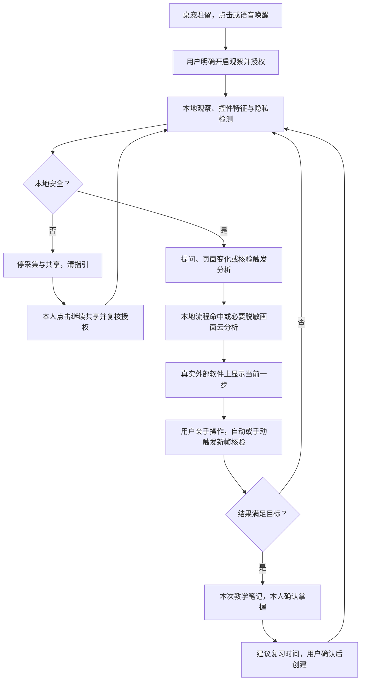
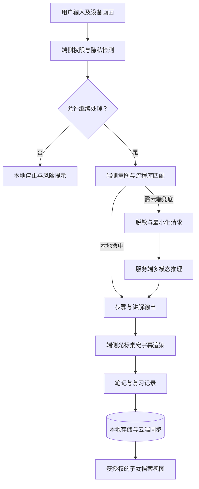
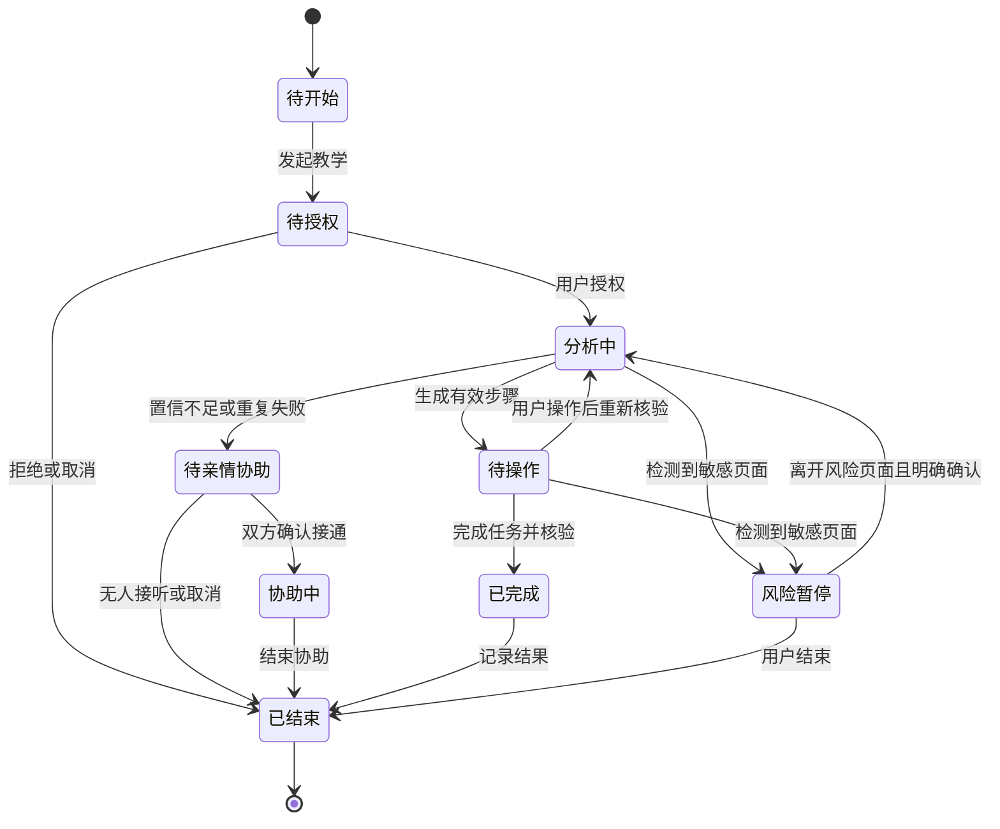

# 「暖伴」AI 公益助手产品需求文档：独立智能桌宠版

| 项目 | 内容 |
| --- | --- |
| 产品名称 | 暖伴（暂定名）AI 公益助手 |
| 文档版本 | PRD V1.1，独立桌宠核心形态修订版 |
| 编制日期 | 原稿 2026-10-15；本次修订 2026-10-18 |
| 内容依据 | 《AI公益助手-产品大纲与功能介绍(1).md》V2.2 |
| 结构参考 | 《产品需求文档模板(1).docx》V1.0.4 |
| 产品终端 | Android 手机端、电脑端；不包含 iOS |
| 阅读对象 | 产品、设计、客户端、服务端、算法、测试、运营及试点合作方 |
| 评审状态 | 核心交互以本次用户确认更新；设备/性能/供应条件待验证，不把确认需求当成已实现 |

**编制规则：** 本文以产品大纲 V2.2 的实际内容为准，借用模板的概述、产品描述、功能需求、非功能需求和验收结构。大纲明确的能力作为需求基线；为便于研发补充的交互、数据、状态及验收规则属于建议细化，须在评审中确认。本文不设置功能优先级，不恢复大纲已删除的志愿者通道，不将后续规划视为首期交付承诺。

## 本次确认的核心形态与统一规则

本版以 2026-10-18 本次对话中用户明确确认的内容为需求依据。暖伴是**悬浮在真实桌面及其他软件上方、理解当前屏幕并指导用户操作的独立智能桌宠**。Android/Windows 宿主承担系统运行、真实捕获与浮层；主界面承担设置、档案、绘画等管理。关闭管理窗口后，只要用户没有退出桌宠、系统条件及授权仍有效，驻留桌宠及本地观察可继续运行。

| 确认编号 | 产品与工程统一要求 |
| --- | --- |
| CORE-01 独立悬浮 | 桌宠、教学标记、语音/字幕和停止入口服务于真实系统桌面及外部软件；管理页面中的模拟手机界面不能作为核心产品或跨应用验收成果 |
| CORE-02 本地观察 | 用户明确开启并获本机系统授权后持续在本地观察；一次教学结束不自动停止用户仍授权的观察会话；退出/撤权/锁屏/进程终止/隐私暂停按清理规则停止，不在重启后自行恢复 |
| CORE-03 按需云分析 | 提问、显著页面变化或步骤核验触发必要画面的本地检测/脱敏与云分析；连续采集不等于连续上云，重复/过期帧不排成长队，原始帧不传云 |
| CORE-04 用户亲手操作 | 从桌面寻找应用、打开应用、导航到功能、点击或输入直至完成，全部由用户执行；光标/桌宠只指示，不自动启动目标第三方应用或注入输入 |
| CORE-05 通用软件理解 | 面向尽可能多的主流软件理解页面结构、控件含义与位置；Top20 是本地加速能力，不是仅允许这20项的产品范围；未预置软件也可在本地判安全后交云AI尝试，实际覆盖按测试公开 |
| CORE-06 双入口核验 | 自动观察到用户操作/页面变化以及用户点击“我点好了”都可触发核验；都须用当前新画面核对结果，不把按钮点击或旧画面直接视为成功 |
| CORE-07 不确定处理 | 支持重新观察、询问用户、展示明确标注不确定性的候选位置，由AI按当前情况选择；候选必须来自当前可定位控件，不能编造坐标，隐私/交易风险不能靠候选提示绕过 |
| CORE-08 隐私与恢复 | 在设备本地识别边界，敏感/未知/检测故障先关出口并停止相应屏幕采集和指引；用户本人明确点击“继续共享”后复核本机授权及新帧安全，满足后恢复；家属/模型/页面变化不能代为恢复 |
| CORE-09 双唤起 | 点击桌宠和语音唤醒均属于正式功能；语音唤醒在麦克风单独授权和系统允许的运行条件下采用本地唤醒检测，未唤醒的常听音频不持续上传云端 |
| CORE-10 完整教学记录 | 每次教学形成一次可追溯笔记，顺利完成、未完成和用户主动结束均记录实际结果；只存安全摘要。“已掌握”由用户本人明确确认，AI/家属/核验成功/练过不能代替确认 |
| CORE-11 复习确认 | AI 建议具体复习日期、时点及时区，用户确认后创建；不能自动替用户安排。原本人手建和获授权家属代建待办能力保留，并标明创建来源 |
| CORE-12 亲情协助 | 从驻留桌宠直接邀请家人；有效关系、当次本人确认与本机权限齐备后共享安全屏幕和语音；仍由用户亲手操作，风险保护对家属与AI出口同样生效 |

**运行边界：** 独立桌宠仍需要可安装的宿主和系统权限。系统不支持的浮层、后台/麦克风或捕获条件必须如实显示，不能以持续观察目标绕过权限。截图/DOM Mock 可用于单元测试、交互夹具与合成风险页，但外部桌面/第三方软件中的真实捕获、浮层、停止及用户操作证据是核心验收必需项。设备与软件的实测覆盖不足不删除产品目标，也不虚构“所有软件均已支持”。

## 目录

1. [概述](#一概述)
2. [产品描述与整体流程](#二产品描述与整体流程)
3. [六大核心功能需求](#三六大核心功能需求)
4. [账号、亲情联动与系统支撑](#四账号亲情联动与系统支撑)
5. [非功能需求与数据设计](#五非功能需求与数据设计)
6. [验收标准与测试要点](#六验收标准与测试要点)
7. [规划、待确认事项与追溯](#七规划待确认事项与追溯)

## 一、概述

### 1.1 背景与定位

老年人、低年级和乡村儿童，以及视听障碍、读写困难、认知能力衰退等数字弱势群体，在使用智能设备时常面临不会输入、不知道点哪里、怕点错和学过就忘的问题。子女与教师无法持续在场，单纯放大文字或提供语音问答不足以完成操作教学。

暖伴以独立驻留桌宠作为日常入口，悬浮在真实系统桌面及其他软件上方。用户点击或语音唤醒桌宠，在本机授权的观察会话内，由设备本地持续观察当前屏幕；提问、页面变化和步骤核验触发必要脱敏画面的云端分析。AI 理解实际软件的页面结构与控件，给出当前一步，再由原生浮层显示光标/高亮/儿童桌宠指向，用户亲手操作。每次教学都形成笔记，用户本人确认掌握，复习时间经用户确认后形成提醒。

核心差异化为**独立桌宠对真实外部软件的屏幕理解、一步一核验指引，以及跨设备延续的个人学习记忆**。桌宠既是驻留入口，也是教学、语音/字幕和求助的承载体；设置/档案/绘画管理窗口由它按需打开。主界面关闭不等于退出桌宠。

### 1.2 产品目标

| 目标类别 | 需求目标 | 观察方式 |
| --- | --- | --- |
| 低门槛 | 不依赖熟练打字，支持语音、拍照、图片、截屏和屏幕共享 | 输入使用情况、任务发起完成情况 |
| 手把手教学 | 明确指出下一步位置，由用户自己操作 | 独立完成操作次数、指导中断原因 |
| 学习巩固 | 每次教学均记录，保留结果和本人掌握确认，支持反复讲解和复习 | 掌握转化率、复习执行情况 |
| 陪伴与可用性 | 桌宠、字幕、慢速语音和提醒持续可达 | 主动使用次数、提醒触达情况 |
| 公益可持续 | 服务对象核心功能免费，通过端侧处理与流程库控制成本 | 云推理调用量、端侧命中率、服务成本 |
| 安全边界 | 教操作、不替决策，风险场景及时熔断 | 涉诈资损投诉、隐私事故、安全验收结果 |

不在本文虚构用户增长、准确率、营收或上线时间目标。量化目标应在试点设备、样本与成本预算确定后补齐。

### 1.3 用户与角色权限

| 角色 | 主要需求 | 权限与限制 |
| --- | --- | --- |
| 老年用户 | 零基础教学、重复讲解、慢语速、亲情兜底 | 使用本人对话、笔记、待办与桌宠；控制共享、绑定和授权 |
| 儿童用户 | 拍题讲解、鼓励式陪伴、自绘桌宠、走动指引 | 使用儿童模式；涉及个人信息和设备敏感权限由家长授权 |
| 其他数字弱势用户 | 大字字幕、语音或文字替代、简化操作 | 使用同等核心能力；按障碍需求配置交互，不强制套入年龄模式 |
| 子女／家长 | 代注册、了解困难点、设置提醒、远程指导 | 在有效关系和授权范围内查看学习档案、设置待办、参与当次协助 |
| 社区协助人员 | 批量开通、线下培训、推广支持 | 仅在业务授权范围内协助开通；不默认查看个人对话或屏幕 |
| 机构运营人员 | 服务管理、数据看板 | 后续机构后台角色，权限范围另行评审 |

**建议权限细化：** 代注册不等于永久授权；亲情绑定、学习档案查看和远程共享分别管理。每次远程协助均需被协助端确认。解除绑定后停止新增档案访问和推送；不得因绑定关系直接获取摄像头或开启屏幕共享。

### 1.4 名词说明

| 名词 | 定义 |
| --- | --- |
| 手把手教 | 理解屏幕、拆分步骤、呈现目标位置、等待用户操作并核验下一状态的教学过程 |
| 虚拟光标 | 绘制在屏幕上的教学标记，不是真实鼠标控制，也不执行点击 |
| 桌宠走动指引 | 儿童模式在真实桌面/软件上以桌宠走到目标附近并指向，不执行任何系统点击 |
| 操作流程库 | Top 20 高频场景的预置操作步骤及适配规则，含版本与热更新机制 |
| 学习档案 | 笔记、掌握状态和复习记录的集合 |
| 隐私熔断 | 本地发现敏感/未知/故障即关闭发送、停止相应采集/指引；本人明确确认并复查授权/安全后恢复 |
| 本地观察会话 | 系统授权有效且用户明确开启期间的持续本地捕获/检测，与一次教学任务分开管理 |
| 管理窗口 | 档案、设置、绘画和账号等按需打开的窗口；其关闭不终止正常驻留桌宠运行 |
| 教学光标 | 宿主绘制在真实桌面/外部软件上方的提示标记，不能注入鼠标或触摸事件 |
| 端云路由 | 能在本地处理的请求优先本地完成，长尾问题由云端推理兜底 |
| 亲情协助 | 已绑定子女或家长查看当次获准共享的屏幕并通过语音指导 |
| 星云 SDK／AnySearch | 大纲指定的后续接入对象；当前预留接口，首期不以其接入为依赖 |

### 1.5 公益模式与合作落地

面向老人和儿童免费提供核心功能，不投放诱导性广告。资金来源包括政府购买服务、机构 B2B2C 补贴，以及基金会和企业 CSR 资助。与社区养老服务中心、养老机构、乡村学校、公益组织合作，通过集中培训和专人对接落地。

机构付费、采购、结算与完整管理后台属于后续专项设计，不在面向服务对象的交互中加入付费解锁门槛。

## 二、产品描述与整体流程

### 2.1 双端范围与能力边界

| 能力 | Android 手机端 | 电脑端 |
| --- | --- | --- |
| 语音、文字、图片、拍照与摄像头互动 | 支持 | 支持；无摄像头时使用替代输入 |
| 截屏输入、屏幕共享与教学指引 | 支持 | 支持 |
| 2D 桌宠选择、手绘生成与互动 | 支持 | 支持 |
| 3D 模型导入与渲染 | 不包含 | 支持 VRM、FBX、GLB 等；实际规格待验证 |
| 老人光标／儿童桌宠走动指引 | 支持 | 支持 |
| 对话、笔记、字幕、待办与复习 | 支持 | 支持 |
| 同账号同步、亲情联动 | 支持 | 支持 |
| 自启动、后台运行、系统通知 | 目标支持，受设备与权限条件约束 | 目标支持，受操作系统配置约束 |

人群模式跟随账号配置，老人和儿童都可使用任一终端。电脑端操作系统、Android 最低版本、厂商适配列表及硬件下限待确认；本文不默认将“电脑端”扩展为所有桌面操作系统。

大纲中的“开机即用、不会被随手清理关闭”作为体验目标。实现与验收需明确自启动、前台服务、电池策略等前提，无法获得系统支持时应提供设置引导和恢复入口，不承诺任何设备上绝不被关闭。

### 2.2 信息架构（建议细化）

| 入口／页面 | 内容 | 主要动作 |
| --- | --- | --- |
| 悬浮桌宠 | 系统级驻留入口、当前讲解/观察状态、提醒 | 点击/语音唤醒、提问、我点好了、继续共享、停止/退出、按需打开管理窗口 |
| 桌宠对话气泡/可展开对话面板 | 输入区域、语音与字幕、当前屏幕上下文 | 在真实外部软件上提问/发起教学；较长历史按需在管理窗口回看 |
| 教学浮层 | 光标或走动桌宠、当前步骤、停止入口 | 我点好了、再讲一遍、暂停、找家人 |
| 学习档案 | 时间／主题分组、掌握状态 | 查看笔记、筛选未掌握、开始复习、生成待办 |
| 待办页 | 待执行、已完成任务与提醒设置 | 创建、编辑、完成、进入关联讲解 |
| 桌宠设置 | 选一选、画一画、电脑模型导入 | 预览、微调、确认、切换 |
| 账号与亲情 | 登录、模式、绑定、授权与设备 | 代注册、管理绑定、调整权限、退出 |
| 子女视图 | 获授权档案、待办和协助请求 | 查看、设置提醒、接听协助 |

主流程在系统桌面及其他软件中执行。管理窗口仅在需要选择形象、绘画、查看档案、配置账号/权限等时出现；教学不要求它一直位于前台，也不要求第三方软件嵌入暖伴组件。

### 2.3 整体主流程

用户从真实桌面发起任务时，暖伴先定位目标应用图标或指导用户进入应用列表/搜索，再指示用户亲手打开；跨应用切换也由用户执行。无法理解的安全页面依次可重看、询问、标注候选或求助。亲情协助从桌宠直接发起，经当次确认后接通；交易/隐私场景不通过它绕行。一次教学结束后可回本地观察待命，前提是原观察授权仍有效且未触发停止条件。

### 2.4 数据流与端云分工

端侧驻留运行时负责捕获、持续本地观察、唤醒检测、隐私判断/脱敏、变化事件、意图/流程匹配、浮层和停止清理。云端在提问、页面变化或核验触发时接收必要的安全画面与当前任务，不接收默认持续屏幕视频。服务端仍负责账号、AI 调度、流程、学习档案、同步、提醒、协助信令/中继和审计；亲情安全媒体按当次共享用途单独发送。第三方人脸可靠脱敏后才可上云，失败暂停。

默认不持久化原始屏幕与实时摄像头画面。脱敏留存若确有必要，须另行确定用途、授权、范围和期限；普通学习同步不得附带原始画面。

### 2.5 教学会话状态与观察会话的关系

教学会话与观察会话分别管理：无教学任务时仍可在用户授权的 observing 状态本地观察；结束教学只结束该任务和旧指引，不结束仍被用户允许的观察。观察状态为 off/awaiting_permission/observing/privacy_paused/stopped。隐私暂停时先关门并停相应采集，不能为了判断是否离开隐私页偷偷继续看；用户本人点击“继续共享”后进入授权检查和本地安全检查，检测仍敏感则继续暂停。主动停止、撤权、锁屏、运行时异常终止和重启均不能静默恢复。任何活动状态必须有常驻桌宠/原生面板/系统通知可达的停止入口。

### 2.6 全局交互与异常规则（建议细化）

| 场景 | 规则 |
| --- | --- |
| 加载与处理中 | 明确提示正在听、正在看或正在生成；可取消，避免反复点击造成重复任务 |
| 成功反馈 | 使用文字、图标，必要时配语音；关键结果不只用短暂 toast |
| 权限拒绝 | 解释该功能需要什么权限及用途，提供设置入口或其他输入方式；其他可用能力继续运行 |
| 网络异常 | 提示“网络暂时连不上，可以重试”；保留输入和本地草稿，本地流程库可覆盖的场景继续使用 |
| 推理超时／配额不足 | 说明暂不可用，允许重试、本地教学或找家人；不编造回复 |
| 空列表 | 显示“还没有学习记录／待办”，提供明确的创建或提问入口 |
| 删除与解绑 | 二次确认，说明将停止的访问权限；不能只靠长按或复杂手势完成 |
| 列表规则 | 笔记按提问时间倒序，待办按下次提醒时间排序；笔记支持主题与未掌握筛选 |
| 数据同步失败 | 显示本地保存与待同步状态，允许重试，不将未上传误报为跨端已同步 |
| 重复提交 | 保存和创建请求携带幂等标识；处理中按钮避免重复触发 |
| 普通提醒与敏感会话 | 风险提示优先于陪伴问候，避免桌宠遮挡关键安全信息 |

不直接套用模板中的 Excel 导出、复杂分页、通用统计栏或批量操作，它们不构成本产品既定需求。

## 三、六大核心功能需求

### 3.0 六模块共同依赖的独立桌宠运行能力

以下是六模块的公共运行约束，不替代或删减桌宠、绘画、模型导入、对话、笔记、字幕和复习功能。

| 编号 | 能力 | 必须行为与验收 |
| --- | --- | --- |
| FLOAT-01 | 系统级独立驻留 | Android/Windows 在真实桌面及外部软件上显示桌宠、教学标记/儿童指向、字幕与停止入口；关闭管理窗口后仍可唤起和教学；显式退出桌宠则停相关采集/媒体 |
| OBS-01 | 授权后的本地持续观察 | 本地观察与云端请求分开；提问/显著页面变化/核验触发最小安全画面分析；无相关事件不持续传云，页面变化先撤旧指引，隐私/故障即时停 |
| WAKE-01 | 点击和本地语音唤醒 | 点击桌宠可展开提问，语音唤醒可开始一轮交互；麦克风单独授权、可关闭、状态可见；未唤醒的短时音频仅本地检测，拒绝麦克风时点击/文字仍可用 |

系统桌面、应用列表和应用内部属于同一指导路径。用户要求“打开某软件”时，暖伴指向真实图标让用户点击，不代调第三方启动/触摸/输入接口。主界面中的仿手机或网页按钮只能是开发夹具；核心验收必须到第三方实际窗口。

### 3.1 模块一：多模态输入与交互系统

**目标与故事：** 作为不会熟练打字的用户，我可以说话、拍照或共享当前屏幕，让暖伴理解问题并带我继续操作。

| 编号 | 功能 | 前置条件 | 交互与业务规则 | 结果与异常 |
| --- | --- | --- | --- | --- |
| IN-01 | 文字输入 | 对话可用 | 提交文字并进入统一对话上下文；提供清晰发送和取消入口 | 返回讲解；空内容不发送，失败保留原文 |
| IN-02 | 语音输入 | 麦克风可用且已授权 | 以明显状态区分聆听、识别与回复；识别结果可确认或重说 | 识别后进入对话；未听清时请求重述，不猜测高风险信息 |
| IN-03 | 拍照与图片输入 | 相机或文件访问已授权 | 支持拍照、相册／文件选图，发送前预览，可同时附带语音或文字问题 | 图片与问题关联到当前会话；模糊或无法辨认时提示重拍 |
| IN-04 | 截屏带入 | 具备截屏能力并获用户确认 | 用户截屏后可直接带入提问，沿用安全检测规则 | 建立图片上下文；取消后不发送 |
| IN-05 | 摄像头实时互动 | 摄像头可用且已授权 | 显示实时采集中状态及停止入口；持续画面进入多模态理解链路 | 画面实时处理；设备占用时转拍照、图片或文字 |
| IN-06 | 真实屏幕观察与按需共享 | 本人明确开启、已解释用途并取得本机系统授权 | 从桌宠开启本地持续观察；提问/页面变化/核验触发必要画面检测脱敏与云分析；状态和停止持续可见 | 真实桌面/第三方软件画面进入理解；敏感/未知/故障停共享和采集，用户确认后恢复 |

**建议交互细化：** 实时摄像头与屏幕共享切换时明确当前发送的来源，停止上一来源采集，避免用户误以为摄像头已关。前后台切换和权限撤回应立即更新状态。图片数量、大小、支持格式、实时视频采样率与压缩策略待设备测试后确定。

**关键数据：** `input_id`、`session_id`、`input_type`（text／voice／photo／image／screenshot／camera／screen）、`created_at`、`permission_state`、`processing_route`。媒体引用和传输缓存应有清理策略，不默认作为长期学习档案字段。

**验收：** 双端均可通过不同输入发起同一对话；拒绝相机权限后仍能文字提问；停止实时采集后无新增帧上送；截屏输入中的敏感内容同样受保护。

### 3.2 模块二：桌宠系统

**目标与故事：** 老人通过简单选择得到亲切的伙伴；儿童能将自己的画变成会动的桌宠；电脑用户可以导入自己的 3D 模型。

#### 3.2.1 老人模式“选一选”（PET-01）

前置条件为老人模式和形象生成功能可用。以少量偏好问题收集动物、色调、性格等信息，生成候选形象；用户预览并确认后启用，语速与表现稳重、亲切。生成失败提供重试并保留现有桌宠。候选数量及默认形象由设计评审确定。

#### 3.2.2 儿童模式“画一画”（PET-02）

提供简易画布、画笔粗细、颜色和橡皮擦。用户完成涂鸦后提交，AI 将二维手绘稿转为可动桌宠，支持五官、动作与配色微调，预览确认后应用。电脑端也支持该能力。

**建议细化：** 保留当前手绘草稿；生成失败不清空画布；替换已启用形象前保留撤回路径。不得把“手绘转可动桌宠”自动扩写成首期手绘转 3D 模型需求。

#### 3.2.3 电脑端 3D 模型导入（PET-03）

仅电脑端提供导入入口，目标支持 VRM、FBX、GLB 等常见格式。导入后解析、预览并尝试动作表现，用户确认后启用。实际可用版本、骨骼、材质、动画及外部贴图支持矩阵须经技术验证确认，不能仅以扩展名正确判定可用。

**建议细化：** 校验文件结构和资源消耗；不执行模型中附带的脚本；不自动下载不明外部资源。不支持、损坏或过大的模型需说明原因并允许重新导入，失败不覆盖当前可用桌宠。

#### 3.2.4 桌宠互动与配置（PET-04）

桌宠由宿主独立驻留，悬浮于真实桌面/其他软件之上；通过点击或语音唤醒提供提问、教学、字幕、提醒、亲情求助和停止入口。管理窗口关闭时仍可工作；退出桌宠与关闭管理窗口明确分开。桌宠配合讲解呈现表情与动作，并与语音和字幕协同。支持主动问候、休息提醒、用药提醒等陪伴行为。用药提醒仅复述用户或家属设定的内容，不生成剂量、疗程或调整建议。

人群模式不与设备绑定。同一家庭不同成员可拥有不同桌宠；同账号配置云端同步。电脑端 3D 形象在手机端无法渲染时，建议回退到该账号的 2D 形象，不将 3D 文件作为手机端启用依赖。

**关键数据：** `pet_id`、`owner_id`、`mode`、`pet_type`（2D／3D）、`generation_source`（preference／drawing／import）、`asset_ref`、`appearance_config`、`voice_config`、`updated_at`。原始画稿是否长期保留及 3D 资产如何同步待确认。

**验收：** 两端均能选择与绘制 2D 桌宠；手机没有 3D 导入入口；电脑导入失败不会破坏现有形象；切换账号不串用他人形象；老人、儿童风格与讲解节奏明确区分。

### 3.3 模块三：屏幕操作指引与安全保护

**目标与故事：** 用户不理解页面时，暖伴直接指出下一步位置；用户亲手操作；AI 无法确定时能诚实说明并连接家人。

#### 3.3.1 屏幕理解与逐步教学（GUIDE-01）

**前置条件：** 已授权共享；当前页面通过本地隐私检测；拥有可用流程规则或模型识别结果。

1. 从用户实际桌面或当前外部软件开始，识别应用/窗口、页面、控件层级与分组、标签/图标含义、可见性/可用状态及其位置；不得用内部模拟界面替代真实输入。
2. 高频流程命中时优先本地；未预置或不匹配的主流软件，在本地安全检查通过后，把必要脱敏画面交云 AI 理解，不能仅因不在 Top20 而拒绝尝试。
3. 每次下发当前一步，包含简短说明、目标位置、所需动作和预期页面变化。
4. 端侧渲染指引，用户自行点击，系统不得通过指引模块自动点击、填表、提交或代替确认。
5. 自动观察到用户操作/页面变化或用户点击“我点好了”都触发同一新帧核验流程；按预期状态、目标/窗口及当前帧身份核对，成功才进入下一步，失败重看/询问/候选提示。软件仍在加载时显示等待，不因一次点击直接判定成功。
6. 完成或结束本次教学时均记录实际结果和一份笔记；由用户本人确认是否已掌握；AI 建议具体复习时间，用户确认后创建。教学结束后，仍有效的本地观察会话可继续待命。

**建议细化：** 页面滚动、窗口移动、旋转、分辨率变化或目标消失后，立即隐藏失效标记并重新定位；坐标绑定具体捕获帧及窗口，不沿用旧坐标。用户点击“我点好了”只是核验触发，不直接视为成功。

#### 3.3.2 老人模式光标与儿童走动指引（GUIDE-02／GUIDE-03）

| 模式 | 呈现方式 | 共同规则 |
| --- | --- | --- |
| 老人模式 | 自动生成虚拟光标、高亮框或箭头，移动到应点击位置 | 指引不遮挡目标，不抢占用户点击；同时提供简单语音与字幕 |
| 儿童模式 | 桌宠自动寻路至目标应用图标附近，站定并指向 | 以桌宠指向替代光标；界面变化后重新定位，避免站在旧目标处 |

大纲对儿童走动的明确场景是应用图标指引。应用内按钮是否采用同样的寻路动画待交互与能力验证；建议保持桌宠指向及简短步骤表达，不擅自恢复成儿童光标模式。

#### 3.3.3 不确定与连续失败兜底（GUIDE-04）

AI 根据当前页面和用户目标选择以下方式，允许组合使用：重新捕获/观察当前页；向用户询问目标软件、任务或具体页面信息；对当前实际可定位但含义/用途尚不完全确定的控件展示“可能是这里，请先确认”的候选提示。候选样式、语音和字幕必须明确不确定，不能伪装成已经确认的下一步。找不到实际目标、页面失效或坐标不可靠时不画候选光标。

重新观察或询问后仍无法确认时，说明不确定、清掉无效标记，提供从桌宠发起亲情协助/结束/稍后重试。无家人绑定、拒绝、无人接听、超时和断网均诚实反馈。阈值和重试预算按样本校准，禁止无限重试。候选判断不能覆盖本地隐私边界、支付/转账/验证码停教规则；家属同样不能绕过。

#### 3.3.4 敏感场景熔断（SAFE-01）

本地检测应先于上云。对密码输入、支付、转账、验证码及私人聊天等敏感页面，停止当前共享、清除已有教学标记并停止基于该画面的后续处理。

| 场景 | 必须动作 | 可继续的支持 |
| --- | --- | --- |
| 密码、私人聊天等一般隐私页面 | 暂停屏幕共享，停止基于敏感画面的指引 | 可提供不引用私密内容的通用文字说明，不索取密码或聊天内容 |
| 转账、支付、验证码及涉钱确认 | 停止共享和该风险操作指引，提示联系子女电话确认 | 仅提供风险提醒、退出风险页面或联系家人的安全提示；不继续教如何完成付款或验证码提交 |
| 医疗、用药、投资、理财决策问题 | 说明能力边界，不作决策建议 | 可解释一般操作入口；用药仅按用户已设内容提醒 |
| 用户认为已离开风险页 | 不自动重启共享和采集 | 用户本人点击桌宠的“继续共享”，复核本机授权并检测新帧；安全才恢复，家属不能远程代恢复 |

发生风险暂停时，亲情协助也不能继续透传敏感画面；先电话确认，不能把一键协助当作绕过熔断的通道。暂停前已经传出的数据无法靠暂停撤回，因此传输前检测与脱敏是必要环节。

**规则优先顺序：** 大纲中“涉转账、支付、验证码停止指引”的铁律优先于一般“暂停共享后转文字指引”。不得通过文字继续完成同一风险交易。

#### 3.3.5 关键数据与验收

步骤建议字段：`guide_session_id`、`flow_id`、`flow_version`、`step_id`、`frame_id`、`target_rect`、`coordinate_space`、`instruction`、`expected_state`、`confidence`、`risk_state`、`result`。

风险事件仅记录场景类型、触发时间、处理动作和结果，不将密码、验证码、账户余额或私人聊天正文写入日志。

**验收：** 用户能按指引自行完成安全任务；观察不到系统代点击；错误页面不推进；敏感页面不向模型或亲情端继续发送；页面变化清除旧指引；失败进入诚实告知与亲情兜底；任何模式均执行同一安全边界。

### 3.4 模块四：AI 对话与实时智能笔记

**目标与故事：** 用户反复提问时，暖伴记得困难点，换更简单的说法再次讲解；子女能在授权范围内了解最近学到了哪里。

#### 3.4.1 适老适幼实时对话（CHAT-01）

接收全部输入类型，保留当前问题所需的会话上下文。老人模式使用口语、短句和慢速讲解；儿童模式语言简单、分步启发并给予鼓励。无把握时明确说明，操作困难进入指导链路，高风险决策遵守 SAFE-01。

**建议细化：** 提供停止本次播报与“再讲一遍”入口，用户新问题可中断旧讲解；避免一段输出堆积多个操作。儿童拍题以引导理解为目标，不能仅以输出最终答案作为完成教学的判据。

#### 3.4.2 自动笔记与掌握状态（NOTE-01）

每次教学结束或主动中断时自动形成一份笔记，包含顺利完成、尚未学会和未完成情况，用户无需手动整理。每份绑定本次 guide_id/学习会话，记录安全的任务、步骤摘要、实际结果和时间；同一次教学重讲/重试不重复创建，同主题另一次教学仍新增本次记录并关联历史笔记。仅持续观察而没有教学，不自动创建学习笔记。普通对话中发现的知识困难仍可形成学习笔记。

| 必需字段 | 说明 |
| --- | --- |
| 提问时间 | 本次学习/教学发起的问题时间 |
| 提问内容 | 用户实际问题或必要的脱敏转述 |
| 涉及事项／知识点 | 如微信视频通话、网上挂号、乘法进位 |
| AI 解答摘要 | 可供复习的讲解摘要或安全操作步骤 |
| 掌握状态 | 未掌握／已掌握 |

**已确认规则：** 笔记默认未掌握，用户本人可通过明确点击/语音确认调整。只有本人确认才能设为已掌握；AI 只能询问或建议，家属档案查看/待办管理权限不包含代改掌握状态。无提示复现可以另记练习证据，但不是强制掌握判据，也不能自动改状态。同主题每次教学各有记录并关联，不能合并后丢失本次教学；同一教学的重复回调按会话幂等。

风险页面的密码、验证码和支付细节不得因自动笔记而被重新留存。

#### 3.4.3 归档、再次讲解与亲情查看（NOTE-02）

笔记按时间与主题组织，支持“未掌握”筛选。再次遇到同一问题时，调用授权范围内的历史学习信息，放慢语速并简化说法。点击笔记可重新进入讲解或创建复习任务。

子女仅查看当前授权的学习档案。学习档案查看不等同于查看完整对话、历史屏幕、摄像头记录或实际支付信息。

**关键数据：** `note_id`、`owner_id`、`asked_at`、`question`、`topic`、`answer_summary`、`mastery_status`、`source_session_id`、`review_history`、`updated_at`、`version`。

**异常与验收：** 自动笔记失败不打断讲解，可提示稍后重试；本地保存失败不能显示成功。跨端能查看同一档案；同题复习能关联历史；未授权子女不能访问；状态变化具有来源和时间，便于解释。

### 3.5 模块五：字幕系统

**目标与故事：** 听不清的用户可以看大字字幕；安静环境下可以关闭语音，继续获得完整讲解。

| 编号 | 需求 | 交互与规则 | 验收 |
| --- | --- | --- | --- |
| SUB-01 | 语音同步字幕 | AI 讲解时显示对应字幕；字号可调，语速默认偏慢并可调 | 字幕与当前播报语义对应，不在下一步开始后仍显示上一操作指令 |
| SUB-02 | 纯字幕模式 | 关闭语音，只输出字幕，继续对话、教学与提醒 | 关闭声音后讲解内容完整，不因 TTS 失败导致整条回复不可读 |
| SUB-03 | 双端浮层适配 | 与桌宠、步骤、安全提示协作，避免遮挡目标与停止按钮 | 大字号、横竖屏及不同窗口尺寸下无关键内容截断 |

**建议细化：** 字幕按句分段，长内容允许回看；暂停或打断播报时同步更新字幕状态，提供重播入口。字号范围、语速档位与同步容忍误差待试点确定。

**关键数据：** `caption_segment_id`、`message_id`、`text`、`segment_index`、`playback_state`、`font_scale`、`speech_rate`、`silent_mode`。字幕不独立生成另一套未经安全审核的回答。

### 3.6 模块六：待办与复习管理

**目标与故事：** 用户或子女设置“到点再练一次”，提醒后一步回到对应笔记和讲解。

#### 3.6.1 创建与编辑待办（TODO-01）

用户自行创建，或由获授权子女远程创建。支持事项、提醒时间和重复规则；大纲包含“每周三上午”和“三天后”等表达，需能够形成可确认的具体时间。

**建议交互细化：** 语音创建后复述“将在某年某月某日几点提醒”，由用户确认。缺少时点时请求补全；过去时间提示修改；每日或每周重复与一次性任务区分。子女创建后明确展示创建来源，并允许被提醒用户查看和关闭。

#### 3.6.2 笔记联动与复习直达（TODO-02）

每次教学笔记提供复习入口，未掌握可筛选突出。AI 主动建议具体日期、时点和时区，用户明确确认后创建关联 note_id 的复习待办；拒绝或尚未确认只保留建议，不排程。本人手动创建、获授权家属代建的原能力保留且标来源。提醒通过桌宠/系统通知可达，点击后进入该笔记并可从桌宠继续真实外部软件教学，不要求管理窗口全程打开。

“任务完成”与“已掌握”分开：完成一次练习不自动证明学会。关联笔记已删除时说明情况，允许调整任务，不能跳转到他人记录或空白页面。

#### 3.6.3 提醒触达（TODO-03）

App 主界面未打开时，通过系统通知提醒；在亲情授权范围内向子女端推送。桌宠可以配合提醒，但系统通知与待办列表须保留可达入口。

**建议细化：** 本地已同步任务采用本地调度作为可用性支撑；服务端调度与推送协同并去重。通知权限关闭、设备离线、后台受限时记录实际状态并提供恢复说明；不得把服务端“已发送”等同于用户“已看到”。

**关键数据：** `todo_id`、`owner_id`、`creator_id`、`title`、`note_id`、`remind_at`、`timezone`、`repeat_rule`、`status`、`next_fire_at`、`delivery_state`、`updated_at`、`version`。

**建议状态：** 待执行／已完成／已取消；提醒状态另记待调度／已投递／失败，避免混淆任务结果与通知结果。重复任务完成当前一期后计算下一提醒实例。

**验收：** 自建、子女代建、笔记生成三条路径均可创建；点击通知直达正确笔记；重复提醒不因双端同步重复轰炸；权限关闭有可理解说明；完成待办不自动改变掌握状态。

## 四、账号、亲情联动与系统支撑

### 4.1 账号与免密登录（ACC-01）

大纲要求支持本机号码一键登录、人脸识别登录、子女代注册与社区批量开通，减少密码和验证码门槛。同一账号可登录 Android 与电脑端，学习档案、待办和桌宠配置云端同步。

**建议流程：** 展示简明用途说明 → 选择可用免密方式或由家属协助 → 建立账号 → 选择人群模式 → 完成必要授权 → 启用驻留桌宠入口并按需打开管理窗口。人脸登录必须与已确认的账号绑定，不能通过陌生人脸自动创建关系或扩大数据访问范围。

**待确认边界：** 电脑本机号码能力、无 SIM 设备、无摄像头或人脸校验失败时的安全登录路径，需要专项验证。不得把“目标免密”写成所有设备都具备同一能力，也不得因失败默认引入强制验证码。社区批量开通需明确组织授权、账号认领与交付流程，不能以名单导入替代本人或监护人的授权。

### 4.2 亲情关系与档案授权（ACC-02）

建议流程：子女发起绑定 → 本人或监护人确认 → 配置档案查看、待办管理等权限 → 双方可查看关系状态 → 随时解除。

| 权限项 | 授权后的能力 | 不随之开放的能力 |
| --- | --- | --- |
| 学习档案查看 | 查看笔记、掌握状态和复习记录 | 完整私人对话、实时屏幕或摄像头 |
| 待办协助 | 创建、查看和调整获授权范围内的提醒 | 更改账号身份、长期控制设备 |
| 当次远程协助 | 接收本次已同意的屏幕与语音 | 后台静默观察、自动接听、后续会话永久授权 |

授权粒度、确认方式、儿童监护关系核验与多家属冲突待评审。首期保留支撑既定场景的亲情能力；多老人绑定、协助时长等完整亲情体系属于后续深化。

### 4.3 远程协助（HELP-01）

1. 用户在教学失败或主动求助时选择已绑定家人。
2. 本端说明即将共享的内容，用户确认后发送邀请。
3. 子女端接听，服务端建立信令、屏幕转发及语音通道。
4. 子女查看获准屏幕并语音指导，用户自己完成操作。
5. 任一方结束后立即停止媒体通道，记录协助结果。

**建议细化：** 协助中持续显示接入者和结束入口；未接听时允许取消；重连需保留可见状态，过期邀请失效。远程协助不提供远程代点击或设备接管控制。敏感页面继续执行熔断，不共享验证码、密码或支付画面。审计记录可包含参与者、授权、开始／结束时间与中断原因，不默认录音录像。

### 4.4 自启动、后台运行与通知（SYS-01）

提供自启动、后台运行、电池策略与通知权限的通俗引导；用户可查看当前提醒是否受限制。正常关闭主窗口与退出服务需明确区分，避免用户误关后不知道为何无提醒。

**已确认与系统边界：** 关闭管理窗口只关闭设置/档案 UI；在宿主仍健康、授权有效且常驻停止入口可达时，桌宠、语音唤起、本地观察、教学与通知可独立运行。用户选择“退出桌宠”则先关闭出口，停止观察/唤醒/媒体，再退出。重启仅恢复桌宠配置和待办调度，不自动恢复麦克风、摄像头、共享或协助；持续观察会话须由本人重新开启。后台终止、系统隐藏浮层、麦克风/通知限制均如实显示和验证，不承诺任何设备永不被关闭。

### 4.5 服务端模块与职责

| 服务 | 基线职责 | 建议约束 |
| --- | --- | --- |
| 账号与家庭关系 | 免密认证、代注册、批量开通、绑定与权限 | 所有档案、任务和协助请求均校验身份及对象权限 |
| AI 推理 | 多模态统一调度、端云路由、限流与降级 | 端侧可答不重复上云；超时不伪造答案；安全规则不可因降级失效 |
| 操作流程库 | Top 20 本地加速流程、版本与热更新 | 失配后在本地安全允许时走通用 AI 屏幕分析，不按旧坐标继续错指 |
| 学习档案 | 笔记、掌握状态、复习记录及双端同步 | 控制亲情可见范围，隔离不同账号数据 |
| 待办与提醒 | 存储、调度、系统通知与子女端推送 | 调度幂等、提醒实例去重、保留真实触达状态 |
| 远程协助 | 信令、屏幕中转、语音通道 | 必须当次授权，终止后关闭媒体访问 |
| 安全与风控 | 隐私及防诈规则、内容审核、操作审计 | 规则变更留版本，日志不留敏感原文 |
| 机构管理后台 | 服务管理和数据看板接口预留 | 后续建设，不默认开放个人明细 |

### 4.6 本地流程库与成本控制（FLOW-01）

Top 20 高频场景作为本地加速和成本优化，包括调节字体、视频通话、挂号、连接 Wi-Fi 等；完整清单由试点调研确定。该清单不是允许教学的软件白名单；暖伴面向尽可能多主流软件提供基于真实屏幕的 AI 通用理解，未知应用名称本身不等于隐私风险未知，但本地安全判断不明确的画面仍不能上传。流程匹配有效时采用本地规则，不调用大模型；端侧小模型承担常见意图识别及语音唤醒等任务，大模型兜底长尾问题。

**建议配置项：** 流程编号、适用应用及版本、页面特征、步骤、目标元素、预期结果、安全标签、流程版本与失效状态。热更新失败保留可用版本；无法确认适配时转兜底，不强行套用。一次教学复用已确认的安全步骤，页面出现显著变化则重新理解。

流程库不得预置“自动完成付款、提交验证码”等越界路径。挂号场景仅教操作，不替用户选诊疗方案；触及支付时停止相关指引。

## 五、非功能需求与数据设计

### 5.1 安全、隐私与责任边界

以下为产品要求与建议落实项，具体合规文本和适用规范需在上线前专项评审，不以本 PRD 声称已达标。

| 领域 | 要求 |
| --- | --- |
| 数据最小化 | 仅获取当前请求所需信息；原始实时画面默认不留存，上云前本地检测及必要脱敏 |
| 传输与存储 | 建议采用加密传输、受控媒体通道、敏感数据加密存储，并实施最小权限访问 |
| 儿童保护 | 提供未成年人模式与家长授权，不因亲情账号自动扩展设备采集范围 |
| 第三方人脸 | 画面中第三方人脸进行模糊处理；无法可靠脱敏时不继续上传该画面 |
| 登录生物信息 | 人脸识别方式、处理位置、模板留存及替代登录路径待确认，不与普通档案默认混存 |
| 屏幕保护 | 本地检测先于外发；隐私暂停关闭出口并停相应采集；仅本人明确恢复并复查授权/安全后继续 |
| 决策保护 | 不提供医疗、用药、投资、理财决策建议；涉钱和验证码停止指引并建议电话确认 |
| 数据管理 | 建议支持查看、纠错、删除个人记录和解除关系；具体保留及备份清除期限待确认 |
| 审计 | 记录必要授权、关系变更、风险熔断、协助与流程版本，不记录秘密内容 |
| 用户协议 | 说明 AI 操作参考性质和能力边界；责任条款须另行审查，不将免责文案当作安全措施 |

### 5.2 适老化与无障碍

采用大字体、大按钮、大字号字幕、默认偏慢的语音、简化层级与易理解文案。关键动作不能仅依靠颜色、声音或短暂浮层表达，用户可以随时停止、重听或重看。

**建议验证项：** 系统字体放大、读屏标签与焦点顺序、键盘操作、弱听纯字幕、视力较弱用户的语音替代，以及单手误触场景。光标和桌宠可能不适合完全依赖读屏的用户，需提供对应口头步骤与可访问控件。目标为满足适老化及无障碍改造要求，适用标准版本与检查表待确认。

### 5.3 性能、稳定性与兼容性

大纲未定义量化性能指标。下表为评审与测试项目，具体阈值由试点设备和网络条件验证后确定；不能直接沿用模板中未提供的“公司通用性能规范”。

| 项目 | 观察量 | 必须满足的行为 |
| --- | --- | --- |
| 语音交互 | 识别耗时、首段回答和首段播报耗时 | 全程状态可见、可停止，超时有反馈 |
| 屏幕教学 | 采集至指引耗时、定位误差、失效标记清除耗时 | 不在已变化页面继续显示旧目标 |
| 风险保护 | 敏感检测、停止上送与隐藏标记的时间 | 已识别敏感页面不再继续发送或指导 |
| 桌宠渲染 | 帧率、内存、CPU／GPU、电量 | 不妨碍原应用操作；模型失败可回退 |
| 字幕同步 | 音画对应与字幕滞后 | 同步异常时仍能阅读完整内容 |
| 提醒 | 调度、实际投递、重复率与点击路径 | 不混淆发出、投递、阅读和任务完成 |
| 同步 | 离线恢复、冲突数、同步耗时 | 不串号、不静默覆盖、不把失败显示为成功 |
| 长时运行 | 后台存活、重启恢复、资源增长 | 采集与共享不在重启后静默开启 |

试点须覆盖权限拒绝与撤回、弱网与断网、锁屏、进程终止、横竖屏切换、不同分辨率、电脑多显示器及模型异常。具体支持矩阵作为发布准入条件。

### 5.4 核心数据对象（逻辑设计建议）

| 对象 | 建议关键字段 | 关联／约束 |
| --- | --- | --- |
| 用户 | `user_id`、`user_mode`、`login_binding`、`preferences` | 人群模式属于账号；认证凭据不进入业务日志 |
| 设备 | `device_id`、`user_id`、`platform`、`permission_state` | 权限按设备记录，云端状态不能替代系统授权 |
| 亲情关系 | `relation_id`、双方用户、`scopes`、`status`、授权时间 | 访问时实时校验有效关系，不仅依赖客户端按钮隐藏 |
| 同意记录 | `consent_id`、用户、用途、范围、版本、时间、撤回时间 | 支撑采集、监护及亲情授权追踪 |
| 会话与教学 | `session_id`、输入类型、流程版本、步骤结果、风险状态 | 原始媒体不是默认持久字段 |
| 观察会话 | observation_id、device_id、state、generation、local_consent_id、last_local_check | 与 guide_id 分开；授权不随云同步自动恢复；原始帧短时内存 |
| 页面分析触发 | trigger_id、reason、frame_id、layout_revision、generation、request_id | reason 为 question/page_changed/verification；去重、取消、当前帧校验 |
| 复习建议 | proposal_id、note_id、具体时间/时区、状态、confirmed_by | 未确认不排程；家属代建标 family 来源，不冒充本人接受AI建议 |
| 桌宠配置 | `pet_id`、用户、类型、资产引用、外观、语音配置 | 手机端仅应用可用的 2D 配置 |
| 学习笔记 | note_id、owner_id、source_guide_id、时间、问题、主题、摘要、实际结果、掌握状态 | 每次教学一份，按会话幂等；掌握仅本人确认，不存敏感秘密 |
| 复习记录 | `review_id`、`note_id`、任务、时间、结果、状态来源 | 区分练过、任务完成和真正掌握 |
| 待办 | `todo_id`、用户、创建者、笔记、时间、重复规则、状态 | 时间明确包含时区；删除笔记不能导致无提示断链 |
| 提醒实例 | `instance_id`、`todo_id`、计划时间、通道、投递状态 | 按任务与计划时间幂等去重 |
| 流程配置 | `flow_id`、版本、适配条件、步骤、安全标签、状态 | 应用改版后能热更新、停用与回退 |
| 协助记录 | `assist_id`、双方、授权、时间、状态、结束原因 | 默认只留元数据，不留录音录像 |

主键、字段类型、索引、数据库选型与物理拆表由技术设计确定。文本长度、资产大小、数据保留期限等未有依据的数值不在本文虚构。

### 5.5 同步与一致性（建议细化）

- 本地记录写入后显示保存状态；网络恢复时同步至同账号的其他设备。
- 更新携带版本标识，创建携带幂等标识；两个端同时编辑同一事项时保留可解释的冲突处理结果，避免静默丢失。
- 删除和解除绑定必须同步生效；离线缓存的访问与清除策略须在隐私设计中明确。
- 桌宠外观、语音等可跨端配置；麦克风、相机、录屏、通知及后台权限不随账号同步自动授权。
- 桌宠资产、笔记和任务采用独立同步状态；单个大模型资源失败不应阻塞笔记与提醒同步。

### 5.6 系统集成与接口预留

| 集成对象 | 本期要求 | 后续及异常要求 |
| --- | --- | --- |
| 多模态模型／ASR／TTS | 支撑当前问答、识别和慢速播报 | 超时、限流、不可用可降级，不返回伪造成功 |
| 操作流程库 | 本地匹配及服务端热更新 | 对流程与客户端协议进行版本兼容校验 |
| 操作系统 | 屏幕捕获、悬浮层、相机、麦克风、通知、后台能力 | 用户拒绝时提供能力说明与替代路径 |
| 星云 SDK | 预留渲染、会话、语音、行为状态和事件适配层，首期自研 | 后续验证流式播报、表情口型、SSML、打断、重连、Widget 与事件回调 |
| AnySearch | 预留查询、结果、来源与错误状态的统一接口 | 后续在 API、MCP、Skill 方式中评估；展示可追溯来源，不默认首期具备实时搜索 |
| 机构后台 | 保留服务管理和聚合指标的对接空间 | 具体报表、权限、采购结算另行制定 |

接口建议统一包含请求标识、身份及权限上下文、版本、状态和可理解错误信息。模型、搜索或 SDK 的供应方描述来自大纲，实际能力和接入可行性须技术验证。

### 5.7 统计需求与成功指标

| 指标 | 大纲定义／用途 | 建议统计口径与边界 |
| --- | --- | --- |
| 北极星：独立完成操作次数 | 同一操作首次无需协助完成，记一次成功 | 以用户与规范化操作标识去重；具备任务结果确认，且未发生亲情协助；AI 教学可存在，不能把“无人帮助”和“无 AI 提示”混为一谈 |
| 掌握转化率 | 未掌握转为已掌握 | 以观察期内未掌握笔记集合为分母，转为已掌握为分子；标记来源可追踪 |
| 子女端周活跃数 | 家庭联动使用 | 周内完成授权档案查看、待办管理或有效协助的子女账号去重 |
| 涉钱场景人工接管率 | 大纲要求跟踪并期待趋势下降 | 记录涉钱触发后转人工确认的比例；必须结合涉钱遭遇量和安全策略解读，不能靠减少安全转接来压低指标 |
| 老人模式日均主动使用次数 | 主动使用频率 | 主动提问、主动学习等有效行为；不把后台运行或被动问候计入 |
| 涉诈资损投诉数 | 红线指标 | 任一发生即启动排查整改；不能把模型未发现风险解释为无事故 |
| 隐私合规事故数 | 红线指标 | 任一发生即启动整改与影响评估 |
| 端侧命中与推理成本 | 成本辅助观察 | 统计本地流程命中、模型请求量和单次教学成本，不采集敏感画面作埋点 |

**口径待确认：** 北极星指标是否进一步要求用户在无 AI 提示下独立复现。若采用更严格定义，应单独采集复习验证结果，不能与“按 AI 指引完成”合并。涉钱人工接管率的下降不得成为削弱安全规则的考核目标。

**建议事件：** `question_started`、`input_submitted`、`guide_started`、`step_verified`、`task_completed`、`risk_paused`、`assist_requested`、`assist_connected`、`note_created`、`mastery_changed`、`review_started`、`reminder_delivered`、`reminder_opened`、`sync_failed`。事件只记录必要标识、时间、模式、端类型、结果、来源及版本，不上传原始秘密内容。

## 六、验收标准与测试要点

### 6.1 端到端场景

**场景 A：真实外部软件操作教学。** 用户停在自己手机/电脑的真实桌面，点击或语音呼叫驻留桌宠，说明“教我调整某软件的字体”。管理窗口关闭，用户明确开启并授权本地观察；暖伴定位真实应用图标，用户亲手打开；AI 识别实际软件的菜单/按钮并给当前一步。每次用户操作后自动新帧核验，也能按“我点好了”核验。目标完成形成笔记，询问本人是否学会；建议具体复习时间，用户确认后排程。再次提醒后可从桌宠回到真实软件继续教学。测试包含至少一项没有预置流程的主流软件操作。

原视频通话教学保留，联系人/通话安全入口由用户亲手操作；私人聊天页面触发暂停，不能为演示放开。学习档案获授权家属可看，不能代改掌握状态。

**场景 B：桌宠创作与作业辅导。** 儿童从驻留桌宠打开绘画面板，画稿生成真实可动2D、微调预览确认，再回到桌宠。通过拍题提问接受分步讲解和鼓励，每次教学留笔记，本人确认掌握，AI 建议复习时间并经确认排程。电脑另验 VRM/FBX/GLB 支持规格，手机2D回退。绘画/设置面板的存在不把主产品变成只能在窗口内工作的桌宠。

**场景 C：隐私暂停与亲情协助。** 本地观察发现密码、私人聊天、支付或验证码，先关闭 AI/家属出口，清目标/播报并停止相应采集。用户离开后桌宠保持暂停；用户本人点击“继续共享”，按系统需要重新授权，新帧本地判安全后恢复。陌生安全页面无法理解时，可重看、询问或标明不确定候选；仍无法指导可直接从桌宠邀家人，经当前关系/当次确认/系统权限后安全屏幕+语音协助。拒绝、无人接听、掉线、撤权和结束均有明确结果，家人不代操作。

### 6.2 核心验收矩阵

| 用例 | 对应需求 | 操作／条件 | 预期结果 |
| --- | --- | --- | --- |
| AT-01 | IN-01～06 | 双端分别测试文字、语音、图片、截屏、摄像头、共享 | 能建立正确上下文；采集状态可见且可停止 |
| AT-02 | IN-02／03／05 | 拒绝或撤回麦克风、相机权限 | 不继续采集，提示用途与替代方式 |
| AT-03 | PET-01／02 | 老人选择形象，儿童绘画并微调 | 生成可用 2D 桌宠，失败保留原配置和草稿 |
| AT-04 | PET-03 | 电脑导入支持模型、损坏模型和不支持模型 | 成功可预览，失败明确说明；Android 无 3D 导入 |
| AT-05 | PET-04 | 切换模式、账号和设备 | 风格正确，账号隔离，3D 不使手机渲染失败 |
| AT-06 | GUIDE-01／02 | 完成一项安全流程 | 真实桌面到外部软件逐步教学；每步由用户执行，自动/“我点好了”均用新帧核验；无自动启动、点击或提交 |
| AT-07 | GUIDE-01 | 指引期间滚屏、旋转或移动窗口 | 旧指引隐藏并重新定位，无过期坐标误指 |
| AT-08 | GUIDE-03 | 儿童模式指向目标应用 | 桌宠走到附近并指向，配简单字幕与语音 |
| AT-09 | GUIDE-04／HELP-01 | 低置信或连续失败后发起协助 | 支持重看/询问/标注不确定候选；不编造位置；仍失败从桌宠求助，当前关系和当次确认后接通 |
| AT-10 | SAFE-01 | 进入密码与私人聊天页面 | 本地熔断，不再上传画面，不记录敏感原文 |
| AT-11 | SAFE-01 | 进入支付、转账、验证码页面 | 停止相关指引；文字与亲情媒体不绕过保护 |
| AT-12 | SAFE-01 | 离开敏感页但未确认恢复 | 保持暂停；确认且授权有效后才重新共享 |
| AT-13 | CHAT-01 | 重复问同一困难点并中断播报 | 能关联历史、简化重讲，中断状态正确 |
| AT-14 | NOTE-01／02 | 自动笔记、筛选与状态修改 | 每次教学均有笔记，重复回调幂等，同主题保留各次；只有本人可改掌握，家属/AI修改被拒绝 |
| AT-15 | SUB-01～03 | 最大评审字号、慢语速、静音与 TTS 故障 | 可阅读完整讲解，不遮挡关键按钮和目标 |
| AT-16 | TODO-01～03 | 自建、子女代建及笔记生成任务 | 三路径及来源正确；AI建议具体时间、本人确认后才排程；通知从桌宠直达正确复习 |
| AT-17 | TODO-03／SYS-01 | 主界面关闭、离线、通知禁用、进程终止 | 记录实际能力与失败原因，不误报已看到或已完成 |
| AT-18 | ACC-01／02 | 同账号双端、亲情绑定与解除 | 本人数据同步，授权受限，解绑后无新增访问 |
| AT-19 | HELP-01 | 子女未接听、拒绝、掉线及结束会话 | 有明确状态，结束后不再接收媒体 |
| AT-20 | FLOW-01 | 流程命中、应用改版、热更新失败 | 命中本地执行；失配转兜底；更新失败不破坏可用规则 |
| AT-21 | 同步与一致性 | 两端同时修改、重复提交、断网恢复 | 不重复创建或串号，冲突可解释，恢复后正确同步 |
| AT-22 | SYS-01／隐私 | 重启设备或恢复后台服务 | 恢复配置和提醒，不自动开启实时采集或协助 |
| AT-23 | 安全与统计 | 检查请求、日志、缓存与埋点 | 无密码、验证码、私人聊天正文等秘密留存 |
| AT-24 | 成功指标 | 同一操作重复完成、协助完成、复习完成 | 去重与协助排除正确，不将练过自动记为掌握 |
| AT-25 | FLOAT-01 | 双端管理窗口关闭，桌宠处于真实桌面/第三方软件上方 | 可提问/教学/停止；浮层不挡原软件操作，核心证据不是内部仿手机 |
| AT-26 | WAKE-01 | 点击唤起、本地语音唤醒、拒绝/撤回麦克风、误唤醒 | 两种唤起真实可用；未唤醒音频不传云，拒绝语音仍可点击/文字 |
| AT-27 | OBS-01 | 授权持续观察、无事件、提问/页面变化/核验、重复/迟到事件 | 云调用仅对应必要触发；原始帧零外发、重复有界、旧结果不绘制，一次教学结束可回观察待命 |
| AT-28 | GUIDE-01～04/FLOW-01 | 没有预置流程的主流软件，桌面打开到目标完成、相似/遮挡控件 | AI识别真实结构与控件语义/位置，用户亲手打开和操作；不确定处理真实，Top20未命中不直接拒绝 |
| AT-29 | NOTE-01/TODO-02 | 顺利/失败/中断教学，AI/家属尝试改掌握、复习建议未确认 | 各次笔记完整且无秘密；掌握仅本人；未确认建议无提醒实例，确认后精确排程 |
| AT-30 | SAFE-01/OBS-01 | 观察中进入隐私页、离开但未确认、家属或旧事件尝试恢复 | 即停出口/相应采集和指引；暂停时不偷看；仅本人确认并复核授权/新帧安全后恢复 |

### 6.3 发布准入建议

核心场景必须在确认的双端真实桌面和外部软件矩阵上可复现，管理窗口关闭时仍由独立桌宠完成；共享、敏感熔断、账号隔离和授权撤回等安全用例不得带已知失败上线。具体性能、稳定性、适老化检查清单和通知可达标准，经评审量化并实测。

星云 SDK、AnySearch、机构完整后台及其他后续能力不纳入当前功能“已完成”的验收。每项测试留设备与系统版本、应用及流程版本、网络条件和结果；画面证据如涉及真实个人信息须脱敏。

## 七、规划、待确认事项与追溯

### 7.1 交付与后续规划边界

大纲未指定排期和功能优先级。以下区分需求范围和后续方向，不构成自行排定的开发顺序或日期。

| 范围 | 内容 |
| --- | --- |
| 当前产品需求基线 | 六大核心模块、双端共用能力、电脑 3D 扩展、免密与代注册、基础亲情联动、流程库、端云协同、同步与提醒 |
| 当前架构预留 | 星云 SDK 适配接口、AnySearch 接口、机构后台服务管理与指标接口 |
| 后续明确方向 | 完整亲情体系、多老人绑定与协助时长；接入星云 SDK、AnySearch；方言识别；防诈骗课堂；可打印大字步骤卡；机构管理后台 |
| 当前排除 | iOS、手机 3D、志愿者通道、AI 代点击、代付款或代决策、面向老人儿童的收费解锁与诱导广告 |

**建议里程碑形式：** 需求与安全评审 → 双端核心链路验证 → 试点适配与验收 → 按数据反馈迭代。实际日期、人员、阶段功能组合由团队确定，不能据此删减当前大纲中的既定能力。

### 7.2 需要评审确认的事项

| 编号 | 待确认问题 | 影响及建议负责方 |
| --- | --- | --- |
| Q-01 | Android 最低版本、厂商及电脑操作系统范围 | 影响捕获、悬浮层、自启动与通知；客户端／测试 |
| Q-02 | Top20 清单与版本待冻结；通用主流软件屏幕分析目标已确认，Top20不构成软件白名单 | 影响流程库建设、试点和独立完成口径；产品／运营／研发 |
| Q-03 | 低置信、重复失败、超时和性能阈值 | 影响兜底触发与验收；算法／测试／产品 |
| Q-04 | 无 SIM、电脑与人脸失败时的免密替代方案 | 影响弱势用户账号可达性；客户端／账号服务 |
| Q-05 | 未成年人授权、监护关系和亲情权限确认方式 | 影响档案与共享安全；产品／安全／相关审核人员 |
| Q-06 | 手绘到可动 2D 的生成方案、资源预算与失败回退 | 影响实际可用性和成本；算法／客户端／设计 |
| Q-07 | VRM／FBX／GLB 版本、骨骼材质支持及资产上限 | 影响 3D 导入验收；客户端／图形开发 |
| Q-08 | 已确认儿童以真实桌面/软件上的桌宠指向教学；应用内路径/遮挡/资源预算的实现阈值待实测 | 大纲明确应用图标场景，应用内表现需验证；设计／客户端 |
| Q-09 | 同账号不同端的个性化覆盖、3D 资产同步与 2D 回退 | 影响配置一致性与手机体验；产品／客户端／服务端 |
| Q-10 | 原始媒体、笔记、资产、审计与备份的保留及删除期限 | 影响隐私设计与运维；安全／服务端 |
| Q-11 | 已确认掌握仅本人确认；任务结果/练习/无提示复现另记；指标观察期与去重实施细节待冻结 | 影响学习评价真实性与统计；产品／运营 |
| Q-12 | 涉钱人工接管率口径与下降趋势的安全解释 | 避免指标反向激励；产品／安全／运营 |
| Q-13 | 多端提醒去重、时区、离线编辑与冲突策略 | 影响提醒可信度；服务端／客户端 |
| Q-14 | 当前基础亲情能力与后续完整体系的交付边界 | 大纲当前功能含远程协助和代设待办，不能只做档案查看却宣称闭环完整；产品／项目负责人 |
| Q-15 | 多模态模型、语音供应方与预算；预留 SDK 实际接入契约 | 影响端云路由、成本与技术可行性；算法／架构／项目负责人 |

### 7.3 大纲到需求的追溯

| 大纲章节 | 本文承接位置／需求编号 |
| --- | --- |
| 1.1～1.4 定位、对象、价值、公益落地 | 第一章、5.2 |
| 1.5 商业模式与成本 | 1.5、4.6、5.7 |
| 2.1 双端形态 | 2.1、3.2、4.4 |
| 2.2 技术架构与外部能力预留 | 2.4、4.5、5.1、5.6 |
| 2.3 客户端与服务端设计 | 2.4、第四章、5.4～5.6 |
| 3.1 多模态输入 | IN-01～06 |
| 本次 CORE-01～03/09 | 3.0 FLOAT-01/OBS-01/WAKE-01、2.3～2.5；AT-25～27/30 |
| 本次 CORE-04～08 | GUIDE-01～04/SAFE-01；AT-06～12/28/30 |
| 本次 CORE-10～12 | NOTE/TODO/HELP；AT-14/16/19/29 |
| 3.2 桌宠系统 | PET-01～04 |
| 3.3 指引与安全保护 | GUIDE-01～04、SAFE-01、HELP-01 |
| 3.4 对话与智能笔记 | CHAT-01、NOTE-01～02 |
| 3.5 字幕系统 | SUB-01～03 |
| 3.6 待办与复习 | TODO-01～03 |
| 第四部分功能清单中的账号与系统能力 | ACC-01～02、SYS-01 |
| 第五部分典型场景 | 6.1、6.2 |
| 第六部分后续规划 | 5.6、7.1 |
| 第七部分成功指标 | 5.7、AT-24 |

**配套文档：**《暖伴AI公益助手-技术与实施方案-独立桌宠版.md》《暖伴AI公益助手-项目实施计划-独立桌宠四机并发版.md》。本次用户确认的CORE规则是三文档共同基线；参数与平台覆盖仍以实测冻结。
