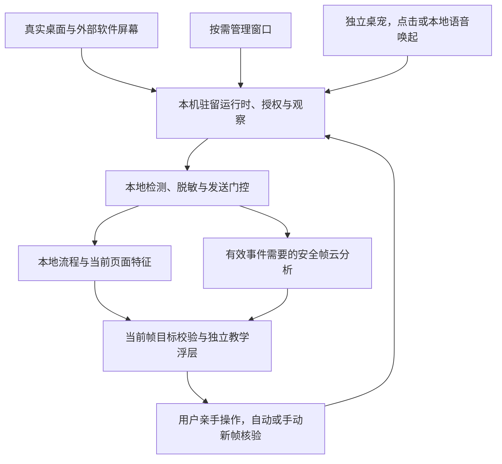
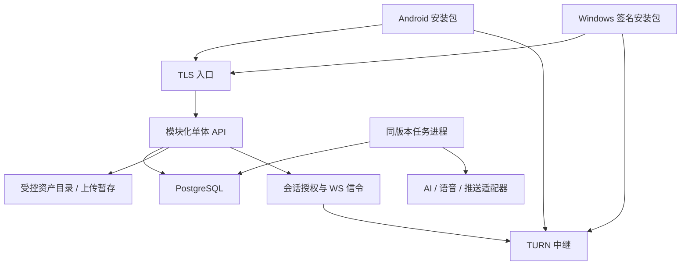
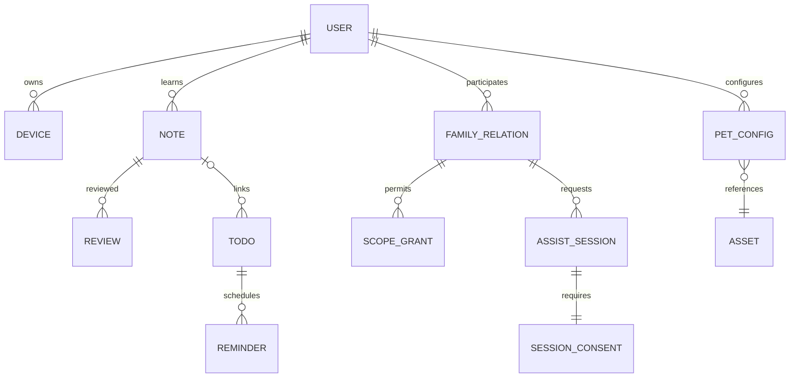
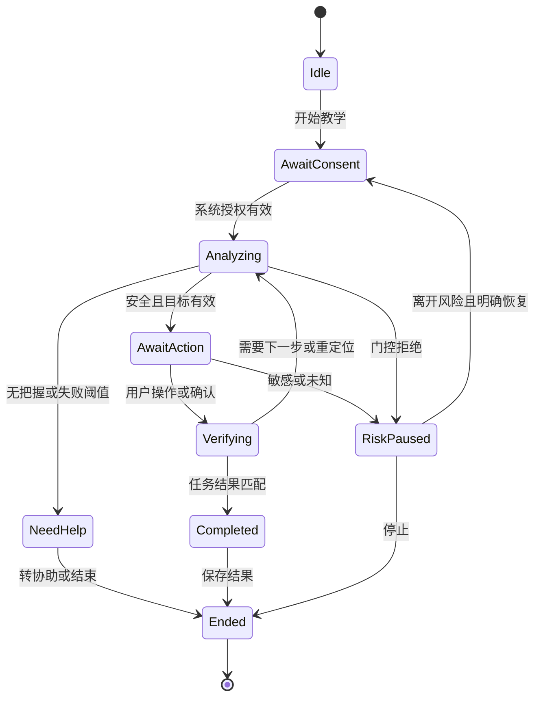

# 「暖伴」AI 公益助手技术与实施方案：独立智能桌宠版

| 项目 | 内容 |
| --- | --- |
| 文档版本 | 技术方案 V1.1，独立桌宠运行时与真实屏幕链路修订版 |
| 编制日期 | 原稿 2026-10-15；本次修订 2026-10-18 |
| 需求依据 | 《暖伴AI公益助手-产品需求文档-独立桌宠版.md》，正文 PRD V1.1及本次用户确认 |
| 编写要求 | 《暖伴AI公益助手-技术与实施方案提示词(2).md》 |
| 当前交付 | 技术设计、接口草案、实施与验证计划；未创建业务工程、未执行真机验证 |
| 适用范围 | Android 手机与电脑端；电脑首个验证平台暂定 Windows 11 x64 |
| 使用约定 | “基线”来自 PRD；除明确引用的基线外，本文选型、字段、阈值、期限、流程细化均为技术建议，评审后冻结 |

> 本文保留 PRD 全部当前需求，不以分阶段实施删减功能。文中代码、配置、命令均为设计示例，不表示已实现、已接入或已通过测试。官方资料查证日期为 2026-10-15；资料支持平台机制，不等同于暖伴已经具备这些能力。

## 本次确认的核心形态与统一规则

本版以 2026-10-18 本次对话中用户明确确认的内容为需求依据。暖伴是**悬浮在真实桌面及其他软件上方、理解当前屏幕并指导用户操作的独立智能桌宠**。Android/Windows 宿主承担系统运行、真实捕获与浮层；主界面承担设置、档案、绘画等管理。关闭管理窗口后，只要用户没有退出桌宠、系统条件及授权仍有效，驻留桌宠及本地观察可继续运行。

| 确认编号 | 产品与工程统一要求 |
| --- | --- |
| CORE-01 独立悬浮 | 桌宠、教学标记、语音/字幕和停止入口服务于真实系统桌面及外部软件；管理页面中的模拟手机界面不能作为核心产品或跨应用验收成果 |
| CORE-02 本地观察 | 用户明确开启并获本机系统授权后持续在本地观察；一次教学结束不自动停止用户仍授权的观察会话；退出/撤权/锁屏/进程终止/隐私暂停按清理规则停止，不在重启后自行恢复 |
| CORE-03 按需云分析 | 提问、显著页面变化或步骤核验触发必要画面的本地检测/脱敏与云分析；连续采集不等于连续上云，重复/过期帧不排成长队，原始帧不传云 |
| CORE-04 用户亲手操作 | 从桌面寻找应用、打开应用、导航到功能、点击或输入直至完成，全部由用户执行；光标/桌宠只指示，不自动启动目标第三方应用或注入输入 |
| CORE-05 通用软件理解 | 面向尽可能多的主流软件理解页面结构、控件含义与位置；Top20 是本地加速能力，不是仅允许这20项的产品范围；未预置软件也可在本地判安全后交云AI尝试，实际覆盖按测试公开 |
| CORE-06 双入口核验 | 自动观察到用户操作/页面变化以及用户点击“我点好了”都可触发核验；都须用当前新画面核对结果，不把按钮点击或旧画面直接视为成功 |
| CORE-07 不确定处理 | 支持重新观察、询问用户、展示明确标注不确定性的候选位置，由AI按当前情况选择；候选必须来自当前可定位控件，不能编造坐标，隐私/交易风险不能靠候选提示绕过 |
| CORE-08 隐私与恢复 | 在设备本地识别边界，敏感/未知/检测故障先关出口并停止相应屏幕采集和指引；用户本人明确点击“继续共享”后复核本机授权及新帧安全，满足后恢复；家属/模型/页面变化不能代为恢复 |
| CORE-09 双唤起 | 点击桌宠和语音唤醒均属于正式功能；语音唤醒在麦克风单独授权和系统允许的运行条件下采用本地唤醒检测，未唤醒的常听音频不持续上传云端 |
| CORE-10 完整教学记录 | 每次教学形成一次可追溯笔记，顺利完成、未完成和用户主动结束均记录实际结果；只存安全摘要。“已掌握”由用户本人明确确认，AI/家属/核验成功/练过不能代替确认 |
| CORE-11 复习确认 | AI 建议具体复习日期、时点及时区，用户确认后创建；不能自动替用户安排。原本人手建和获授权家属代建待办能力保留，并标明创建来源 |
| CORE-12 亲情协助 | 从驻留桌宠直接邀请家人；有效关系、当次本人确认与本机权限齐备后共享安全屏幕和语音；仍由用户亲手操作，风险保护对家属与AI出口同样生效 |

**运行边界：** 独立桌宠仍需要可安装的宿主和系统权限。系统不支持的浮层、后台/麦克风或捕获条件必须如实显示，不能以持续观察目标绕过权限。截图/DOM Mock 可用于单元测试、交互夹具与合成风险页，但外部桌面/第三方软件中的真实捕获、浮层、停止及用户操作证据是核心验收必需项。设备与软件的实测覆盖不足不删除产品目标，也不虚构“所有软件均已支持”。

## 目录

1. [方案摘要](#1-方案摘要)
2. [需求基线、范围、工作假设与待确认项](#2-需求基线范围工作假设与待确认项)
3. [技术基线、选型决策与技术原则](#3-技术基线选型决策与技术原则)
4. [总体架构、端云分工与关键链路](#4-总体架构端云分工与关键链路)
5. [建议目录结构、依赖与工程规范](#5-建议目录结构依赖与工程规范)
6. [核心数据模型、关系与状态机](#6-核心数据模型关系与状态机)
7. [接口、流式事件、原生桥接与 Mock 策略](#7-接口流式事件原生桥接与-mock-策略)
8. [内容配置、操作流程库和资源管理](#8-内容配置操作流程库和资源管理)
9. [界面、交互、桌宠及无障碍方案](#9-界面交互桌宠及无障碍方案)
10. [原生能力验证、媒体和隐私门控](#10-原生能力验证媒体和隐私门控)
11. [本地存储、同步、日志与隐私](#11-本地存储同步日志与隐私)
12. [前端先行的阶段实施计划](#12-前端先行的阶段实施计划)
13. [后端实施、部署和运维方案](#13-后端实施部署和运维方案)
14. [测试、性能和兼容性方案](#14-测试性能和兼容性方案)
15. [分阶段技术完成定义与能力账本](#15-分阶段技术完成定义与能力账本)
16. [风险、架构决策、PRD 追踪矩阵及下一步任务](#16-风险架构决策prd-追踪矩阵及下一步任务)

## 1. 方案摘要

### 1.1 结论与核心闭环

推荐采用 **Kotlin Android 驻留运行时 + 原生桌宠/教学浮层、Electron Windows 主进程/受控媒体进程 + 独立桌宠窗口、React/TypeScript 共享管理界面、TypeScript 模块化单体后端**。产品运行入口是独立桌宠，设置/档案/绘画界面按需打开。Android 核心观察/停止/教学协调不依赖管理 Activity/WebView 存活；Windows 同样不依赖管理 BrowserWindow。前端先行阶段仍用契约/Mock 验交互，但同时必须验证关闭管理窗口后真实外部软件中的桌宠链路；真实服务在 D 后接入。

核心闭环是：桌宠驻留/点击或本地语音唤起 → 本人开启并授权本地观察 → 提问/页面变化/核验触发 → 本地检测脱敏及必要云分析 → 在真实外部软件上仅显示当前一步 → 用户亲手操作 → 自动/手动入口触发新帧核验 → 每次教学笔记与本人掌握确认 → 建议具体复习时间、本人确认后排程 → 桌宠/通知直达复习。亲情协助从桌宠经当次确认后接入；正常教学结束后可回仍有效的本地观察。

这条路线适合共享页面与业务规则，也保留系统能力的原生实现空间。**跨应用捕获与浮层、发送前隐私门控、跨平台坐标、手绘生成、免密认证是技术准入项**。在验证之前，只能确认设计路径，不能确认全范围可行。

### 1.2 实现边界与接入方式

| 部分 | 主方案职责 | 前端阶段 | 后端接入后 |
| --- | --- | --- | --- |
| 共享 UI | React 管理窗口中的绘画/设置/档案/账号和可复用组件；桌宠气泡/字幕按平台承载 | 使用确定性 Mock 完成六模块交互 | 保留页面和用例，替换服务适配器 |
| 共享领域与应用 | 共享领域规范、纯TS规则/测试向量、管理用例；Android驻留核心以Kotlin实现同一协议和状态规范 | 真实运行规则，以合成事件驱动 | 继续使用相同规则与 DTO 转换 |
| Android 宿主 | 独立 PetRuntimeService/会话协调、原生桌宠/教学浮层/输入面板、本地唤醒与观察、捕获/Room/通知；WebView仅按需管理 | 真机验证捕获、绘制、停止、保存、提醒 | 接入真实媒体和服务鉴权，不重做页面 |
| Windows 宿主 | 主进程/驻留协调、独立桌宠/字幕窗口、受控媒体进程、IPC/捕获/SQLite/通知/3D；管理窗口可关闭 | 验证多屏缩放、穿透、受控捕获 | 接入服务与更新发布 |
| 后端 | 身份、授权、AI 编排、档案、同步、提醒、协助信令 | 只设计契约和边界，运行 Mock 服务 | 模块化单体 API + 同代码库任务进程 |
| 媒体基础设施 | 脱敏后画面与语音的中继 | 本地合成源及受控测试端验证 | WebRTC 强制 TURN 中继，应用信令控制会话 |

DOM 只能绘制当前页面。跨应用光标和儿童走动由宿主浮层承载；浏览器授权不代表系统授权；页面计时器不承担正式提醒。Android 主页面可共享 Web 代码，但跨应用教学浮层采用原生 Canvas/View，避免让完整 WebView 叠在目标应用上。

### 1.3 范围与主要决策假设

| 决策或假设 | 当前取值 | 影响与解除条件 |
| --- | --- | --- |
| 首个电脑平台 | Windows 11 x64 | macOS/Linux 不列已支持；新增平台需独立捕获、权限、打包验证 |
| Android 候选范围 | Android 10/API 29 起；验证重点含 12、13、14、15、16 | 只是测试起点，最低版本与发布 target SDK 在阶段 A/C 按实际设备和分发要求冻结 |
| 工程组织 | pnpm workspace 单仓库 | Android 由 Gradle 构建，UI 与原生构建独立；不强求所有代码由 Node 构建 |
| 通信 | HTTP JSON + SSE；WS 用于语音与协助信令；WebRTC 用于协助媒体 | 业务 DTO 统一；不为每种协议重复建领域模型 |
| 默认本地教学 | 已匹配流程优先；未预置软件用本地安全门+必要脱敏画面的云AI通用结构/控件理解 | 未识别/无法安全脱敏时暂停；不能把云模型当本地安全门 |
| 生成桌宠 | 服务端异步生成分层 2D 资产和受限动画描述 | 未经质量验证不能将静态晃动算完成；供应方与预算影响上线 |
| 身份路径 | 运营商 token 换会话；已绑定账号的设备认证；亲属协助认领 | 设备生物认证不等于服务端人脸识别；后一能力仍需专项验证 |
| 人员假设 | 共享前端、Android、桌面、后端/AI、测试安全职责有人承担，可兼任 | 无固定日历工期；原生与生成专长缺失会拉长关键路径 |

## 2. 需求基线、范围、工作假设与待确认项

### 2.1 已确认与禁止越界

新增公共运行要求 FLOAT-01/OBS-01/WAKE-01；原六模块基线继续包含 IN-01～06、PET-01～04、GUIDE-01～04、SAFE-01、CHAT-01、NOTE-01～02、SUB-01～03、TODO-01～03、ACC-01～02、HELP-01、SYS-01、FLOW-01。双端共用学习档案与账号模式，Android 不含 3D。免密、代注册、社区批量开通、当次亲情远程协助均在当前范围。

当前只预留星云 SDK 的渲染/会话/语音/行为接口、AnySearch 的查询与来源接口，以及机构服务管理/聚合指标边界。不建设完整机构后台，不宣称实时搜索已接入。方言、防诈课堂、步骤卡、完整多老人亲情体系属于后续深化。

严禁自动点击、填表、提交、代付款、远程接管和决策建议。密码与私人聊天页面暂停共享及相关画面教学；转账、支付、验证码还必须停止该风险操作指导，文字、字幕、流程库、亲情音视频均不得绕过。用药仅复述已设置内容。停止、锁屏、权限撤回、重启后均不得静默恢复采集。

### 2.2 Q-01～Q-15 逐项响应

| 编号 | 方案响应与可推进假设 | 验证/决策责任与关口 |
| --- | --- | --- |
| Q-01 平台 | 先验证 Android 候选矩阵及 Windows 11；不默认所有电脑系统 | 客户端/测试在 C 提供设备报告，F 冻结发布矩阵 |
| Q-02 Top 20 | 格式和更新链路先实现；先以字体设置等合成样例验证 | 产品/试点方在 C 前确定 20 项及应用版本；未适配不得计完成 |
| Q-03 阈值 | 重试、时延、置信阈值参数化；低置信默认停止，不凭模型自评分放行 | 算法/测试按标注集校准，D 冻结候选、F 形成设备门槛 |
| Q-04 免密替代 | 已登录亲属协助一次性认领、电脑二维码绑定已认证设备，均需本人/监护确认；无已认证设备时需受控开通 | 账号负责人验证运营商、无 SIM、无摄像头与人脸失败路径；生产账号开通阻塞项 |
| Q-05 监护授权 | 关系与同意分建模；儿童敏感权限需有效监护同意并由本机完成系统授权 | 产品/安全明确核验材料、授权人和撤回流程；未确认不开放儿童真实采集 |
| Q-06 手绘生成 | 保留草稿，异步生成透明分层图、动作与表情配置，预览后应用 | 算法/设计用手绘样本评估相似性、动作完整性、时延和单次成本；整体生成能力准入项 |
| Q-07 3D 规格 | VRM、FBX、GLB 各建支持矩阵；只允许本地受控资源，无脚本/外链 | 图形/桌面在 C 实测合法、损坏、恶意与超限样本，冻结规格 |
| Q-08 儿童指向 | 真实桌面与应用内均采用桌宠邻近指向；路径、遮挡、替代停靠按实际屏幕验证 | 设计/客户端在真实桌面和外部软件验可达/遮挡，保持桌宠指向；细节参数以实测冻结 |
| Q-09 跨端配置 | 账号 2D 为共同基线；设备可覆盖位置/缩放，桌面另选 3D；手机回退不改人群模式 | 产品确认覆盖字段，服务端确认 3D 是否云同步；默认 3D 本机保存、配置同步可用性标记 |
| Q-10 保留删除 | 按第 11 章建议 TTL 实现可配置清理，原始实时媒体不持久化 | 安全/运维冻结期限和备份清除 SLA；上线前决策 |
| Q-11 掌握与指标 | 每次教学一笔记；本人明确确认掌握，家属无代改权限，AI只建议；无AI复现是独立事实 | 本人确认来源已由用户决定；产品/测试冻结观察期/去重细节与拒绝越权用例 |
| Q-12 涉钱转人工 | 按触发次数、电话确认入口使用等分开统计；分母为涉钱遭遇量 | 安全复核，不以少熔断/少转接优化指标 |
| Q-13 多端提醒 | 同一提醒实例稳定 ID，本地与云分通道去重；冲突需确认，存 IANA 时区 | 服务端/客户端在 D 验证规则，在 F 验证双端真实投递 |
| Q-14 亲情范围 | 首期保留基础绑定、档案授权、代设待办、当次屏幕+语音协助；不先做复杂家庭组织 | 产品确认权限表；缺少远程协助不能称整体闭环完成 |
| Q-15 供应方 | 固定端口契约，以服务端模型/ASR/TTS/生成适配器接入；暂不虚构供应方型号、价格或能力 | 项目负责人提供可用区域、预算、凭证及数据条款；E 接入前冻结供应清单 |

### 2.3 待验证与阻塞分级

可立即推进方案、Schema、页面、状态机、Mock、合成素材、桌宠引擎和本地流程。真实业务上线须解决：目标设备/分发条件；可用且有授权的认证和 AI/语音/生成供应方；监护同意；隐私门控的实测可靠性；媒体经门控后可编码发送；手绘生成质量。缺少凭证不阻塞前端，缺少门控能力会阻塞相应真实共享能力的发布，不得通过删掉安全检查解围。

## 3. 技术基线、选型决策与技术原则

### 3.1 收敛后的主技术栈

| 层次 | 主选择 | 原因、取舍和验证方法 |
| --- | --- | --- |
| 共享界面 | TypeScript strict、React、Vite、React Router | 复用管理页面/组件；核心教学在原生/独立浮层，管理窗口关闭测试属于必需验收 |
| UI/状态/样式 | Radix 可访问原语 + 自建业务组件；CSS Modules + CSS 变量；Zustand 保存跨页面会话状态 | 一个全局状态库；远端列表经仓储缓存，不再引入第二套全局库；交互状态与持久化分离 |
| 领域状态 | 无框架 TypeScript 判别联合 + 纯 reducer | 便于模拟并发、非法迁移和属性测试；不把业务迁移散落 useEffect |
| 契约 | JSON Schema 2020-12 + OpenAPI 3.1，Ajv；生成 TS/Kotlin DTO | 跨语言契约统一；生成器兼容范围在 A 验证，不支持关键特性时用明确 DTO 映射而非放松校验 |
| Android | Kotlin 驻留运行时、原生 View/Canvas 桌宠/字幕/交互浮层、MediaProjection/CameraX/AudioRecord、Room/调度；WebView只承载按需管理 | 保留真实系统能力；原生代码和桥接成本较高；C 专项样例优先 |
| Windows | Electron 主进程驻留协调、独立桌宠/字幕与管理窗口、受控媒体 utility/原生辅助进程 | 共享 TS 业务，透明窗与调试生态可用；内存成本高；多屏、窗口定位可能需要 Windows 原生桥 |
| 本地存储 | 浏览器演示 IndexedDB；Android Room；桌面 SQLite | 领域仓储端口一致，生产敏感正文加密，令牌独立安全存储；不把演示存储当正式方案 |
| 图形 | 2D 受限 sprite/分层动画描述，Canvas；画布 Pointer Events；桌面 Three.js + three-vrm + GLTFLoader/FBXLoader | 双端复用资产协议；Android 原生解释同一动作；3D 按需加载；不把格式解析等同骨骼动作兼容 |
| 本地理解 | OCR + 安全规则 + 经评测的本地分类/人脸检测模型；ONNX Runtime 作为推理执行器 | 离线安全门不依赖云；具体模型权重、授权和设备速度待 C 验证；不能保证识别任意敏感画面 |
| 服务端 | TypeScript、NestJS + Fastify、Prisma、PostgreSQL | 模块化单体；事务和对象鉴权集中；同一发布版本提供 API 与任务进程，不先拆微服务 |
| AI/语音 | 多模态、ASR、TTS、图像生成适配端口；服务端隐藏供应凭证 | 供应方仅在 E 按预算和样本验证后绑定；TTS 字幕按句统一编排，供应方时间戳非硬依赖 |
| 通信/媒体 | HTTP、SSE、受控 WS；亲情 WebRTC + coturn 中继 | 区分请求、单向流、双向信令和媒体；两人会话不引入 SFU；敏感原始轨道禁止直接接 PeerConnection |
| Mock/测试 | MSW（浏览器）、同端口内存适配器（宿主）、Vitest、Testing Library、Playwright、Android instrumentation | 网络与端口两级覆盖；固定种子与虚拟时钟；协议测试覆盖真实适配器 |
| 发布 | pnpm lock、Gradle wrapper/version catalog、容器镜像、Electron Forge、CI | Windows 构建/签名在 Windows runner；Android Studio/JDK 按 AGP 官方兼容表冻结；后端 Linux 部署 |

版本策略：不在未建工程时捏造“最新版本”。阶段 A 建 `toolchain.lock.md`，写精确 Node LTS、pnpm、TypeScript、React、Electron、Android Gradle Plugin、Kotlin、JDK、SDK、数据库、WebRTC commit 和模型 hash，配套官方支持链接；执行最小安装、构建、桥接、契约生成后锁定。禁止发布依赖 `latest`、浮动 git 分支或未校验模型下载。

许可证策略：对上述确切依赖和传递依赖生成 SBOM，核验仓库 LICENSE/NOTICE、字体/音色/模型权重/桌宠素材/用户导入资源的许可与再分发条件。WebRTC、编解码与运营商 SDK 另列二进制来源及授权；本文不据技术名称宣称全部可商用。CI 对禁止许可、未知来源和高风险漏洞设检查；人工复核记录归档。

### 3.2 唯一条件备选

若阶段 C 证明 Electron 媒体/窗口宿主无法满足 Windows 上的门控、坐标或资源预算，且原生辅助模块无法补足，改为 **Windows .NET 原生宿主 + WebView2 共享页面**。沿用 UI、领域、Schema 和服务端，重做平台端口实现与打包。这是需要 ADR 批准的桌面宿主替换，不与主方案并行搭两套。Android 原生浮层、后端和媒体协议不因此改变。

### 3.3 工程原则与落地措施

| 原则 | 工程措施 |
| --- | --- |
| 契约先行、依赖反转 | 页面调用 application 用例；仓储/服务/平台通过组合根注入；CI 禁止 UI 导入 mocks、数据库和供应 SDK |
| 领域/DTO/持久层分离 | `domain.Note`、`NoteDto`、`NoteRow` 独立；显式 mapper；媒体句柄不可序列化进通用消息 |
| 系统权限真实 | `PermissionSnapshot` 仅反映观测；grant 只能由宿主系统回调产生；HTTP/Mock 不得更新原生授权 |
| 端侧优先 | 本地持续观察/安全门/语音唤醒；提问/页面变化/核验按需云分析，流程命中省云；正式交付点击与语音唤醒均需实测 |
| 安全先于传输 | 唯一媒体出口要求 `SanitizedFrameHandle`，没有检测结果拒绝编码和发送；不提供 rawFrame 网络 API |
| 明确状态与取消 | 每次采集/回复拥有 generation；停止递增；所有异步结果必须核对 generation 与版本 |
| 最小采集与日志 | 屏幕内存有界、默认不录制；结构日志字段白名单；诊断不抓请求体 |
| 可用性与诚实反馈 | 真实请求失败显示失败；能力账本区分界面、模拟、真实、真机验证；生产包不可启用 Mock 登录 |
| 控制复杂度 | 单数据库、模块化单体、数据库任务队列；达到实测瓶颈再扩展；供应方适配不泄漏进领域 |

### 3.4 官方资料查证与适用边界

以下均于 2026-10-15 查阅。平台依据的摘要只用于约束设计，其他工程组织与阈值为本方案建议。

| 编号 | 官方资料 | 查证结论及本项目影响 |
| --- | --- | --- |
| S-01 | [Android MediaProjection](https://developer.android.com/media/grow/media-projection) | 会话授权及 token 有使用限制；停止回调须释放资源；不能复用旧授权静默开新会话 |
| S-02 | [Android 前台服务类型](https://developer.android.com/develop/background-work/services/fgs/service-types) | 捕获、相机、麦克风需匹配服务类型及权限；启动和后台存在限制；不设计开机恢复采集 |
| S-03 | [Android 12 不可信触摸](https://developer.android.com/about/versions/12/behavior-changes-all#untrusted-touch-events) | 悬浮层可能导致底层触摸被系统阻止；仅设不可触摸不足以保证穿透，需实机验证 |
| S-04 | [Android 通知权限](https://developer.android.com/develop/ui/compose/notifications/notification-permission)、[精确闹钟变更](https://developer.android.com/about/versions/14/changes/schedule-exact-alarms) | 通知与精确闹钟能力不能默认获得；区分权限、调度与实际触达 |
| S-05 | [WebView 原生桥安全](https://developer.android.com/privacy-and-security/risks/insecure-webview-native-bridges) | 来源校验与暴露面是风险点；本地可信页面、方法白名单、禁止任意 iframe/远端内容使用桥 |
| S-06 | [Android 生物认证](https://developer.android.com/identity/sign-in/biometric-auth) | 系统认证用于本机用户认证和密钥访问；服务端账号/人脸绑定另行设计 |
| S-07 | [Electron 安全](https://www.electronjs.org/docs/latest/tutorial/security/) | 开启上下文隔离、沙箱，关闭 renderer Node 集成，校验 IPC 来源，持续更新 |
| S-08 | [BrowserWindow](https://www.electronjs.org/docs/latest/api/browser-window)、[desktopCapturer](https://www.electronjs.org/docs/latest/api/desktop-capturer) | 提供窗口/捕获接口；透明、穿透、内容保护仍需按目标系统验证，不能当隐私保证 |
| S-09 | [Electron screen](https://www.electronjs.org/docs/latest/api/screen)、[safeStorage](https://www.electronjs.org/docs/latest/api/safe-storage) | 分辨物理像素与 DIP；安全存储依赖平台，本文只在验证的 Windows 环境使用 |
| S-10 | [WebRTC TURN](https://webrtc.org/getting-started/turn-server) | 连接可能需要中继；本方案主动选 relay-only，由短期授权控制会话；门控由应用实现 |
| S-11 | [Three.js GLTFLoader](https://threejs.org/docs/pages/GLTFLoader.html)、[FBXLoader](https://threejs.org/docs/pages/FBXLoader.html)、[three-vrm 官方仓库](https://github.com/pixiv/three-vrm) | 有相应加载入口；不据此承诺任意版本/材质/骨骼均兼容，必须建立资源样本矩阵 |

无障碍服务当前不作为主依赖。若未来拟使用，先核验 Android 官方 API 与目标分发渠道政策，形成新 ADR；未查证前不接入，也不通过它增加自动操作。本文不对适用法律或具体合规认证作已达标结论。

## 4. 总体架构、端云分工与关键链路

### 4.1 逻辑结构与信任边界



原始画面只进入本机受控捕获/检测路径。管理窗口是可断开的订阅/配置入口，不持有驻留核心生命周期；它关闭后，桌宠、系统授权/停止和健康状态仍由原生宿主负责。云只收到已经本地放行的必要脱敏帧，返回语义/位置候选，宿主在最新帧验证后绘制；不存在对第三方软件的执行点击接口。亲情安全媒体复用发送门控，按当次独立用途授权。

### 4.2 部署边界



首期可在单台受控服务器运行 TLS、API、任务进程、PostgreSQL 和资产目录；TURN 独立端口与带宽预算，可同机试点但须评估争用。数据库不暴露公网。部署图表达信令授权关系，不表示 TURN 能读取业务对象。WebRTC 媒体不经过普通业务 JSON；不默认录音录像。

### 4.3 五条关键链路

**提问与播报。** 点击桌宠或本地唤醒词触发一轮会话；唤醒检测只用本机短时音频，取得用户提问授权后才将本轮录音送受控语音通道。驻留运行时创建 request_id 和 response_generation，ASR 文本可确认后提交。后端先判定安全与上下文范围，再流式输出经过内容约束的句段。客户端将同一 `segment_id` 的文本送字幕和 TTS 队列，按实际播放进度高亮。新提问先终止旧音频和旧请求、递增代际；迟到事件丢弃。TTS 失败保留文本并提示；再讲一遍生成新的播放代际，不重复创建笔记。

**屏幕教学。** 用户明确开启且本机授权有效 → 驻留服务持续本地观察/安全检测 → 提问、显著页面变化或核验触发当前必要帧 → 本地脱敏与门控票据 → 本地命中流程或上传必要安全帧 → 云AI理解真实应用/窗口与控件结构、语义、位置 → 回当前一步候选 → 宿主按当前帧/目标再定位校验 → 原生/独立桌宠浮层显示 → 用户亲手操作 → 自动观察/“我点好了”触发新帧核验。用户未打开应用时先指向真实桌面应用图标/入口，用户自己打开；没有任何自动启动/输入注入接口。页面改变先撤标；候选样式明确不确定，成功核验才推进。

**笔记与复习。** 每次教学完成/失败/主动结束均按 guide_id 形成笔记 → 去除秘密、关联主题历史但保留本次记录 → 本地事务写笔记与 outbox → 显示本地/同步状态 → 询问本人是否学会，仅本人确认可更新 mastery → AI建议具体日期/时点/时区 → 本人确认后建待办和实例 → 桌宠/通知点击校验对象权限 → 直达笔记并可继续真实外部软件复习。未确认建议无排程；本人手建和获授权家属代建任务保留并标来源，家属不能代改掌握。

**失败转亲情。** 低置信或重复核验失败 → 隐藏指引并诚实说明 → 用户选择已绑定家属 → 本机确认本次屏幕与语音范围 → 创建短期邀请 → 家属接听并服务端再查关系 → 本机系统授权有效后接通。媒体只接收检测脱敏后的帧；敏感/未知页面关闭视频门控，支付等风险同时暂停本次操作指导并提示电话确认。断线显示状态，恢复需重查授权；超时结束，不静默自动接听。

**同步。** 本地修改与 outbox 原子提交 → 发送变更和幂等键 → 服务端校验版本/对象权限 → 返回确认或冲突 → 本地标记 ack → 拉取游标变更 → 显式合并/冲突处理。账号代际不一致的响应全部拒绝应用；大资产独立队列，不能阻塞笔记和待办。

### 4.4 共享与原生划分

| 可共享 | 必须平台实现 | 服务端实现 |
| --- | --- | --- |
| 页面、用例、领域模型、配置 Schema、步骤规则、同步合并、字幕分段、2D 资产协议、坐标算法测试向量 | 系统权限、捕获、媒体安全出口、浮层窗口、坐标来源、通知、生命周期、安全存储、SQLite/Room 适配、麦克风相机 | 身份/对象权限、AI 供应密钥、关系与授权、同步日志、持久任务、流程发布、推送、协助信令/撤权 |

平台端可重复实现安全核验与坐标转换，但使用相同测试向量和协议版本；不能假设 TypeScript 状态仍在运行就能替代原生停止回调。

### 4.5 独立桌宠运行时与管理界面的分离

| 层/生命周期 | Android 实现方向 | Windows 实现方向 | 必须约束 |
| --- | --- | --- | --- |
| 驻留运行时 | PetRuntimeService + 原生串行协调器、符合用途的前台状态/停止通知 | main 进程 RuntimeCoordinator + 受控 utility/media 进程 | 观察/任务/授权/停止事实的唯一权威，不能由管理 UI 存活决定 |
| 桌宠与教学呈现 | 原生 PetOverlay/GuideOverlay/CaptionOverlay，独立小尺寸交互面板 | pet/guide/caption 独立 BrowserWindow 或原生辅助窗，非交互层穿透 | 实际覆盖外部桌面/软件，目标/停止不遮挡，关闭管理窗仍可交互 |
| 管理界面 | Activity/WebView 的绘画、设置、档案和账号页面 | management BrowserWindow 的同版共享页面 | 按需开关，关闭只断该 UI 订阅；重新打开拉当前状态快照 |
| 数据/网络核心 | 原生仓储/加密/HTTP-SSE-WS 适配与DTO映射 | TS 运行时仓储/网络适配，与renderer隔离 | Android 核心不能要求一个隐藏WebView一直执行 JS；两端以同契约/向量保持语义 |
| 本地观察与唤醒 | 原生 capture/detector/wake-word 端口，系统权限独立 | 受控 capture/detector/audio 进程 | 屏幕授权不包含麦克风；原始帧/未唤醒音频不暴露管理页面 |

共享 React/TS 继续复用管理页面、2D资产规范、Schema、纯领域规则与测试向量；Android 驻留状态机/门控/核验/触发协调有 Kotlin 对等实现。禁止为复用 TS 而把核心链路挂到管理 WebView 的 timer/useEffect。Windows 主进程可复用纯 TS 核心，不能从 renderer 读取 DOM 当外部屏幕。

**关闭与退出：** management.close 仅关闭管理窗口并取消其订阅；pet.exit/用户停止观察/系统撤权/锁屏/运行时失效均执行安全清理。桌宠停止入口和系统通知均不可达、驻留协调器丢失或媒体进程断开时应停采集，不能留下无人可停的后台观察。系统后台/浮层条件不满足时公开受限状态，不能保证所有厂商永不终止服务。

**隐私暂停：** observing → privacy_paused 先关闭所有相关出口并停止屏幕捕获。停止后不继续偷偷采集来判断用户是否已离开。只有用户本人点击“继续共享”才进入 permission_check → local_safety_check；缺系统授权则重新申请，新帧仍风险/未知则回暂停，安全且本次同意有效才回 observing。模型、家属和旧回调不能触发这个恢复动作。

### 4.6 本地持续观察、事件触发和通用软件理解

观察会话 observation_id 独立于教学 guide_id。授权有效时持续本地捕获/变化检测和隐私判断，只在 question/page_changed/verification 等有效事件需要时选取当前必要帧进入云分析。显著页面变化先撤旧标记；去抖、去重、同代际合并和有界 latest-frame 队列避免每个动画像素都发一次云请求。提问/核验优先，过期请求取消，迟到结果拒绝；无有效事件不形成连续屏幕上行。一次教学结束只终止 task_generation，仍允许的 observation 会话可回待命。用户停止/隐私/撤权使 observation_generation 失效并连带失效所有子任务。

通用理解链路为真实图像 → 本地 OCR/布局/图标候选 → 安全检查和必要脱敏 → 云端多模态结构分析 → 当前页 UIElement 集合及一步语义候选 → 当前本地帧重定位 → 实际浮层。UIElement 包含 source_frame、label/icon语义、type、父子/分组、bounds、visible/enabled 和依据；未知字段/模型自报置信不作安全证明。不要求目标软件改代码或安装暖伴SDK；可合法使用的只读结构信号是补充，不能绕过系统权限或增加自动操作。

Top20 命中优先本地；未预置软件也有同一通用 AI 路径，不能只显示“未适配”结束。未知软件名称与 privacy.unknown 分开：前者不直接拒绝，后者表示本地仍不能判安全，必须暂停不上传。目标是覆盖尽可能多主流软件，覆盖表按平台/软件/版本/页面/任务/结果记录，不能据一个样例宣称所有软件精确可用。

AI 不确定时可重观察、询问、标注候选；候选位置必须在最新页面有实际可定位控件且不与隐私规则冲突，展示“可能是这里”的独立样式/话术。若只有想象中的按钮、目标被遮挡无法定位或页面已失效，不画光标；可问用户、等待页面稳定或经当次确认请求家人。不能把候选猜测直接记 matched。

## 5. 建议目录结构、依赖与工程规范

### 5.1 目录树

```text
nuanban/
  apps/
    client-ui/                 # React 路由、组合根、浏览器演示入口
    desktop/
      main/                    # 驻留RuntimeCoordinator、独立桌宠窗、IPC/存储/通知
      preload/                 # 最小白名单桥
      media/                   # 门控媒体进程及 Windows 原生适配
      renderer/                # 复用 client-ui，桌宠窗口入口
      packaging/
    android/
      # 独立驻留 runtime/coordination/observation/wake 与原生 overlay
      app/src/main/
        assets/ui/             # 构建后复制的共享 UI
        java/.../runtime/      # Activity/WebView 关闭后仍承担授权观察/教学协调
        java/.../observation/
        java/.../wake/
        java/.../bridge/
        java/.../capture/
        java/.../privacy/
        java/.../overlay/
        java/.../storage/
        java/.../notifications/
        java/.../auth/
      gradle/
    server/                    # A-D 只放模块说明；E 才实现
      src/modules/             # auth family chat guidance notes todos pets flows sync assist audit
      src/workers/
      prisma/
  packages/
    domain/                    # 实体、值对象、状态 reducer
    application/               # 用例、事务边界、ports
    contracts/                 # JSON Schema、OpenAPI、生成 DTO、事件、错误码
    api-client/                # TS HTTP/SSE/WS适配；Android运行核心另有原生对等适配
    platform-ports/            # 捕获、通知、权限、媒体与存储句柄
    ui/                        # 可访问基础/业务组件
    design-tokens/             # CSS/JSON/Kotlin 可生成令牌
    pet-engine/                # 动作协议、2D 解释、桌面 3D 适配
    guidance-engine/           # 帧与坐标、目标生命周期
    privacy/                   # 共享策略及测试向量；原始帧检测由宿主实现
    local-data/                # 仓储映射、迁移、outbox/冲突规则
    config/                    # 环境/能力装配、版本校验
    mocks/                     # MSW、端口实现、固定场景
  content/
    flows/                     # 草案与已验证包分目录
    personas/
    pets/
    safety/
  tests/
    contract/
    integration/
    e2e/
    native/
    privacy/
    performance/
  docs/
    architecture/
    adr/
    api/
    implementation/
    acceptance/
  scripts/
  infra/                       # E 阶段容器、部署、备份脚本
```

### 5.2 依赖与装配

`UI → application → domain`；application 只依赖端口与领域。`api-client/local-data/宿主/mocks → application 的接口 + contracts`。domain 不依赖 React、HTTP、ORM、Android 或 Electron。contracts 定义传输形状，不成为持久化表的直接别名；各适配器通过 mapper 生成领域对象。

管理UI组合根及两个宿主各自的驻留组合根按职责读取配置并注入 `ConversationService`、`GuidanceService`、`NotesRepository`、`TodoRepository`、`FamilyService`、`PetGenerationService` 及平台实现。组件调用 `startGuidance()`、`createReviewTodo()` 等用例；组件不读 Mock JSON、不调用 SQL、不持有供应方 key、不发送原始帧。原生桥只暴露特定用途方法，禁止任意 `execute`、文件路径读取和 shell。

工程规范：严格 TS、格式化/静态检查、包导入边界检查；Schema 修改必须更新示例、生成 DTO 和兼容性说明；文案集中配置；日期统一使用 UTC instant + IANA timezone；所有可恢复写操作有幂等键；日志统一白名单；数据库迁移与客户端本地迁移分版本。环境为 dev/test/prod，生产启动若 `apiMode=mock` 或模拟登录开启直接拒绝。

### 5.3 核心运行边界与四机代码归属

延续四机计划：PC1 负责 Windows/3D、公共契约/工程与最终集成；PC2 负责共享管理UI、2D/绘画、业务规则规范/向量和remote消费；PC3 负责 Android 驻留核心、端侧隐私/唤醒、原生浮层及安全复核；PC4 负责服务/AI/语音/生成/信令/中继。公共Schema由PC1发布，Kotlin驻留实现由PC3负责，不让PC2的管理页面成为原生核心运行前提。

每条核心链路均有“管理窗口关闭”测试。独立桌宠不是新增第三套产品：客户端安装包仍含宿主、按需管理页面与独立浮层；原六模块功能和原目录可复用，必要的runtime/observation/wake子目录是原工作包的落实。

## 6. 核心数据模型、关系与状态机

### 6.1 字段通则

下文字段类型 `ID` 为 UUID 字符串，`Instant` 为 UTC RFC3339，`Version` 为单调整数，金额和身份秘密不进入领域档案。记法 `!` 必填，`?` 可空，`=值` 默认；未列默认值的必填字段不静默补值。所有持久实体另有 `created_at!`、`updated_at!`、`schema_version!`；可同步对象另有 `version!=1`、`deleted_at?=null`。安全相关枚举遇到未知值按不允许处理。

敏感级别：L0 公开配置；L1 运行元数据；L2 个人内容；L3 凭证/生物/实时媒体。类别不是法律分级，仅供工程控制。

### 6.2 核心实体字典

| 实体 | 关键字段：类型、必填、默认/枚举 | 来源/敏感级别 | 位置、同步与删除 |
| --- | --- | --- | --- |
| User | `user_id:ID!; mode:elder\|child\|accessible!; preferences:object!={}` | 本人/监护配置，L2 | 服务端主档+本地缓存；删除账号走级联清理 |
| LoginBinding | `binding_id:ID!; user_id:ID!; kind:carrier\|server_face\|device_key\|assisted_claim!; provider_subject:string!; verified_at:Instant!; revoked_at:Instant?` | 服务端验证，L3 | 服务端受限表；本地不缓存供应标识或人脸模板；撤销失效 |
| Device | `device_id:ID!; user_id:ID!; platform:android\|windows!; public_key:string?; revoked_at:Instant?; last_seen_at:Instant!` | 宿主注册，L1/L3 | 云端设备记录；私钥只本机；注销撤销刷新凭证 |
| PermissionSnapshot | `device_id:ID!; permission:camera\|mic\|projection\|overlay\|notification\|alarm!; state:unknown\|granted\|denied\|restricted!; observed_at:Instant!` | 系统回调，L1 | 本机为准；云仅诊断摘要，不同步 grant；重启重查 |
| FamilyRelation | `relation_id:ID!; subject_id:ID!; helper_id:ID!; status:pending\|active\|revoked!; revision:Version!` | 双方确认，L2 | 服务端强一致，撤销发布事件；本地短缓存 |
| ScopeGrant | `grant_id:ID!; relation_id:ID!; scopes:string[]!; consent_id:ID!; expires_at:Instant?; revoked_at:Instant?` | 本人/监护，L2 | 档案读、待办写分开；每次访问服务端重查 |
| Consent / GuardianAuthorization | `consent_id:ID!; subject_id:ID!; actor_id:ID!; purpose:string!; scopes:string[]!; notice_version:string!; accepted_at:Instant!; withdrawn_at:Instant?; guardian_proof_ref:ID?` | 明确确认，L2/L3 | 受控存储；证明附件独立 ACL/TTL；撤回与审计保留分开 |
| Conversation / Message | `session_id:ID!; owner_id:ID!; message_id:ID!; role:user\|assistant!; text:string?; request_id:ID!; status:draft\|streaming\|complete\|cancelled\|failed!` | 输入/模型，L2 | 最小上下文、有限保留；不默认长期完整同步，删会话不误删已确认笔记 |
| InputMetadata | `input_id:ID!; session_id:ID!; type:text\|voice\|photo\|image\|screenshot\|camera\|screen!; route:local\|cloud!; media_ref:ID?; consent_id:ID?` | 客户端，L1/L2 | 只持久必要元数据；临时媒体 ref 到期不可恢复 |
| CaptionSegment / Playback | `segment_id:ID!; message_id:ID!; index:int!; text:string!; playback:queued\|playing\|paused\|done\|cancelled!; generation:int!` | 已审核句段/TTS 回调，L2 | 实时内存；必要字幕随消息，不另存音频；静音不删文本 |
| TeachingSession | `guide_id:ID!; owner_id:ID!; flow_id:ID?; flow_version:string?; state:enum!; generation:int!; risk:unknown\|safe\|private\|transaction!; assisted:bool!=false` | 用例/宿主，L1/L2 | 云存摘要与结果、本地存进行状态但不恢复采集；结束清句柄 |
| ObservationSession / ScreenTrigger | `observation_id:ID!; state:off\|awaiting_permission\|observing\|privacy_paused\|stopped!; observation_generation:int!; local_consent_id:ID!; trigger_id:ID!; reason:question\|page_changed\|verification!; frame_id:ID!` | 原生驻留事实，L1/L3 | 本机权威，当前帧只在内存；云不创建采集权限，停止使所有子请求失效 |
| WakeSession | `wake_id:ID!; permission:enum!; state:disabled\|listening_local\|awakened\|recording_question!; response_generation:int!` | 原生音频/唤醒，L1/L3 | 常听短缓冲本地释放，唤醒后本轮提问音频才可按用途上传；重启不自动恢复麦克风 |
| UIElementCandidate | `element_id:string!; source_frame_id:ID!; role:string!; label:string?; parent_id:string?; bounds:NormalizedRect!; visible:bool!; enabled:bool?; evidence:string?; uncertainty:enum!` | OCR/本地特征/云候选，L2 | 只绑定当前页面，不能成为可执行控件句柄；当前帧校验失败即撤标 |
| ReviewProposal | `proposal_id:ID!; note_id:ID!; proposed_remind_at:Instant!; proposed_at:Instant!; timezone:string!; state:suggested\|accepted\|rejected!; confirmed_by:ID?; confirmed_at:Instant?` | AI建议/本人确认，L2 | suggested不产生ReminderOccurrence；本人接受后事务创建todo/outbox，家属代建走原授权todo路径 |
| TeachingStep / Verification | `step_id:ID!; frame:FrameContext!; target:NormalizedRect!; instruction:string!; expected_state:object!; confidence:number?; result:pending\|matched\|mismatch\|unknown!; verified_at:Instant?` | 流程/模型候选+本地核验，L2 | 不存原图；坐标仅当前代际有效；结果可作最小学习证据 |
| PetConfig | `pet_id:ID!; owner_id:ID!; type:2d\|3d!; source:preference\|drawing\|import!; asset_id:ID!; fallback_2d_id:ID?; appearance:object!={}; voice:object!={}` | 本人确认，L2 | 配置同步；设备渲染选择独立；删除不立刻破坏被引用资源 |
| Asset / GenerationJob | `asset_id:ID!; hash:string!; manifest_version:string!; kind:pet2d\|model3d\|drawing!; job_id:ID!; status:queued\|running\|succeeded\|failed\|cancelled!; input_ref:ID?; expires_at:Instant?` | 用户/生成适配器，L2 | 资源受 ACL、隔离扫描；取消删临时产物；确认后才换当前桌宠 |
| Note | `note_id:ID!; owner_id:ID!; source_guide_id:ID?; asked_at:Instant!; question:string!; topic:string!; answer_summary:string!; teaching_result:completed\|incomplete\|aborted?; mastery:unmastered\|mastered!=unmastered; source_session_id:ID?` | 脱敏学习摘要，L2 | 每次教学按(owner_id,source_guide_id)幂等成一份；同主题另次教学另记并关联；本地优先+云同步；不带秘密画面 |
| MasteryChange / Review | `change_id:ID!; note_id:ID!; actor_id:ID!; source:self!; previous/next:enum!; review_id:ID!; todo_id:ID?; result:practiced\|verified\|aborted!; evidence_kind:string?` | 本人明确确认/独立练习事实，L2 | 追加记录可追溯；仅本人确认可变 mastery，家属只读/待办scope无代改；AI建议不自动生效 |
| Todo | `todo_id:ID!; owner_id:ID!; creator_id:ID!; title:string!; note_id:ID?; timezone:string!; remind_at:Instant!; repeat_rule:object?; status:pending\|completed\|cancelled!=pending; next_fire_at:Instant?` | 本人/获授权家属，L2 | 双端同步；重复任务保留系列、每期单独结果；删除笔记显式断链 |
| ReminderOccurrence / Delivery | `instance_id:ID!; todo_id:ID!; schedule_revision:Version!; planned_at:Instant!; channel:local\|push!; target_device_id:ID!; state:scheduled\|submitted\|delivered\|opened\|failed\|missed\|unknown!` | 调度/系统回执，L1/L2 | 服务端与本地去重；未知不能写 delivered；删除待办撤销未来实例 |
| SyncMutation / Conflict | `mutation_id:ID!; entity_id:ID!; base_version:Version!; operation:create\|update\|delete!; patch:object!; state:pending\|sending\|acked\|conflict\|failed!; conflict_id:ID?` | 本地事务/服务端，L2 | 按账号分区加密；确认后压缩清理；冲突不静默丢弃 |
| AssistSession / SessionConsent | `assist_id:ID!; relation_id:ID!; subject_device_id:ID!; helper_id:ID!; consent_id:ID!; grant_revision:Version!; invite_expires_at:Instant!; media:idle\|connecting\|active\|paused\|ended!; ended_reason:string?` | 当次确认/信令，L2 | 服务端记录最小元数据；当次凭证短期；结束删除媒体缓冲 |
| ConfigBundle / FlowPackage | `bundle_id:ID!; version:string!; min_client:string!; hash:string!; signature:string!; active:bool!; rules_version:string!` | 审核发布，L0/L1 | 双槽原子更新；回滚到兼容签名版本；安全底线不可被远程关闭 |
| Audit / MetricEvent | `event_id:ID!; actor_id:ID?; action:string!; outcome:string!; request_id:ID?; versions:object!; occurred_at:Instant!` | 服务端/最小化客户端事件，L1 | 单独受控保留；不存原文/媒体/密钥；按期限清除 |

本人掌握确认使用明确的本机按钮或用户语音确认动作记录；服务端从已认证本人动作确定actor/source，不信任模型生成的mastery或客户端任意mastery_source。AI编排、自动核验、家属授权投影均不暴露掌握写入工具。既有普通笔记内容编辑和家属待办权限与掌握确认分开，不能因同一JSON对象包含mastery就随其他字段批量接受。

### 6.3 关键关系与数据库约束



参与双方用显式 subject/helper 两个外键，不用模糊的“家庭 ID 即可访问”。唯一约束建议：`(provider, provider_subject)` 登录绑定、活动关系双方组合、`(owner_id, mutation_id)`、`(todo_id, schedule_revision, planned_at)`、`(instance_id,target_device_id,channel)`、`(guide_id,step_id,verification_id)`。教学笔记唯一约束 `(owner_id,source_guide_id)`（仅非空教学来源）；笔记查询索引 `(owner_id,deleted_at,mastery,asked_at)`；待办索引 `(owner_id,status,next_fire_at)`；变更日志索引 `(owner_id,sequence)`；任务索引 `(status,run_at)`。所有资源外键验证 owner 一致，不能跨账号引用 note/asset；删除策略由事务显式处理，不依赖错误的全表级 cascade。

### 6.4 帧与坐标类型示例

```typescript
type UserMode = 'elder' | 'child' | 'accessible';
type Risk = 'unknown' | 'safe' | 'private' | 'transaction';
interface FrameContext {
  frame_id: string;
  generation: number;
  display_id: string;
  window_id: string;
  layout_revision: number;
  captured_at: string;
  source_size_px: { width: number; height: number };
  content_rect_px: { x: number; y: number; width: number; height: number };
  scale_factor: number;
  rotation: 0 | 90 | 180 | 270;
  transform_id: string;
}
interface StepCandidate {
  step_id: string;
  frame: FrameContext;
  coordinate_space: 'normalized-content';
  target_rect: { x: number; y: number; width: number; height: number };
  instruction: string;
  expected_state: { page_key: string; required_features: string[] };
  risk: Risk;
  expires_at: string;
}
// 运行时 Schema 必须约束坐标范围、正尺寸、边界和字段长度。
// SanitizedFrameHandle 是宿主私有能力句柄，不可 JSON 序列化成原始媒体。
```

模型提供的 risk/confidence 仅为候选信息，不能覆盖本地检测或授权。绘制须同时满足 frame、显示器、窗口、layout revision、代际和变换匹配，以及当前目标仍可定位。时间未过期不代表页面未变化。`UserMode` 与 platform 分开；手机启用 2D 回退只影响渲染选择。

### 6.5 驻留与业务状态机及非法迁移



观察/教学/播报采用父子代际：observation_generation 属于捕获授权，task_generation 属于本次教学，response_generation 属于回答；FrameContext.generation 明确定义为观察代际，教学/流事件另带task/response代际。结束一个教学不停止仍获准的观察，停止观察则失效所有子代际。任何活动状态的停止、撤权、锁屏均进入终止清理路径，图中为简洁未展开所有停止边。`AwaitAction → Completed` 非法；“我点好了”只能到 Verifying。风险暂停后不能由模型消息自动恢复。

| 状态机 | 合法主链与分支 | 非法迁移/并发处理 |
| --- | --- | --- |
| 采集授权 | idle → explaining → system_pending → active → stopping → stopped；拒绝到 denied；风险 active → paused，恢复重新确认并按系统要求授权 | 云端 grant、旧投影 token、重启记录不能到 active；stop 幂等；缺权限直接 fail closed |
| 亲情协助 | draft → inviting → accepted → awaiting_local_consent → connecting → active → ended；邀请过期/拒绝/取消结束；断线到 reconnecting | 只接听未当次授权不能 active；撤权优先于重连；旧 invite/token 拒绝；结束态不可复活 |
| 生成任务 | draft → queued → running → succeeded → confirmed；queued/running 可 cancelled；失败可新 job 重试 | cancelled 后迟到产物清理，不自动 succeeded；confirmed 必须预览校验，当前形象原子切换 |
| 同步任务 | pending → sending → acked；临时失败回 pending，版本冲突到 conflict，用户合并生成新 mutation | 旧账号 ack 丢弃；同 mutation 重试不重复创建；conflict 不能覆盖为 acked |

非法迁移在开发环境抛可诊断错误，生产拒绝操作并写无敏感的状态审计；安全相关非法迁移先关门控。并发事件以本机串行协调器处理，`stop/revoke` 优先级最高。

## 7. 接口、流式事件、原生桥接与 Mock 策略

### 7.1 统一约定

以下为 `/v1` 契约草案，阶段 A 写入可执行 Schema。登录前仅限公开认证端点，其他 HTTP 请求携带短期 access token 和 `X-Request-ID`；写入带 `Idempotency-Key`，更新带 `If-Match` 版本。服务端从认证上下文确定 actor，`owner_id` 仅可作为经授权的目标选择，不作信任凭据。

统一成功包 `{data, request_id, schema_version}`；失败包 `{error:{code,message,retryable,details},request_id}`，details 只含安全字段。错误包括 `AUTH_EXPIRED`、`SCOPE_DENIED`、`CONSENT_REQUIRED`、`PERMISSION_DENIED`、`RISK_PAUSED`、`TARGET_STALE`、`LOW_CONFIDENCE`、`VERSION_CONFLICT`、`RATE_LIMITED`、`PROVIDER_UNAVAILABLE`、`CANCELLED`。对象不可见返回不泄露存在性的 404。客户端据 code 映射通俗文案，不直接播报供应商堆栈。

通用建议预算：查询 10 秒、普通写入 15 秒；取消本地等待不代表写入没发生，超时后先凭幂等键查询状态。幂等键绑定 actor、操作和请求摘要，保留建议 7 天；相同键不同内容返回 409。列表默认 20、最大 100，返回 opaque `next_cursor`；游标绑定 owner/筛选，不接受任意 SQL 条件。数值为初始工程预算，D/F 按实测调整。

### 7.2 HTTP 操作清单与紧凑示例

表中 JSON 为 `data` 内的最小请求/响应示例，省略通用包络。作用域在服务端与当前关系版本共同校验；`self` 表示本人。所有未另注明的列表使用上述游标，写入适用幂等规则，正文使用长度限制与运行时校验。

| 需求 | 操作及请求 → 响应示例 | 鉴权、校验与错误 | 幂等、分页、取消/超时 |
| --- | --- | --- | --- |
| ACC-01 | `POST /auth/carrier/exchange` `{carrier_token,nonce,device_id}` → `{access_token,refresh_token,expires_in}` | 登录前；供应端验 token/nonce，防重放，失败 AUTH_FAILED | token 一次兑换；15 秒；不记录 token |
| ACC-01 | `POST /auth/claims` `{method:"family_assisted",subject_profile}` → `{claim_id,expires_at}`；`POST /auth/claims/{id}/confirm` `{proof,consent_id}` → `{account_id,status}` | 已认证且有开通权限的家属/社区操作员；本人/监护确认、证明待定 | 幂等；认领一次有效且有期限；无证明不激活 |
| ACC-01 | `POST /auth/device-challenges` `{binding_id}` → `{challenge,expires_at}`；`POST /auth/device-exchange` `{challenge_id,signature}` → `{session}` | 设备私钥签名+已绑定账号；本机生物认证只解锁密钥；新设备需独立绑定 | nonce 一次使用；超时作废；不能替代真实服务端人脸能力 |
| ACC-01 | `POST /auth/face-challenges` `{binding_id}` → `{challenge_id,capture_policy}`；`POST /auth/face-exchange` `{challenge_id,proof_ref}` → `{session}` | 已登记 server_face 绑定、活体与供应方验签；验证方案未确定前端口不可用 | challenge 过期拒绝，生物媒体按专项期限清理；15 秒初反馈，不假成功 |
| ACC-01 | `POST /auth/refresh` `{refresh_token}` → `{session}`；`DELETE /devices/{id}` → `{revoked:true}` | 轮转刷新令牌，重用检测；self 可撤销本人设备 | 撤销幂等；刷新不盲目自动重试；撤销后断媒体 |
| ACC-01/SYS-01 | `GET /me` → `{user,devices}`；`PATCH /me/preferences` `{mode,preferences}` → `{user,version}` | self；mode 不改变设备授权 | 版本冲突 409；15 秒 |
| ACC-02 | `POST /relations/invitations` `{helper_ref,requested_scopes}` → `{invitation_id,expires_at}`；`POST /relations/{id}/accept` `{consent_id,scopes}` → `{relation}` | 发起方/受邀本人或监护；不能给自己加权 | 幂等；邀请到期拒绝；可取消 |
| ACC-02 | `GET /relations?cursor=...` → `{items,next_cursor}`；`PATCH /relations/{id}/grants` `{scopes,consent_id}` → `{grant_revision}`；`DELETE /relations/{id}` → `{revoked_at}` | 双方可撤关系，扩权需本人确认；家属不能单方扩权 | 撤销幂等且立即阻断新访问；变更推送失效事件 |
| ACC-02/HELP-01 | `POST /consents` `{purpose,scopes,notice_version,subject_id}` → `{consent_id}`；`POST /consents/{id}/withdraw` → `{withdrawn_at}` | 当事人/有效监护授权；不能替本机系统 grant | 幂等；撤回同步关闭会话，不接受旧 revision |
| CHAT-01/IN | `POST /conversations` `{mode}` → `{session_id}`；`GET /conversations/{id}/messages` → `{items,next_cursor}` | self；仅当前允许保留的上下文，家属档案权不能读全对话 | 创建幂等；列表游标；查询 10 秒 |
| CHAT-01 | `POST /conversations/{id}/responses` `{input_id,text?,media_refs?,generation}` → `{request_id,stream_path}`；`POST /requests/{id}/cancel` → `{status:"cancelled"}` | self；媒体 owner、类型、TTL、安全票据均校验；禁止跨对象引用 | 输入幂等；SSE 首片段候选 15 秒超时、总时长 120 秒；取消终止供应请求 |
| IN-03～06 | `POST /media/uploads` `{purpose,mime,size,hash,safety_ticket}` → `{upload_id,upload_path,expires_at}`；`PUT {upload_path}` 二进制；`POST /media/{id}/commit` `{hash}` → `{media_ref}` | self/本次采集授权；检测脱敏在端侧先完成，服务端再限额/审核 | 文件示例上限 10 MiB、TTL 10 分钟待测；中断清暂存；帧使用专用短生命通道 |
| GUIDE-01～04 | `POST /guidance` `{goal,flow_hint?}` → `{guide_id}`；`POST /guidance/{id}/analyze` `{frame_ref,frame_context,local_features}` → `{request_id}` | self + 当前采集 consent；只返回候选，不执行操作；低置信/风险显式事件 | frame_id+generation 幂等；超时隐藏目标，旧结果拒绝 |
| GUIDE-01/SAFE-01 | `POST /guidance/{id}/verify` `{step_id,verification_id,new_frame_context,observed_features}` → `{result,next_state}`；`POST /guidance/{id}/stop` → `{ended:true}` | 校验步骤与帧绑定；用户确认不直接算 matched | 核验幂等；stop 本地立即生效，HTTP 确认不阻塞清理 |
| NOTE-01/02 | `GET /notes?...` → 授权投影；`POST /notes` 包含 source_guide_id/asked_at/question/topic/answer_summary/teaching_result → `{note,version}` | self / `learning.read` 只可读授权投影；输入净化；归档失败不影响讲解 | 每次教学按 source_guide_id 幂等，同主题不同教学分别保留；普通对话笔记仍按请求幂等 |
| NOTE-01/02 | `PATCH /notes/{id}` `{answer_summary?,mastery?,mastery_source?}` → `{note,version}`；`DELETE /notes/{id}` → `{deleted_at}`；`POST /notes/{id}/reviews` `{result,todo_id?,evidence_kind}` → `{review_id}` | self 才可改 mastery，服务端强制 actor_id=owner_id且有本人确认动作；AI/家属即使可读档案/写待办也拒绝代改 | If-Match；删除 tombstone；练习记录与掌握分开 |
| TODO-01/02 | `GET /todos?cursor=...` → `{items,next_cursor}`；`POST /todos` `{title,note_id?,remind_at,timezone,repeat_rule?,time_confirmed:true}` → `{todo,version}` | self/`todo.write`；检查目标 owner、有效笔记、时区和时间确认 | 幂等；含糊时间返回 NEED_TIME_CONFIRMATION，不自行决定 |
| TODO-01/03 | `PATCH /todos/{id}` `{patch}` → `{todo,version}`；`POST /todos/{id}/occurrences/{instance_id}/complete` → `{result,next_fire_at}`；`DELETE /todos/{id}` → `{cancelled:true}` | self/授权管理；完成当期不自动改 note.mastery | If-Match；改时间撤旧实例；重复完成幂等 |
| TODO-03 | `POST /reminders/{instance_id}/receipts` `{device_id,channel,state}` → `{accepted:true}` | 本人设备；只有可观测事实才接收 delivered/opened | instance+device+channel+state 去重；离线可补报 |
| PET-01/02 | `POST /pet-jobs` `{source:"drawing",input_ref,appearance}` → `{job_id,status}`；`GET /pet-jobs/{id}` → `{status,progress?,assets?,error?}`；`DELETE /pet-jobs/{id}` → `{status:"cancelled"}` | self；资源安全/本人所有；取消后新产物不得应用 | 幂等；5 秒轮询或事件；总预算候选 5 分钟，超时可取消 |
| PET-03/04 | `PUT /pets/current` `{asset_id,fallback_2d_id,appearance,voice}` → `{pet,version}`；`GET /pets/current` → `{pet,availability}` | self；必须已通过资源验证；Android 禁用 3D 启用端口 | If-Match；资产失败不替换旧配置；3D 本地导入不默认上传 |
| FLOW-01 | `GET /flows/manifest?client_version=...` → `{version,hash,signature,download_path}`；`GET /configs/manifest` 同形 | 已认证客户端；仅兼容、审核签名内容；用户数据不混入 | ETag；损坏不应用；下载可取消/离线回滚 |
| 同步 | `POST /sync/mutations` `{mutations:[{mutation_id,entity_id,base_version,operation,patch}]}` → `{results:[{status,version?,conflict?}]}`；`GET /sync/changes?cursor=...` → `{changes,next_cursor}` | self；批量逐项授权；权限类对象不允许客户端离线强制覆盖 | 单 mutation 幂等；部分失败逐项处理；游标失效走授权快照重建 |
| HELP-01 | `POST /assists` `{relation_id,local_consent_id,requested_media}` → `{assist_id,expires_at}`；`POST /assists/{id}/accept` → `{state}`；`POST /assists/{id}/join` `{device_id}` → `{signal_ticket,turn_credentials,expires_at}` | 双方当前关系+当次授权+设备；家属接听不替代本机系统许可 | 邀请候选 TTL 120 秒；凭证候选 60 秒且可续；撤权拒绝续期 |
| HELP-01 | `POST /assists/{id}/end` `{reason}` → `{state:"ended"}` | 任一参与者；本地停止先行，服务端通知对端并清信令 | 幂等；网络失败也立即停本端，服务端租约超时回收 |
| SAFE-01/统计 | `POST /safety-events` `{kind,action,versions,occurred_at}` → `{event_id}`；`POST /metrics/batch` `{events}` → `{accepted_count}` | self/设备；字段白名单，无原始文本、图像或密钥 | event_id 幂等；日志失败不允许媒体放行；有限离线队列 |

社区批量开通复用 claim 机制，另设受控 `POST /provisioning/batches` `{authorized_org_ref,subject_refs,consent_refs}` → `{batch_id,item_results}`；仅经授权操作员可用，不建设全机构后台。逐人确认和认领状态必须可追踪；名单上传不能自动建永久亲情权限。批量请求部分失败逐项返回，拒绝无同意记录的激活。

### 7.3 完整请求/响应示例

```http
POST /v1/todos
Authorization: Bearer <短期令牌>
X-Request-ID: req-example
Idempotency-Key: mutation-example
Content-Type: application/json

{
  "title": "再练一次设置大字体",
  "note_id": "note-example",
  "remind_at": "2026-10-18T01:00:00Z",
  "timezone": "Asia/Shanghai",
  "repeat_rule": null,
  "time_confirmed": true
}
```

```json
{
  "data": {
    "todo_id": "todo-example",
    "status": "pending",
    "version": 1,
    "next_fire_at": "2026-10-18T01:00:00Z",
    "sync_state": "confirmed"
  },
  "request_id": "req-example",
  "schema_version": "1.0"
}
```

示例 ID 为可读占位，正式 Schema 使用 UUID；契约测试 fixture 必须生成有效 ID。冲突返回 409 与 `{code:"VERSION_CONFLICT",details:{current_version:3,conflict_id:"..."}}`，由冲突用例加载授权可见的两份内容；不在错误日志中附全文。

### 7.4 SSE、WS 与媒体

SSE 用于回答、教学候选和生成任务事件。客户端使用支持 Authorization 的 fetch 流解析器，不把 token 放 URL。事件流需要明确终止事件；连接关闭不自动代表成功。建议事件回放窗口 2 分钟，窗口外通过 HTTP 查状态，不无界缓存对话。

```json
{
  "request_id": "req-example",
  "session_id": "session-example",
  "event_id": "event-example",
  "seq": 12,
  "generation": 3,
  "type": "caption.segment",
  "payload": {"segment_id":"seg-2","index":1,"text":"请点一下字体大小。"}
}
```

类型包括 `response.started/text.delta/caption.segment/response.completed/response.failed/response.cancelled`、`guidance.candidate/risk.paused/step.verified`、`job.progress/job.completed`。同一 request 序号单调递增；event_id 去重；乱序暂存有界，缺号超时请求补齐或终止并查状态，不能跳过安全事件继续播报。重连传最后确认 event_id；已终止 request、旧代际、旧账号事件一律丢弃。缓冲满时暂停读取/降低上游速率；不可控时取消请求，不堆积旧操作说明。

WS 用于语音双向流与协助信令，连接前 HTTP 换一次性短期票据；票据不得记录 URL 日志。信令采用同一事件包，类型为 `invite/accept/offer/answer/ice/risk.pause/consent.revoked/end`，服务端校验会话参与者与 grant revision，消息限制大小、速率与序号。重连重新鉴权和查会话；结束后拒绝 offer/ice，不能靠旧连接保留权限。

语音走受限二进制帧：头含 request/generation/seq/codec，正文音频，候选每片 20～40ms；单会话只保留短队列，积压丢旧音频并通知重说。图片经短期 upload URL 或受控二进制通道，WS/JSON 只含引用。AI 屏幕理解固定采用触发式必要安全关键帧，不建立默认持续云端屏幕视频；亲情媒体编码只使用安全输出源。WebRTC 两端 relay-only，经 coturn 中继，端到端媒体加密不等于可跳过端侧检测。

### 7.5 原生桥接

```json
{
  "bridge_version":"1.0",
  "request_id":"bridge-example",
  "method":"capture.start",
  "params":{"purpose":"teaching","consent_id":"consent-example"},
  "generation":4
}
```

返回 `{request_id,ok:true,result:{state:"system_pending"}}`；真正授权完成由 `permission.changed` 与 `capture.state` 事件报告。方法限 `capabilities.get`、`permissions.request`、`capture.start/stop`、`camera.start/stop`、`audio.start/stop`、`overlay.present/clear`、`notifications.schedule/cancel`、`storage.*` 受限业务操作、`assets.import/preview`。`capture.start` 仅提出申请，不能接受 `granted:true`。overlay 只收已校验步骤和安全句柄，不收脚本。

桥接两端校验 Schema、来源、frame、代际和方法权限；Android 只加载打包的可信 origin，拒绝 iframe/未知导航；Electron preload 使用 contextBridge 暴露逐个方法，IPC 主进程验证 sender。普通方法候选超时 10 秒，系统授权等待可 60 秒并可取消。驻留宿主/媒体进程停止、核心运行协调失效或常驻可见停止入口不可达时关门控并清理。管理 Activity/WebView/management窗口关闭只断管理订阅，不终止仍有效的桌宠观察；原生/独立桌宠停止入口继续可达。桌宠呈现桥失效且无可靠停止替代则停采集，不能把任意管理WebView销毁都误当退出桌宠。二进制不经字符串 base64 桥来回复制；只传句柄/最小状态。

### 7.6 Mock 与真实切换

```typescript
const app = compose({
  services: config.apiMode === 'mock'
    ? createMockServices({ seed: 20261015, scenario: 'risk-pause' })
    : createRemoteServices(config.apiBaseUrl),
  platform: config.platformMode === 'native'
    ? createNativePorts()
    : createSimulatedPorts(),
});
```

配置明确独立：`apiMode=mock|remote`、`platformMode=simulated|native`。浏览器通过 MSW 复用 Schema 和固定 fixture；宿主用同接口内存适配器模拟服务，但原生权限始终来自系统。UI 中只读取业务状态，不能分支直接引用 fixture。

固定场景至少有 `success/empty/loading/timeout/offline/permission-denied/low-confidence/risk-pause/stream-interrupted/version-conflict/partial-failure/invite-expired/provider-quota`。重置清理演示命名空间并恢复固定时钟与 ID 序列，不能清真实账号数据。Mock 也校验输入、输出、错误与事件顺序。接入真实服务只替换组合根和 mapper，若契约修改先更新 Schema/Mock/测试；真实请求失败不得回退 Mock。前端 D 交付中记录每个端口的接入点与缺口。

### 7.7 驻留控制、事件与分析契约补充

原 `/v1` HTTP/SSE/WS 和桥接Schema继续有效，以下由A阶段纳入同一版本定义；本节为拟定协议，不声称已经实现。

| 端口/事件 | 生产者与输入/输出 | 授权与时序 |
| --- | --- | --- |
| runtime.status / management.attach | 驻留端返回runtime/observation/task/permission最小快照；管理UI重连订阅 | 管理UI无原始帧、不能伪造granted；管理close不等于runtime.exit |
| observation.start/stop/resume | 本人从桌宠发起，宿主走系统授权；返回实际状态及observation_generation | resume仅接受本机本人动作，家属/云端不得调用；停止本地立即先行 |
| wake.enable/disable、wake.detected | 独立麦克风用途确认、本地唤醒事件；唤醒后开启本轮提问 | 常听音频不经网络/日志；撤权/退出/重启不自动恢复 |
| screen.changed / analysis.triggered | 本地布局/语义变化和原因，带observation_id/trigger_id/reason/frame/layout/task_generation | 去抖/去重、有界最新帧；安全票据由原生签发，云不能索取rawFrame |
| guidance.verify | trigger=automatic或user_confirm，携当前新frame和预期目标 | 两种入口共核验；相同任务/新帧可合并，旧结果不推进 |
| guidance.candidate | 现有StepCandidate追加presentation=confirmed或uncertain_candidate及UIElement依据 | 候选不是matched/指令执行；本机再定位与风险检查后才可呈现 |
| POST /guidance/{id}/analyze | 现有请求补 observation_id/trigger_id/trigger_reason/task_generation，返回结构化页面/当前一步候选 | frame_context与票据一致；只传必要脱敏帧，账户/观察/任务代际有一项过期就拒绝 |
| POST /review-proposals；POST /review-proposals/{id}/confirm | AI建议具体时间保存为suggested；本人确认后accepted并原子创建todo和实例 | 服务端检查actor=owner，重复确认幂等；拒绝/未确认无实例，家属代建用原TODO接口并标来源 |

运行状态事件带 observation_id、相关guide_id、父子代际和seq；普通管理订阅断开不丢运行状态。网络断开仍维持本地可用观察/流程及可见停止，但云分析显示不可用、不伪造答案。屏幕原始帧不经页面桥传输，不通过远程接口请求“先发原图再脱敏”。

## 8. 内容配置、操作流程库和资源管理

### 8.1 配置分类与安全边界

| 配置 | 版本与校验 | 可调整内容 | 禁止能力 |
| --- | --- | --- | --- |
| 人群/无障碍 | persona Schema + 资源版本 | 短句、字号、语速、鼓励话术、减少动态 | 不改变系统权限或交易保护 |
| 流程包 | flow Schema + 应用版本/页面特征 + 签名 | 识别条件、目标、预期结果、退出条件 | 不携带脚本、自动点击、付款或验证码捷径 |
| 桌宠清单 | asset manifest + hash + 引擎兼容版本 | 动作、表情、图层、受限关键帧 | 不运行外部脚本，不联网取未知资源 |
| 安全/异常文案 | safety Schema + 审核记录 | 通俗提示、邀请、失败文案 | 不关闭发送前检测，不隐式恢复采集 |
| 工程参数 | config Schema + 上下界 | 采样、重试、超时、资源限额、功能开关 | 不降低硬性安全不变量；关闭功能只能缩减暴露面 |
| Mock 素材 | seed + scenario_version | 合成页面、输入、异常 | 不包含真实账号、秘密与人脸素材 |

环境变量只用于部署装配，供应密钥由服务端密钥设施提供；模型提示词独立版本控制，引用安全规则但不能替代硬门控；用户偏好与远程配置分别存储。客户端配置不得有供应 key，远程包不得写任意代码或扩大授权。

### 8.2 流程配置示例

以下为合成设置页面的格式样例，**不是已适配某款真实手机的流程**。

```json
{
  "schema_version":"1.0",
  "flow_id":"demo.settings.font-size",
  "version":"0.1.0",
  "verification_status":"synthetic_only",
  "app_match":{"package":"demo.settings","versions":["1.0"]},
  "safety_tags":["non_transaction","no_secrets"],
  "entry_features":[{"text":"显示设置","role":"heading"}],
  "steps":[{
    "step_id":"open-font",
    "instruction_key":"flow.open_font",
    "target":{"text":"字体大小","role":"button","unique":true},
    "expected_state":{"page_key":"font-size","required_features":["预览"]},
    "requires_user_action":true,
    "on_missing":"stop_and_relocate"
  }],
  "exit_on":["risk_not_safe","window_changed","app_version_mismatch"]
}
```

目标优先基于文字、图标与相对布局组合匹配，不用裸固定坐标。页面无法唯一定位、版本不符、遮挡或出现输入秘密区域时停止；“连接 Wi-Fi”可教入口和选择网络，进入密码输入即暂停。视频通话流程在联系人私人聊天内容出现时同样熔断，不能为典型场景豁免；需验证是否能在安全的联系人/通话入口页面继续。挂号流程不替人选诊疗方案，触及支付停止。

Top 20 由产品提供 `flow_id/应用/版本/入口/完成证据/敏感断点/维护人` 清单。发布前逐项真机验证；当前只交付格式与计划，不能统计为 20 项适配完成。

### 8.3 人群配置示例

```json
{
  "schema_version":"1.0",
  "persona_id":"elder.default",
  "mode":"elder",
  "font_scale":1.25,
  "caption_scale":1.4,
  "speech_rate":0.85,
  "max_instructions_per_step":1,
  "pet_behavior":"calm",
  "reduce_motion":"follow_system",
  "messages":{
    "uncertain":"这个我拿不准，可以请家人一起看看。",
    "risk_transaction":"先停一停，请给家人打电话确认。"
  }
}
```

字号和语速只是初始设计值，按测试调整。儿童配置使用短句启发、鼓励和桌宠指向；无障碍用户可独立选字幕/语音/字号，不必须套老人模式。

### 8.4 更新与回滚

客户端内置最低可用包与不可下调的安全底线。远端下载到 staging → 校验大小/hash/签名、Schema、兼容版本、资源引用 → 离线测试样例 → 写入备用槽 → 原子切换版本指针。失败保留旧包；回滚只允许兼容且未被安全撤销的版本。流程有紧急停用列表，停用优先于本地命中；离线且过有效期的流程仅限已验证低风险内容，不能忽略过期安全策略继续共享未知页面。

## 9. 界面、交互、桌宠及无障碍方案

### 9.1 页面与路由

下表为开发路由，产品页面不向用户展示技术路径。共同组件包括 `AppShell/LargeAction/PermissionExplainer/StatusPanel/CaptionView/StopSharing/SyncBadge/EmptyState/RetryPanel`。所有页面都覆盖 loading、empty、ready、failed、denied、offline、processing、syncing；不适用状态显式说明，不用空白页。

| 页面/路由 | 入口 → 退出；数据来源 | 组件、权限与错误恢复 | 键盘/读屏及双端差异 |
| --- | --- | --- | --- |
| 初次使用 `/welcome`、`/mode` | 首启/账号认领 → 权限说明/主页；User、认证服务 | 简短用途卡、模式选择；认证失败保留进度并给协助认领路径 | 线性焦点、整卡标签；手机单列，电脑居中窄面板 |
| 权限 `/onboarding/permissions` | 功能首次用 → 返回原入口；真实 PermissionPort | 一次解释一种权限，拒绝可跳过；不得一键假授权 | 系统弹窗返回后恢复焦点；电脑列设备状态，手机提供设置跳转 |
| 对话 `/chat/:sessionId` | 桌宠/主页/复习 → 关闭主窗或档案；ConversationService | 输入栏、相机/选图、流式句段、停止/重讲；未听清重说，超时保留输入 | 播报状态用温和 live region，逐 token 不刷读屏；手机底栏，电脑侧栏 |
| 教学浮层 `/overlay/guide` | 教学用例 → 暂停/完成/结束；Guidance 状态与宿主 | 当前一步、我点好了、重讲、找家人、常驻停止；失效立即清目标 | 短口头步骤补偿视觉指向；Android 原生控件，桌面独立小窗 |
| 桌宠 `/overlay/pet`、`/pets` | 悬浮入口/设置 → 对话或预览；PetConfig | 点击/键盘唤起菜单、问候、选择形象；资产失败回旧形象 | 提供非拖拽的“移动位置”按钮；手机仅 2D，电脑按需 3D |
| 字幕 `/overlay/captions` | 讲解启动 → 关闭/暂停；CaptionSegment | 大字、回看、静音、字号；TTS 失败文字完整 | 读屏避免和 TTS 重复；横竖屏换行、电脑可停靠 |
| 绘画 `/pets/draw` | 画一画 → 草稿保存/生成；DrawingRepository | 画笔、颜色、粗细、橡皮、撤销、预览；失败保留草稿 | 颜色带文字，工具可键盘选择；绘画提供选图替代，电脑支持笔/鼠标 |
| 生成 `/pets/jobs/:id` | 选一选/画一画 → 预览确认或取消；PetGenerationService | 队列/处理中/失败/取消状态，五官动作配色微调 | 状态不只进度动画；确认前不替换，手机按预算缩减预览帧率 |
| 3D `/pets/import-3d` | 仅电脑设置 → 预览确认/取消；AssetPort | 文件校验、资源摘要、动作预览、错误原因 | 文件对话框可键盘使用；Android 路由/端口均不开放 |
| 档案 `/notes`、`/notes/:id` | 主入口/通知 → 重讲/创建复习；NotesRepository | 时间主题筛选、未掌握、来源、状态确认；保存失败标明 | 表单标签与列表焦点明确；手机卡片，电脑列表+详情 |
| 待办 `/todos`、`/todos/edit/:id` | 自建/笔记/家属 → 列表；TodoRepository | 时间复述确认、来源、重复规则、取消；冲突保留两份 | 日期输入有文本替代；不只拖拽排程；手机逐步表单 |
| 复习 `/review/:noteId` | 桌宠/提醒/档案 → 记录结果；Note+Review | 笔记可在按需管理面板回看，继续教学回真实外部软件；掌握仅本人确认 | 完成练习与本人掌握确认分开，不自动显示已学会 |
| 亲情 `/family` | 设置/求助 → 绑定/撤权；FamilyService | 关系、权限分项、当次协助说明；无绑定可退出 | 权限通俗名称，撤权二次说明；双方可查当前状态 |
| 家属 `/family/:subjectId/learning` | 选择有效关系 → 档案/代建待办；授权投影 | 仅学习档案，显示权限不足与撤权；不展示完整对话 | 可稍高信息密度，仍适配手机，不变成机构后台 |
| 协助 `/assist/:id` | 本人求助/家属受邀 → 结束；AssistService+媒体状态 | 接听、拒绝、到期、连接中、断线、风险暂停、结束；实时接入者 | 结束按钮固定；读屏播报连接变化，屏幕无法共享时说明原因 |
| 系统/隐私 `/settings/status`、`/settings/privacy` | 设置/异常提示 → 原入口；宿主状态/同意记录 | 后台受限、通知状态、设备、删除/解绑、采集来源与停止 | 正式能力说明与开发模拟状态分区；所有动作可键盘完成 |

本表路由是按需管理/预览入口与桌宠浮层状态的开发标识。Android 的 /overlay/* 不要求 WebView 页面真实存在：原生桌宠、教学和字幕由驻留服务驱动；Windows 同样使用独立窗口。对话可从桌宠气泡开始，设置/绘画/历史按需展开。关闭管理窗口后必须仍能从实际第三方软件上唤起、观察、指导、求助和停止。不能把“/overlay/guide 页面有箭头”当成原生跨应用完成。

### 9.2 设计令牌与浮层层级

建议暖白底 `#FFF8EF`、深棕正文 `#2D2521`、温暖主色 `#A64B2A`，风险状态同时配图标和文字；实际文字对比度在工具检查与真机上确认。正文老人模式候选 20sp/等效尺寸，核心按钮候选最小 56dp，字幕 28～40sp 起评审；尊重系统字体放大，布局不得固定高度截字。圆角、间距和动画时长由 tokens 生成 CSS/Kotlin 常量，避免双端漂移。

层级从高到低：**系统授权/系统安全界面 → 风险提示与停止入口 → 可交互教学小面板 → 字幕 → 桌宠 → 不可交互标记**。系统可能隐藏浮层，不能声称永远置顶。风险时先撤教学再显示提示；停止入口还放在 Android 前台通知和主界面，桌面托盘/主界面可停止。没有可靠停止入口时暂停采集。

目标区域不铺全屏可触摸遮罩。Android 标记用小尺寸不可触摸窗，交互控件独立小窗，按 S-03 验证底层触摸；若系统阻断触摸就隐藏标记后让用户点击。Windows 非交互层穿透，按钮区独立可交互窗口，避免整体切换穿透时抢点击。各层避让目标和停止按钮，位置变化即重排。

### 9.3 桌宠与生成资产规范

2D 引擎统一状态为 idle/listening/thinking/speaking/pointing/celebrating/concerned/paused；状态机由会话事实驱动，暂停不能仍显示“正在看”。关键动作优先于闲置动画；系统减少动态时用短淡入或静态指向，仍保持儿童桌宠指向语义。

手绘生成正式链路：本机画布与草稿 → 用户预览确认上传 → 服务端生成任务 → 图像清理、分层/表情与动作资产生成 → 透明度、边界、完整性和内容检查 → 输出 manifest、图层/sprite、受限关键帧 → 客户端验证预览 → 用户微调五官/颜色/动作强度 → 确认切换。AI 负责实际生成新资产，不是仅给原画套 CSS 晃动。若采用绑定分层骨架，缺失部件须在任务结果中说明并重试；可用动作、相似性与穿帮样例由设计验收。没有合格生成供应方时保持“未接入”，静态图晃动只能标演示占位。

候选资源预算：2D 图集单边不超过 2048px、总解码内存 64MiB；3D 文件 50MiB、贴图单边 2048px、三角面 10 万、解析子进程预算 512MiB，均待 C 以低端设备验证后调整。资源检查包括压缩炸弹、路径穿越、外部 URI、shader/脚本、坏骨骼与异常尺寸；不信任扩展名。FBX/GLB 无标准人体骨骼时允许显示模型并说明动作不兼容，不能假装全部动作可用。支持规格需要逐格式/版本/材质/动画矩阵签收。

儿童应用图标指向：把桌宠包围盒、目标、停止区、字幕区作为障碍，计算屏幕内折线路径或网格路径；不可达时停在目标附近安全位置并指向，不强行穿过交互区。目标代际变化立即终止动画并隐藏指向。应用内指向待 Q-08 评审，保持相同避让与失效规则。

## 10. 原生能力验证、媒体和隐私门控

### 10.1 最小验证清单

阶段 C 的每项验证均提交 `hypothesis.md`、最小样例源码、构建 hash、设备/系统/SDK 版本、授权路径、合成测试素材、可复现步骤、测量数据、限制与结论。当前以下项目全部为“待实测”，本文没有真实结果。官方资料索引见 3.4；无法从资料直接确定的行为须写入实测项。

| 验证编号 | 假设/依据与最小样例 | 设备、权限与测试条件 | 通过证据、限制与回退 | 是否阻塞 |
| --- | --- | --- | --- | --- |
| NV-01 Android 捕获/浮层 | S-01～03；一个 Activity + projection 服务 + 小尺寸标记窗，读取 ImageReader | Android 候选矩阵；分开申请录屏、悬浮权限；普通第三方合成应用 | 视频与事件证明跨应用可见、底层可点；受保护/黑屏内容停止，不尝试绕过 | 阻塞 Android 跨应用教学 |
| NV-02 Android 服务/通知 | S-02/04；实际前台通知、普通待办与开机重建 | 原生系与至少两家试点厂商；拒绝通知/闹钟、后台限制、强制停止 | 状态区显示实际限制；不能承诺自启动或保活；受限时手动打开入口和待办列表可达 | 阻塞相应后台承诺，不阻塞普通问答 |
| NV-03 Windows 窗口/坐标 | S-08/09；透明标记、小面板、原生窗口跟踪与单帧捕获 | Windows 11，100/125/150/200% 缩放、左右屏负坐标、混合 DPI | 目标不遮挡、不代点；窗口移动/跨屏立即失效；无法映射时退出指引 | 阻塞电脑跨应用教学 |
| NV-04 生命周期 | S-01/02；统一 stop 协调器和计数器 | 双端锁屏、撤权、进程终止、系统停止录屏、重启、旋转 | 停止后采集/编码/发送计数不再增长；重启仅恢复配置/调度 | 阻塞所有真实采集 |
| NV-05 自身浮层捕获 | S-08 仅提供候选接口，不作保证；对比开关浮层的帧 | 双端全屏/单应用共享，桌宠/字幕/停止面板不同位置 | 截图排除能力按版本验证；不支持时采集前隐藏装饰并等待合成完成或屏蔽自身区域，缺失目标则停；不能只删除 OCR 文字 | 阻塞受影响捕获模式 |
| NV-06 隐私检测/脱敏 | 本地 OCR、特征规则、人脸检测模型；合成密码/聊天/支付/验证码/未知页样本 | 双端目标硬件，离线、OCR 故障、模型损坏/超时/遮挡/低光 | 数据包与发送队列证明未授权/敏感/未知原始帧未外发；检测失败关门；漏检须分析覆盖范围 | 阻塞相应真实共享 |
| NV-07 媒体安全出口 | 自定义受控视频源 → 检测后的帧 → 编码 → WebRTC；S-10 只支持中继机制 | Android 原生 WebRTC 与桌面受控媒体进程；人为延迟检测、队列满、停止竞态 | 编码器入口无 raw frame 引用；AI 与家属链路同门；不能把原始屏幕轨道直接 addTrack | 阻塞亲情屏幕协助 |
| NV-08 指引行为 | 当前帧目标 + 我点好了 + 新帧核验 | 合成应用无任何远程控制接口；双端点击录制 | 系统输入注入调用为零；页面不变不推进；旧目标不显示 | 阻塞手把手教学 |
| NV-09 儿童路径 | 路径/避让与动作终止最小样例 | 应用图标网格、窄屏、大字幕、低帧率 | 桌宠可停靠并指向；无路径有明确替代位置；目标过期立刻停止 | 阻塞 GUIDE-03 |
| NV-10 图形/资源 | 2D 图集、画布和 VRM/FBX/GLB 三类解析预览；S-11 | Android 低配与 Windows 集显；合法/坏文件/外链/超大贴图 | 各格式规格矩阵、峰值内存、失败回退与无外连证据 | 阻塞对应资产能力 |
| NV-11 AI/语音/生成 | 接口测试夹具与供应方沙箱适配 | 有授权凭证、测试配额；相机占用、ASR 无结果、TTS 超时、生成取消 | 真实流式、中断、字幕、手绘生成结果与成本；无凭证标未接入 | 阻塞真实服务验收，不阻塞 UI |
| NV-12 认证能力 | 运营商 token 验证、本地密钥挑战、专项服务端人脸认证 | 有/无 SIM、无相机、双端认领、认证失败与撤销 | 证明服务端拒绝重放与错误绑定；人脸无方案时不可算完成 | 阻塞真实登录范围 |
| NV-13 独立驻留/观察/唤醒 | 原生服务/主进程协调，管理窗口独立关闭；真实桌面/外部软件捕获 | 双端关闭管理窗、点击/语音、无触发/变页/核验、隐私暂停/本人恢复、退出/重启 | 真实窗/源应用/帧/云触发计数；本地连续/按需云边界、无自动第三方启动；常听音频零上云 | 阻塞独立桌宠核心交付 |

若 NV-07 在桌面 Web 媒体源里无法保证先检测再编码，采用主方案预留的原生媒体辅助模块；不以“直接屏幕共享先跑通”作为生产过渡。该能力必须在 D 前给出可行性结论，即使真实服务端尚未建设，也可用本地测试接收端验证发送边界。

### 10.2 门控设计与残余风险

门控位于所有外发媒体路径之前，原始帧仅进入专用内存，检测覆盖每一张拟发送帧。可以降低采样率，但不能检测一张后把接下来几秒的未检测视频直接放行。云 AI、亲情屏幕、预览导出、诊断均不能另开原始帧出口。

门控放行条件同时包含：本机系统授权有效、用途同意有效、当前观察会话未暂停/结束、相关任务有效、父子代际匹配、页面经本地当前隐私策略判为安全，所属结构/检测能力在声明支持范围内、检测器健康、第三方人脸已可靠脱敏、帧未过期、发送目标仍被授权。原始帧产生安全票据时绑定帧 hash、frame_id、generation、policy_version、处理结果与短有效期，编码/发送前再次检查；票据不能由页面伪造。

风险分类优先级：transaction > private > unknown > safe。unknown 不上云求“先看一眼再判断”；本地无法判安全就暂停屏幕，仍可做不引用画面的普通问答。私人聊天与密码页面暂停画面教学；支付/转账/验证码触发后撤销相关流程输出、排空未播句段并进入风险话术，不能在后台继续生成交易教程。画面中的第三方人脸脱敏失败同样暂停。

本地识别存在误判，无法承诺任意应用敏感页百分之百检出。因此按设备/通用页面结构/检测覆盖和高风险断点声明实际支持边界，并对新软件/布局持续做标注与泛化评测。Top20/已预置应用名不是唯一放行名单；未预置应用可在通用本地检测确认为安全时进行云分析，若本地仍判未知/敏感则暂停。对漏检率、误停率、未知覆盖率分别统计，不能用提高“安全率”掩盖未知样本。高风险漏检未解决或支持范围无法界定时，阻塞该范围真实共享发布。

### 10.3 停止与发送竞态

停止观察/隐私暂停/撤权的执行顺序必须由驻留宿主协调器实现（只结束教学则停止该任务，不释放仍被允许的观察源）：

1. 原子关闭发送门控，设置 stop fence；AI 与亲情出口一起禁止新出队。
2. 递增 observation_generation，并失效其下 task/response 代际，使所有旧帧、票据、模型/语音结果与目标失效；仅结束教学则只递增该 task_generation。
3. 取消本地分析、云请求、编码任务及协助信令续租。
4. 清空待分析/待发缓冲和可控编码队列；已编码但未发的数据不再发送。
5. 停止相应采集、释放 projection/相机/音频/媒体轨道，关闭或暂停 PeerConnection，按用途释放共享麦克风。
6. 隐藏指引、取消桌宠指向和相关 TTS，保留固定停止/风险状态反馈。
7. 更新本机状态、通知对端和服务端，记录最小停止原因。网络失败不阻塞本地清理。

发送线程与 stop 使用同一门控锁/代际核验协议，不允许“检查 active 后异步排队，无二次检查”。测量 capture、detect、encode、enqueue、send、stop fence 时间戳及帧 ID；合成 canary 标记用于验证秘密帧没有到达接收端。测试不能只看 UI 已停止。

已进入网络栈或此前已传出的帧无法撤回，不能承诺撤权后对方忘掉已看内容。策略是在检测前零外发、停止后零新入队，并尽快关闭连接；缓冲保持极短且有界。帧检测滞后应导致丢帧/暂停，而不是增加未经检测的直传通道。

### 10.4 坐标变换与实时媒体规则

归一化目标以捕获内容区为基准：先从归一化坐标映射到有效 content_rect 像素，再应用旋转/裁剪/缩放变换、窗口物理原点与显示器原点，最后映射为宿主绘制单位。Windows 物理像素与 DIP 显式转换，保留负屏幕坐标；Android 处理状态栏、导航栏、letterbox 与投影尺寸变化。变换以 `transform_id` 标识，不能只乘一个缩放系数。

布局变化事件立即撤标；以新画面特征检测补偿没有系统回调的应用内滚动。显示前重定位一次，帧龄上限候选 500ms，仅在页面未变化时有效。云返回较慢时使用语义目标在当前本地帧重新定位，不能直接沿用旧坐标。找不到目标则 LOW_CONFIDENCE，不放宽到猜坐标。

亲情媒体首期为被协助方安全屏幕视频 + 双向语音，不默认分享实时摄像头。一般隐私暂停关闭屏幕轨道；如果无法保证语音不引用私密内容，则一并暂停相关语音。交易/验证码风险触发时，同时暂停亲情屏幕和双向协助语音，取消 AI 的相关播报及未播句段，只允许本机固定风险提示、结束与电话确认入口；不能保留协助语音继续教交易。离开风险页面后仍须明确确认并重新校验授权才能恢复。音频与视频分轨授权，拒绝麦克风不伪装为完整语音协助；摄像头与屏幕输入切换先停旧源，再开新源，状态持续可见。

### 10.5 本次核心验收的额外约束

隐私暂停按 CORE-08 停相应采集，不能保留隐藏观察去等待页面变安全。本人恢复时允许重新申请系统权限并抓取仅供本地安全判定的新帧；这次检查结果仍未知/敏感就立即暂停，任何新帧未通过检测前不发AI/家属。家属只能请求协助，不能代按本机继续共享。

本地语音唤醒是正式功能，在A/C验证模型来源/许可、麦克风权限、误唤醒、功耗与系统运行条件，E固化、F双端实测。缺模型或系统条件时如实标缺口；按键输入是可用替代，不将“只有按键”算双唤起交付完成。非唤醒采集短缓冲本地使用并释放，不纳入ASR云流。

独立运行证据应同时记录驻留与管理进程/窗口状态、真实前台应用标识、系统捕获来源、浮层窗口与原应用触摸路径。管理窗关闭后仍可教学；显式退出或核心服务失效后无新采集/发送。内部仿手机页面、预录图或仅DOM元素不能替代此证据。

## 11. 本地存储、同步、日志与隐私

### 11.1 数据分类与建议生命周期

下表期限是待 Q-10 评审的初始建议，不代表 PRD 已规定或适用法律已确认。删除请求对在线主存即时逻辑生效，物理清理与备份过期分别记录。

| 数据 | 内存/本地/云位置 | 建议生命周期与同步 | 加密、访问与删除 |
| --- | --- | --- | --- |
| 原始屏幕/摄像头帧 | 仅宿主专用内存 | 1～2 帧有界缓冲；处理后释放；不落盘、不同步 | 不暴露 UI/日志/崩溃附件；会话停止清空；内存释放不能宣称绝对物理擦除 |
| 麦克风缓冲 | 本机受控内存、必要时实时语音服务 | 候选不超过 2 秒待发；无默认录音留存 | 按本次用途授权，取消停轨和队列；供应方保留策略须合同确认 |
| 未唤醒的本地常听音频 | 本机唤醒检测短时内存 | 只为本地检测，唤醒前不上传/不录音留存；明确开启后才运行 | 麦克风单独授权，撤回/退出立即停，重启不自动恢复 |
| 本地页面观察特征 | 驻留内存中当前帧/短时OCR布局摘要 | 有界、仅当前上下文；历史屏幕不形成档案，不跨设备同步 | 隐私暂停/账号切换清理；特征摘要也不得携秘密内容 |
| 复习时间建议 | 本地/云最小proposal记录 | 未确认只是建议，不创建提醒；确认与任务关联可追踪 | 本人确认，拒绝/到期清理，家属代建单列来源 |
| 用户拍照/选图/截屏 | 本地临时沙箱；脱敏后短期云暂存 | 发送前预览；默认不复制相册原件作长期档案；暂存建议 10 分钟，异常最长 24 小时清理 | 加密临时文件，ACL 与用途绑定；检测失败不上传；删除引用同步清暂存 |
| 已脱敏实时帧 | 编码队列/短生命请求 | AI 响应或协助帧完成即释放；默认不持久保存 | 云侧禁止请求体日志和供应商训练复用，能力/条款未确认前不得真实接入 |
| 当前对话文本 | 本地加密存储、云端有限上下文 | 建议保留 7 天可关闭历史；不默认无限存完整对话 | 家属档案权不包含全文；删除会话清正文及引用 |
| 笔记/复习/待办 | Room/SQLite + PostgreSQL | 本人学习数据持续保存至删除；同步脱敏摘要 | 按 owner/授权范围访问；删除 tombstone 防复活，关联任务显式断链 |
| 桌宠配置/画稿 | 本地加密资源；确认资产可同步 | 草稿本机默认保留至删除；原画上传仅用于生成，是否长期同步需确认 | 用户预览后应用；取消清云临时输入，不能误删用户本机草稿 |
| 3D 模型 | 电脑账号资源目录 | 默认仅本机；云同步方案待 Q-09 | 文件白名单/隔离解析；删除配置后引用计数清理；Android 不下载依赖 |
| outbox/冲突/同步日志 | 账号隔离的本地加密区与服务端 | 未确认变更保留至解决；acked outbox 建议 7 天后清理；tombstone 建议 90 天 | 游标过旧全量重建，不能把删除数据复活 |
| 登录/刷新凭证 | Android Keystore 保护密钥与加密 token；Windows safeStorage/DPAPI 保护 | access token 候选 10 分钟，refresh 候选 30 天轮转；按设备撤销 | 不存 localStorage/普通 SQLite 明文；退出删本机凭证和会话 |
| 生物登录材料 | 专项受控供应链，默认不进入普通业务库 | 具体模板/活体素材/替代路径待评审，未定前不留存 | 设备私钥认证与服务端人脸识别分离；不得把普通摄像头帧复用为登记模板 |
| 关系/授权/协助审计 | 服务端受限记录，本地最小状态 | 建议 180 天，协助不留音视频；期限待确认 | 撤权立刻阻断新增访问；审计数据隔离，不可用于训练 |
| 运行日志/崩溃 | 本地受限目录、服务端受控日志 | 建议本地 7 天/总 20MiB 轮转，云 30 天；容量待实测 | 白名单字段、脱敏、导出前预览；不默认截图、堆栈变量或请求体 |
| 数据库备份 | 加密备份空间 | 候选保留 30 天；过期销毁，恢复后先重放删除清单 | 独立账号、密钥和访问审计；明确不会远程即时擦除所有备份 |

Android 数据正文可采用 Keystore 包装的账号数据密钥加密后写 Room，索引只保留必要非秘密字段；Windows 同样用账号密钥加密 SQLite 正文和资源。不要宣称 Room 或 SQLite 默认已加密。索引元数据仍可能敏感，需最小化和文件权限保护。浏览器演示只用合成账号，IndexedDB 不存生产凭证。

### 11.2 同步与冲突策略

本地事务同时更新领域记录和 outbox；服务端使用版本 CAS，批量逐项确认。首次同步下载授权快照；增量游标绑定账号与变更序列。恢复失败保留“本地已保存，待同步”，不能显示跨端已完成。

| 冲突对象 | 策略 |
| --- | --- |
| 不同字段的笔记编辑 | 有同一 base 时做字段级无冲突合并，保留变更来源；同字段编辑展示两版供选择 |
| 掌握状态 | 追加状态变更记录；相反确认发生冲突时请求本人确认，不以服务器到达时间默默覆盖 |
| 待办时间/重复规则 | 冲突期间不新增有歧义的提醒；保留原已确认排程并标待处理，用户选择后产生新 schedule_revision |
| 删除与编辑 | 删除优先阻断常规展示和重新同步；恢复需显式新动作，不因旧设备上传自动复活 |
| 外观/设备位置 | 账号外观用版本控制；设备位置、缩放本机覆盖，互不覆盖人群模式 |
| 关系/授权 | 服务端强一致；不做离线扩权或自动合并；离线家属端不能继续拉取受保护档案 |

家属档案默认在线获取，不做长期全文离线缓存；短缓存带授权 revision 和建议 60 秒租约，失去在线校验后关闭受保护视图。撤权使在线订阅/会话断开并清缓存；已离线设备无法收到立即擦除指令，限制靠短有效期、不开长期离线权限、重新联网前重新校验实现。已被截图/外部复制内容不能技术撤回，产品说明应如实描述。

### 11.3 提醒去重、时区与重复

待办保留用户选择的 IANA 时区、当地墙上时间和重复语义，服务端展开 `planned_at`。一次性“三天后”先复述精确日期时间；缺时点不保存为确定提醒。每周规则在其指定时区计算，跨时区旅行默认保持原时区并允许用户显式改；夏令时不存在时点候选顺延到下一有效时点，重复时点只触发一次，规则须在 Q-13 评审确认。

稳定 `instance_id = H(todo_id, schedule_revision, planned_at)`；每设备、每通道记录 delivery。已缓存任务由本地调度主提醒，云推送用于补偿/提醒内容更新，宿主收到相同 instance 只展示一次。在线多端可选“主提醒设备”，其他端静默更新；离线多台各自调度时无法保证全局严格一次，要么接受可能各端一次并显式说明，要么仅指定主设备调度，不能承诺离线全局零重复。本人和家属通知属于不同目标接收者，不互相去重。

Android 优先使用符合用途的本地调度，精确闹钟仅在用户需要且平台/分发允许时申请；WorkManager 用于同步、补偿与重排，不承诺准点。Windows 本地计划通知/辅助任务须独立验证应用退出、睡眠、重启行为；在只剩进程内 timer 的样例阶段标“进程运行时有效”，不能算 SYS-01 全部完成。

### 11.4 退出、切换与日志

退出/切换账号先执行停止清理，再撤销订阅、清安全凭证和当前内容，账号代际递增，关闭对应数据库句柄。个人持久草稿是否保留由明确选项决定，未上传 outbox 需提示；不得将 A 的离线队列用 B 的 token 发送。共享设备默认清除他人可见缓存。删除档案同步 tombstone；取消生成删临时输入/输出；解绑同步关闭协助并清除家属缓存。

日志只允许 request_id、模块、结果、耗时、版本、错误码和状态迁移；不得记录密码、验证码、token、用户私人聊天正文、原始媒体或完整请求体。开发 DEBUG 同样执行字段白名单；生产禁用第三方自动截图和全局网络抓包。诊断导出由用户主动发起，先展示最小化内容范围，默认用合成样本复现。审计不可因日志服务故障阻断用户停止，安全事件落本地有限队列但绝不缓存秘密帧。

## 12. 前端先行的阶段实施计划

### 12.1 阶段任务、交付与验收关口

以下是开发依赖顺序，不是产品优先级，也不是对已定功能的删减。关键原生验证与 UI 骨架可交错进行；真实业务后端须在 D 前端关口后进入 E。支撑 NV 验证的本地接收端/协议夹具不构成提前建设完整服务端。

| 阶段 | 任务与依赖 | 可运行交付与证据 | 风险、后续接入点与关口 |
| --- | --- | --- | --- |
| A 方案/契约/准备 | 评审 Q 项，锁定工作平台，建领域模型、端口、Schema、事件、错误、状态机、合成素材与 AT 映射；输入为 PRD 和本文 | 方案/ADR、toolchain lock、可执行契约校验、固定 Mock 夹具；server 只保留边界说明 | 契约跨语言生成须验证；A 出口要求所有基线需求有负责人/端口/验收，不要求真实业务后端 |
| B 前端骨架/交互 | 依赖 A；工程、tokens、路由、模式、全部输入交互、对话/字幕、桌宠、教学与风险暂停、笔记/待办、家属/协助页面 | 浏览器及宿主界面可启动；三条 PRD 场景用 Mock 重放；加载/空/断网/拒绝/中断均有录制 | 不能把 mock 成功写真实接入；服务端替换点集中组合根；关键原生验证与 B 交错 |
| C 本地能力/平台验证 | 依赖相关 A 契约，可与 B 并行；真实 Room/SQLite、画布、资源预览、系统权限/捕获/浮层/通知/停止门控 | Android APK、Windows 样例安装包、NV-01～13 报告、合成接收端抓包/计数；本地迁移与账号隔离证据 | 核心不可行要触发 ADR 或收紧真实支持范围并标缺口；保留 PRD 范围，不谎称完成 |
| D 前端阶段验收 | 依赖 B/C；冻结契约版本、打通无业务后端演示、复核原生样例和数据隔离 | 演示重置脚本、Mock 场景包、能力账本、AT 的前端层证据、已知限制、后端交接包 | 未过门控/坐标验证不能进入对应真实能力建设；UI 完成不代表 AI/账号/媒体真实 |
| E 后端实现 | D 通过后按契约实现认证/关系、迁移、档案/待办/同步、AI/生成、提醒、信令、安全审计 | 独立服务端、迁移/seed、真实契约测试、任务恢复测试、供应适配沙箱结果 | 凭证/授权/预算是依赖；变更 Schema 先兼容评审，再改 Mock 与客户端 |
| F 真机联调/发布验证 | 依赖 E 和供应/设备；逐端口切 remote、真实多设备/媒体/授权/提醒/隐私联调 | AT-01～30 真实证据、安装包签名、部署/备份恢复/回滚演练、使用说明 | 所有安全红线无已知失败；性能达冻结设备门槛，限制公开；残留 Mock 不得计入整体完成 |

人员可兼任，执行保持四机分工；职责仍覆盖产品/设计、共享管理界面、Android驻留、Windows/图形、后端/AI、测试/安全。假设能同时提供两台 Android 和两台 Windows 联调，至少一台低配手机和一个混合 DPI 双屏环境。未确认团队人数与设备前，不给虚构的固定天数；每阶段以可运行交付和出口检查估算工作量，再形成团队排期。

### 12.2 阶段 B/C 可直接执行的任务清单

| 任务 | 输入 → 输出 | 目录/契约 | 验收与后端接入点 |
| --- | --- | --- | --- |
| FE-01 工程与装配 | A决策 → 驻留入口/管理入口分离、workspace与双模式 | client-ui/config、原生runtime/observation/wake；AppConfig | UI夹具可无业务后端启动；关闭管理窗仍真实外部桌宠；生产拒绝Mock |
| FE-02 设计与可访问组件 | 人群配置 → tokens、大按钮、字幕、状态面板 | packages/ui、design-tokens | 大字号不截断，键盘/读屏焦点正确；无后端依赖 |
| FE-03 领域与状态 | 实体和迁移表 → reducers、用例与 mapper | domain、application、contracts | 非法迁移/取消代际/账号隔离测试通过；后端复用 DTO |
| FE-04 Mock 服务 | 固定样本 → MSW/端口 mock、场景选择与 reset | mocks、tests/contract | 成功/失败/低置信/冲突可重复；后端跑同契约测试 |
| FE-05 对话/输入/字幕 | IN/CHAT/SUB 契约 → 输入栏、流式会话、TTS 队列 | client-ui、application、api-client | 取消后旧字幕不复活，TTS 失败仍可读；接 response/ASR/TTS 端口 |
| FE-06 教学与安全状态 | Step/FrameContext → 指引、核验、暂停、亲情兜底 | guidance-engine、privacy、宿主 overlay | 我点好了仅触发核验，变屏清目标；接 analyze/verify |
| FE-07 桌宠与绘画 | 资产规范 → 2D 动作解释、草稿、微调、生成任务页 | pet-engine、content/pets、宿主资源端口 | 静态占位明确标示；最终生成接 PetGenerationService；3D 规格测试独立 |
| FE-08 档案/复习/待办 | Note/Todo Schema → 列表/详情/时间确认/通知路由 | application、local-data、client-ui | 本地真实保存、未掌握筛选、断链恢复；接 Notes/Todo 仓储远程同步 |
| FE-09 账号/亲情/协助 | 关系授权和信令 → 模式、绑定/撤回、家属投影、协助状态页 | family 用例、contracts、client-ui | 权限不假授权、拒绝/无人接听/断线明确；接 auth/family/assist |
| FE-10 Android 验证 | NV-01/02/04/05/06/07 → 原生最小样例与报告 | apps/android、tests/native/privacy | 跨应用、停止与出队计数、通知实测；后端仅接收安全输出 |
| FE-11 Windows 验证 | NV-03/04/05/06/07/10 → 多屏/资源/媒体样例 | desktop、tests/native/performance | 混合 DPI 定位、穿透、受控源和清理；失败评审宿主备选 |
| FE-12 本地数据/同步模拟 | 冲突规则 → Room/SQLite、迁移、outbox、双端模拟器 | local-data、宿主 storage | 离线写入、幂等、删除不复活；真实同步适配无需改页面 |
| FE-13 前端验收包 | 三条场景、AT/NV 证据 → D 交接包 | docs/acceptance、scripts | 无真实业务服务可跑；能力等级和缺口逐项列明 |

### 12.3 后端交接包与计划命令

D 阶段交接应包含：冻结的 OpenAPI/JSON Schema、TS/Kotlin DTO、有效请求/事件/错误 fixture、端口目录与 mapper、Mock 场景/种子/虚拟时钟、状态机迁移表、领域与数据库映射建议、NV 实测报告与限制、AT 追踪表、媒体安全出口协议、配置/流程样例、客户端迁移策略、供应方待办与预算边界。

以下均为**拟定脚本名，当前未创建工程，未执行通过**：

```bash
pnpm install --frozen-lockfile
pnpm contracts:validate
pnpm contracts:generate
pnpm dev:web -- --apiMode=mock --platformMode=simulated
pnpm mock:reset -- --scenario=grandma-video --seed=20261015
pnpm dev:desktop -- --apiMode=mock --platformMode=native
pnpm build:android-ui
./apps/android/gradlew -p apps/android assembleDebug
pnpm test:contract
pnpm test:unit
pnpm test:e2e -- --scenario=child-homework
pnpm test:privacy
pnpm package:desktop
# E/F 阶段才执行真实业务后端的计划命令
pnpm --filter server db:migrate
pnpm --filter server dev
pnpm test:integration:remote
```

Windows shell 与 Gradle 路径在工程落地后提供等效命令；模拟场景命令应只操作开发数据库。Android 签名和 Windows 发布证书不进入仓库，CI 从受控 secret 取用。

## 13. 后端实施、部署和运维方案

### 13.1 模块职责与事务边界

| 模块 | 领域服务与事务边界 | 关键约束 |
| --- | --- | --- |
| auth/device/provisioning | 供应证明换会话、绑定设备、辅助认领、社区批次；绑定+会话提交事务 | 不信任客户端人脸成功布尔值；刷新轮转、撤销设备、认领一次性与限流 |
| family/consent | 关系、分 scope 同意、监护证明、撤销事件 | 撤权事务先更新 revision，再 outbox 发断开事件；权限每次请求核对当前表 |
| conversation/AI | 请求记录、内容约束、供应路由、SSE 事件 | 只接收按需安全帧；原始媒体不写业务表；模型输出Schema/当前控件结构/安全策略双检；失败不伪造答案 |
| guidance/flows | 一步候选、流程匹配元数据、核验摘要、流程发布 | 无执行点击接口；客户端坐标/门控不被服务端候选越权覆盖 |
| notes/reviews | 每次教学笔记、主题关联、本人掌握变更与复习；按source_guide_id幂等 | Note与outbox同事务；同主题各次教学保留；掌握写入只允许本人，AI/家属无代改权限 |
| todos/reminders | 待办版本、复习时间建议/本人确认、提醒实例/投递 | 未确认建议不排程；确认建待办/实例同事务；家属代建保留scope及来源，任务完成不改掌握 |
| pets/assets | 生成任务、资产扫描、确认与旧资源引用 | 上传隔离目录、不可直接公开访问；取消后迟到产物丢弃 |
| sync | mutation 幂等、版本 CAS、授权快照、增量游标 | 批量每项事务/结果，不能一个错误导致其他项假成功 |
| assist | 邀请、当次授权、WS 信令、TURN 凭证、结束 | 仅会话参与者；拒绝远控消息；租约续期查当前关系和 consent |
| audit/metrics | 最小授权审计、风险与学习指标 | 不把媒体或聊天作为埋点；投诉/事故独立处理与追踪 |

事务跨外部供应调用时不用长数据库事务：先提交任务和 outbox，worker 调用外部服务，再通过版本 CAS 写结果。数据库任务队列采用领取租约和 `FOR UPDATE SKIP LOCKED` 等受控方式，记录 attempts/lease_until/last_error_code；进程崩溃租约到期重领。供应回调校验签名、时间和任务状态，取消任务不被成功回调复活。

### 13.2 鉴权与 AI 执行

access token 短期，refresh 按设备轮转并保存服务端摘要/撤销状态；账号敏感动作可再认证。对象访问总是先解析 actor，再检查本人或有效关系与 scope，再查询被允许投影。不能直接用 body.owner_id 查全表，也不能只信长期 JWT 内旧 scopes。WebSocket 建连、join、续租与关键操作均校验当前授权；撤权关闭相关连接并使未使用票据失效。

AI 适配器输入只含本次必要文本、授权笔记摘要与脱敏媒体引用；不默认全量会话。输出结构包含回答句段、笔记建议或教学候选，按不同 Schema 验证。非法坐标、危险操作、越界建议拒绝；模型提示词约束之外仍有代码规则。流程命中时本地完成，记录 route=local，不为统计而重复调模型。

请求预算按用户/设备/供应方并发分别限制，默认单会话一个活跃回答、一个当前教学分析；新请求取消旧请求。指数退避只用于可重试且幂等操作；已部分流式播报不无提示整段重放。供应故障熔断后返回可理解不可用状态，保留本地流程与纯字幕能力。按 token、媒体量、音频秒数、生成任务数估算成本，不收集秘密正文。预算耗尽不引入面向服务对象收费解锁。

### 13.3 媒体、提醒与流程运维

两人协助采用应用 WS 信令 + TURN relay，不先建 SFU。TURN 凭证短期、与会话租约相关；结束/撤权主动断开双方 PeerConnection，服务端不再续凭证，并配置中继 allocation 超时/管理终止能力。仅“停止签发新凭证”不足以立即终止已有 allocation，必须测试连接关闭、服务端会话失效与中继回收。无法到达的旧客户端可能保留既有网络缓冲，依赖短租约和门控本机关闭限制；相关边界如实记录。

提醒 worker 从数据库获取到期实例、按目标/通道去重投递并记录 submitted；只有设备或通道真实回执才能改 delivered；没有阅读回执就保持 unknown/opened 未发生。建议失败最多 5 次有界退避，超过可接受窗口转 missed/failed，开机/重连展示错过提醒。子女端推送同样校验当前授权，解绑后不能继续发学习内容。推送通道具体供应方及国内厂商后台可达能力在 F 验证，不能拿单一平台实验结论覆盖所有手机。

流程与安全规则发布采用审核、签名、兼容检查、分批灰度、回滚和紧急停用；发布包不得下调客户端编译底线。密钥轮换发布新信任根需应用更新或事先设计双签过渡。操作内容改版维护记录应用版本和验证设备，失配自动停用，不继续猜测指引。

### 13.4 最低基础设施与扩展触发

初期只需 TLS 入口、API、同代码库任务进程、PostgreSQL、受 ACL 的持久资产目录、备份目的地、TURN 与必要监控。真实桌宠资产需要持久资产设施，但初期可用受控本地卷；无须因架构形式立即引入分布式对象存储、Redis 或 Kafka。

| 扩展项 | 必须先观测的触发条件 | 扩展方式 |
| --- | --- | --- |
| 独立消息队列 | 数据库任务锁等待/吞吐成为已测瓶颈，或供应重试影响在线事务 | 用 outbox 保持一致性，再迁移任务投递实现 |
| 缓存 | 经 profiling 证实只读配置/授权无关热点重复查询导致延迟 | 先缓存不可变流程；授权缓存必须带短 TTL/撤权失效，不能牺牲正确性 |
| 对象存储 | 资产容量、备份窗口或多实例共享卷成为瓶颈 | 保持 AssetRepository 接口，迁移私有对象桶与签名访问 |
| API 多实例 | 单实例 CPU/连接数持续接近冻结容量，负载测试不能满足目标 | 会话事件回放/任务租约转共享存储，再负载均衡 |
| AI/媒体服务拆分 | 媒体或供应编排资源争用持续影响业务、隔离收益已证实 | 以现有模块/端口边界拆分；不先拆用户/笔记等小模块 |

### 13.5 环境、部署与恢复

dev/test/prod 的账号、数据库、bucket/卷、供应 key、TURN secret 全隔离；测试只使用合成数据。生产凭证不写仓库/客户端/前端构建产物。健康检查分 liveness/readiness，数据库迁移和必要配置未就绪不接流量，供应 AI 故障不必使全部 API 下线。

迁移采用 expand → 双版本兼容 → 回填 → contract，破坏性删字段延后；客户端持久化迁移保留可恢复路径和账号隔离。发布前数据库备份、依赖/SBOM 检查、签名和安装包 hash 验证；Windows 更新包校验签名/版本，Android 按分发渠道使用签名更新。更新禁止恢复原采集会话。

建议试点目标 RPO 24 小时、RTO 4 小时，须用实际数据量演练后确认，不能作为已达标承诺。每日备份并定期恢复到隔离环境，检查行数/版本/授权/删除重放/资产引用，再出恢复报告。回滚必须覆盖 API、配置、流程、客户端和数据兼容，不以强制降级数据库替代恢复设计。运行手册包括供应限流、推送故障、流程失配、安全事故、撤权断连、数据库/资产恢复和密钥轮换。

## 14. 测试、性能和兼容性方案

### 14.1 测试分层与证据格式

单元测试聚焦高价值业务规则：状态机、代际取消、坐标变换、门控竞态、时区重复和冲突合并，不为静态文案或简单组件镜像实现。组件测试覆盖可访问输入、字幕中断、绘画工具、授权弹窗和异常恢复。契约测试同时校验 Mock、HTTP 适配器、真实后端和 Kotlin 桥 DTO；测试重复、乱序、缺号、过期、结束后事件。E2E 按 PRD 三条场景在固定种子/虚拟时钟下运行，F 再用真实服务和设备重测。

证据统一保存设备型号/系统/应用构建 hash、客户端/流程/规则/模型版本、测试素材 hash、网络条件、步骤、预期、实测、日志/计数摘要和复现脚本。真实个人信息不进入证据；截图只使用合成页面或经明确授权脱敏素材。前端 Mock 通过只能填“前端层通过”，不能替代真实端到端结论。

### 14.2 AT-01～AT-30 验收追踪矩阵

层次缩写：U 单元，C 组件，K 契约，E 前端 E2E，N 原生/真机，I 后端集成，S 安全。设备 A 为 Android 矩阵，W 为 Windows 矩阵，AW 为双端。所有项目当前状态均为待实施/待测试。

| 用例/需求 | 层次、设备与素材 | 预期与必须检查的副作用 | 证据/关口 |
| --- | --- | --- | --- |
| AT-01 IN-01～06 | C/K/E/N/I；AW；合成文字/音频/图片/视频/屏幕 | 上下文与来源正确、状态可见可停；停止后不产生新采集/发送 | 输入事件与源/帧计数，D 前端、F 真实 |
| AT-02 IN-02/03/05 | N/S；AW；逐项拒绝/撤回权限 | 拒绝不采集，撤回释放设备，仍可文字；不保留活动轨道 | 系统权限与音视频计数，C/F |
| AT-03 PET-01/02 | C/K/N/I；AW；多种手绘及生成失败样本 | 两端可生成真实可动 2D、微调确认；失败保草稿/旧配置；静态晃动不算 | 生成任务、资产 manifest、设计评估，D 仅模拟、F 真实 |
| AT-04 PET-03 | N/S；W+A；VRM/FBX/GLB 合法/坏/恶意资源 | 支持规格内可预览，不支持明确报错，不联网取未知资源；Android 无入口 | 格式支持表、解析报告、网络和内存记录，C/F |
| AT-05 PET-04 | U/N/I；AW；老人/儿童两账号+3D 配置 | 模式独立于设备；切号不串资源，手机 2D 回退不改 mode | 账号资源隔离与同步差异，D/F |
| AT-06 GUIDE-01/02 | U/E/N；AW；安全合成设置流程 | 真实桌面到外部软件操作，每步等用户，新画面双入口核验；自动启动/输入注入为零，页面不变不推进 | 状态轨迹、系统调用检查、手工点击录制，C/F |
| AT-07 GUIDE-01 | U/N；AW；滚动/旋转/移动/跨屏/缩放 | 旧目标及时隐藏，无旧帧标记复用；无法重定位就停止 | frame/layout/transform 日志与逐帧位置误差，C/F |
| AT-08 GUIDE-03 | U/C/N；AW；图标密集/遮挡/窄屏页面 | 走到安全附近并指向，路径不可达有替代，失效终止动画 | 路径/目标代际轨迹与录制，C/F |
| AT-09 GUIDE-04/HELP-01 | K/E/N/I；AW；低置信/连续失败/拒绝/无人接听 | 重看/询问/明确不确定候选，候选真实可定位且不冒充确认；失败从桌宠经当次确认求助 | 候选拒绝与邀请/媒体状态，D/F |
| AT-10 SAFE-01 | S/N；AW；合成密码/私人聊天页，检测器故障 | 检测前零外发，敏感画面不发 AI/家属，不入日志/笔记 | 出口 canary、接收端哈希、缓存/日志扫描，C/F 强制 |
| AT-11 SAFE-01 | S/K/N/I；AW；合成支付/转账/验证码页面 | 停共享并停止该交易教学；文字/字幕/流程/亲情媒体无绕过 | 队列清空、TTS 取消、输出审核和双链路包计数，C/F 强制 |
| AT-12 SAFE-01 | U/N/I；AW；离开敏感页但未确认 | 保持暂停，无模型事件/家属重连自动恢复；本机确认并有效授权才开启 | consent/generation/门控事件，C/F |
| AT-13 CHAT-01 | U/K/E/I；AW；同题多次、流式迟到和中断 | 授权历史关联、简化重讲；旧播报/字幕终止，笔记不重复乱建 | segment/request 轨迹、事件重放，D/F |
| AT-14 NOTE-01/02 | U/C/I；AW；自动笔记失败/重复主题/状态调整 | 每次教学有笔记，同会话重复幂等；同主题不丢各次；仅本人可改mastery，家属/AI请求拒绝 | DB/仓储断言、状态记录，D/F |
| AT-15 SUB-01～03 | C/N；AW；最大评审字号、读屏、静音、TTS 故障 | 完整可读且不遮挡目标/停止；纯字幕不依赖语音成功 | 布局截图、读屏记录、播报队列，D/F |
| AT-16 TODO-01～03 | U/E/N/I；AW；自建/家属/笔记、时区和含糊时间 | AI具体时间建议经本人确认才建实例；本人/家属原任务路径及来源正确；从桌宠/通知直达对应笔记/教学 | instance/deep link/ACL 与系统通知证据，D/F |
| AT-17 TODO-03/SYS-01 | N/I；AW；关主窗/离线/禁通知/强制停止/休眠 | 能力与失败状态真实；submitted 不等于 delivered/opened；错过可见 | 系统回执/设备状态/后台测试报告，C/F |
| AT-18 ACC-01/02 | K/I/S/N；AW；同账号双端/绑定/解绑/重放 | 同步本人数据，家属只有授权投影；解绑后无新增访问/续媒体 | 对象级越权测试、撤权事件与接收端计数，F |
| AT-19 HELP-01 | K/N/I；AW；拒绝/到期/断线/结束/旧 offer | 状态明确，结束后旧信令无效、媒体不再接收；不自动接听 | 信令状态与编码/发送/接收计数，D/F |
| AT-20 FLOW-01 | U/K/N/I；AW；命中/改版/坏签名/热更新中断 | 本地命中无云调用；失配停止/兜底；坏包不覆盖旧包 | 云请求计数、活动版本指针、回滚记录，D/F |
| AT-21 同步 | U/K/I；AW；双端编辑/重复/断网/删改冲突 | 单次创建、不串号、不静默丢失，删除不复活，部分失败正确 | outbox/版本/冲突与数据库约束记录，D 模拟、F 真实 |
| AT-22 SYS-01/隐私 | N/S；AW；设备/应用重启、服务恢复 | 只恢复桌宠配置与提醒调度；摄像头/麦克风/共享/协助为关闭 | 重启前后系统设备占用/轨道计数，C/F |
| AT-23 安全/统计 | S/I；AW+服务端；合成秘密 canary | 请求、日志、崩溃附件、缓存、笔记、埋点、备份策略均不意外留秘密 | 自动扫描及人工审计；测试扫描器须先验证能检出注入 canary，F |
| AT-24 成功指标 | U/I；跨端事件集；首次/重复/协助/复习/练习 | 首次规范化操作去重，协助不计独立成功；练过不自动掌握，分母明确 | 聚合 SQL/规则样例与事件去重报告，F |
| AT-25 FLOAT-01 | N/I；AW；管理窗口关闭、真实桌面/第三方软件 | 驻留桌宠仍可提问/指导/停止，浮层不挡原应用；记录捕获来源/窗口状态，内部仿手机不算 | NV-13、C09/C10/E17/E19/F02/F03/F24 |
| AT-26 WAKE-01 | U/N/S；AW；点击/唤醒词/误唤醒/麦克风拒绝撤回 | 两种入口均真实；唤醒前零常听音频上云，撤权即停，点击文字继续可用 | C12/E08/E17/E19、网络/本地唤醒计数 |
| AT-27 OBS-01 | U/N/I/S；AW；无事件/提问/变页/核验/重复迟到 | 本地持续观察、必要帧事件上行；去重/最新帧有界/旧结果拒绝；任务结束回观察，退出全停 | NV-13、触发/帧/代际/云调用计数 |
| AT-28 GUIDE/FLOW | U/N/I；AW；未预置主流软件、真实桌面起点 | 泛化理解控件含义/位置，用户亲手打开和操作；Top20未命中可走安全AI，不确定处理有证据 | UIElement/FrameContext/源应用/坐标轨迹与支持表 |
| AT-29 NOTE/TODO | K/I/N；AW；完成/中断/失败教学、越权改掌握/未确认时间 | 各次安全笔记存在；mastery仅本人；无确认无实例，重复确认幂等；家属原待办路径仍可用 | E03/E14/E22/F08；记录/鉴权/实例断言 |
| AT-30 SAFE/OBS | U/N/I/S；AW；隐私暂停、离开、旧云事件/家属恢复 | 出口及相应采集停；不偷看；仅本人继续共享后复权/新帧安全检查再恢复 | NV-04/06/13、采集/发送/权限/本人动作事件 |

场景 A 在真实微信版本中可能遇私人聊天页面；必须遵守 SAFE-01，不能为跑通演示关闭熔断。产品与流程维护人应选安全入口并记录无法连续共享的断点。场景 B 的儿童生成若仍是 Mock，只能验前端流程。场景 C 必须分别验证交易风险“停止并电话确认”和陌生安全页“获授权亲情协助”，两者不能混为风险绕行。

### 14.3 额外必要测试

- 门控与停止竞态：在检测、编码、入队、发送各点阻塞线程，触发 stop/revoke，证明 fence 后无新出队；AI 与家属两个接收端都检查。
- 授权与安全：跨 owner ID 枚举、旧 scope token、过期邀请、重复认领、伪造 bridge 来源、提示注入与模型危险输出；陌生网页不得调用宿主能力。
- 文件与配置：压缩炸弹、外部贴图 URL、路径穿越、损坏动画、超限分辨率、坏签名、版本降级；失败保留当前资源。
- 数据与运维：迁移中断、任务领取后进程崩溃、备份恢复后删除重放、时区变化和夏令时边界、已删除 note 的 deep link。
- 媒体与设备：相机占用/拔出、ASR 空结果、TTS 失败、静音与双重播放、TURN 不通、网络切换、重连后撤权、系统隐藏浮层。

### 14.4 目标设备与测试条件

| 矩阵 | 候选配置 | 重点与最终确认 |
| --- | --- | --- |
| A-L 低配 | Android 10～12、4GB RAM、低/中端 CPU、720p/1080p | 捕获/OCR/2D 的内存、电量和延迟；能否纳入正式支持待实测 |
| A-M 主流 | Android 13～14、6GB RAM、1080p | 通知、录屏授权、后台限制、横竖屏；至少一台试点厂商真机 |
| A-N 新系统 | Android 15～16 候选及开发时实际目标系统 | 前台服务、锁屏停止、投影回调；更高系统未测不默认支持 |
| A-O 厂商差异 | 原生系 + 至少两家试点厂商，具体型号待提供 | 电池管理、悬浮触摸、自启动/强制停止；模拟器不能替代 |
| W-L | Windows 11 x64、8GB RAM、集显、1080p | 常驻资源、透明窗与 2D；无摄像头/麦克风替代路径 |
| W-M | Windows 11 x64、16GB、1080p+4K 双屏混合 DPI | 负坐标、100～200% 缩放、跨屏、3D 导入与内存 |
| 无 SIM/弱网 | 无 SIM 手机、电脑，无相机设备；离线/高延迟网络 | 辅助认领、手动输入、本地流程与断网恢复；不强制验证码 |

统一网络档：正常档候选 RTT 50ms/20Mbps，弱网档 RTT 300ms/1Mbps/2% 丢包，另加完全断网；用网络整形工具记录实际条件。每设备每交互类候选 100 次，冷启动候选 30 次；报告 p50/p95/最大值及失败率，样本不足明确注明，不将少量样本外推全部设备。长时测试候选 8 小时教学/待机混合，至少一次 24 小时后台观察；电量用相同屏幕亮度/电池条件的基线对照。

### 14.5 性能指标与候选预算

所有数值是评审起点，不是 PRD 承诺；在 C 测本地、F 测真实服务后冻结。除注明外，测量条件为主流 A-M 与 W-L、正常网络、非 3D 模式；低配与弱网单独出报告。

| 指标 | 测量起止与采集位置 | 候选预算/样本 | 未达标处理与确认 |
| --- | --- | --- | --- |
| 冷启动 | OS 启动入口 → 主入口可交互；宿主 trace | p95 ≤3 秒，冷启 30 次/设备 | 延迟加载 3D/非必要资源，离线展示核心入口；C/F 冻结 |
| 语音本地反馈 | 按开始说话 → 聆听状态/录音指示可见；客户端时钟 | p95 ≤200ms，100 次 | UI 与 ASR 解耦，减少主线程阻塞；不假装已录音 |
| ASR 与 AI 首片段 | 语音结束 → 可确认转写；提交 → 首个可用回答句段；客户端与服务端 trace 分开 | ASR p95 ≤2 秒、AI p95 ≤4 秒，100 次 | 本地流程优先、限制上下文、降图片尺寸；超时明确提示 |
| 屏幕至指引 | 安全帧捕获 → 当前有效标记可见；宿主 frame trace | 本地 p95 ≤800ms、云辅助 ≤3 秒，100 次 | 云结果用当前帧重定位；过期就重捕获，不展示旧坐标 |
| 目标定位误差 | 人工标注目标中心/边界 → 实际绘制位置；帧与显示坐标对齐 | p95 中心误差 ≤12dp 等效且标记不误指邻近控件，100 目标 | 禁用失配屏幕组合/流程并修变换；仅中心误差达标不能掩盖边界错误 |
| 本地风险处理 | 原始帧 ready → 检测/脱敏决策；门控计时 | p95 ≤200ms，固定安全/风险/未知样本集 | 降拟发送帧率/分辨率，保持每发送帧都检测；超时暂停 |
| 停止与撤标 | stop fence/布局变化观测 → 关闭出口/隐藏标记；原生事件 | stop 在本机同步关闭门，撤标 p95 ≤100ms；竞态全路径 | 立即停功能排查；不能靠调宽时限允许敏感新帧入队 |
| 字幕同步 | 实际 TTS 句段播放位置 ↔ 当前字幕；播放器时钟 | p95 偏差 ≤300ms，100 句 | 按句播放与高亮，保留完整文本，音频异常转纯字幕 |
| 2D/3D 帧率 | 渲染 frame timing，前台 5 分钟/资源集 | 2D 候选 30fps，3D 候选 24fps，后台 2～5fps 或静态 | 降动作频率/图集和 3D 质量，3D 失败回 2D；不拖慢系统操作 |
| 内存与增长 | PSS/工作集、堆、native/显存；启动及 8 小时 | A 2D ≤300MiB；W 2D ≤450MiB；3D 增量 ≤300MiB；稳定后增长 <10% | 释放纹理/缓冲、限资源、按需加载；预算待真实宿主测量 |
| CPU/GPU | 系统 profiler，待机与教学各 5 分钟 | 待机相对空载平均 CPU 增量候选 <3 个百分点；GPU 报 p95 不先承诺统一值 | 空闲停采集/动画，门控忙则少发，不跳检测；不同芯片独立评审 |
| 耗电 | 同机同亮度相同任务对照，1 小时及 8 小时 | 待机候选增量 ≤2 个电量百分点/小时；教学以实测冻结 | 减少采样/语音唤醒负载，后台静态；不承诺系统保活 |
| 提醒 | planned_at → OS 确认可展示；再单独记录 opened | 已授权且设备可调度时 p95 延迟候选 ≤60 秒，100 实例；受限设备独立统计 | 标受限/错过，提供恢复说明，不把 submitted 当触达 |
| 同步 | 本地提交 → 另一在线设备可见且版本确认 | p95 ≤5 秒，100 变更；离线恢复另测 | 增量/批量、资产独立队列；失败显示待同步 |

硬性不变量独立于性能预算：没有有效授权不采集；敏感/未知/检测失败帧不外发；用户停止后不新入发送队列；过期目标不绘制；不代点击；未授权不读对象；重启不恢复采集。这些不能为了满足时延或帧率放宽。测量到的漏检与残余风险仍需单列，不因某次测试全通过就宣称绝对可靠。

## 15. 分阶段技术完成定义与能力账本

### 15.1 Definition of Done

| 完成层次 | 完成定义 | 可检查证据 |
| --- | --- | --- |
| 方案完成 | 一套主路线、唯一条件备选；全部基线/待确认项可追踪；模型、端口、协议、门控与阶段清楚 | 本文、评审记录、ADR、需求追踪表；本文为方案初稿，评审尚未完成 |
| 前端阶段完成 | 无真实业务后端可跑交互夹具；六模块/支撑页成功失败可复现；真实本地保存；独立驻留/真实外部捕获浮层/NV有证据；管理窗关闭仍可用；契约通过；无散落Mock | 浏览器/宿主包、固定场景、测试报告、能力账本、后端交接包；明确真实 AI/登录/云同步未完成 |
| 原生能力完成 | 支持矩阵上真实授权、跨应用显示/捕获、坐标、停止/撤权、通知/生命周期通过 | NV 报告、系统状态、发送计数与真机证据；浏览器内动画不计 |
| 后端完成 | 契约兼容；身份与对象鉴权有效；迁移可执行；任务/同步恢复；密钥、日志受控；部署与恢复可验证 | API/任务构建、契约与越权报告、迁移/恢复/回滚记录；仍需真实跨端联调 |
| 整体完成 | Mock 按清单替换；三条真实链路及 AT 全部有结果；安全无已知失败；性能达冻结设备门槛；限制公开 | 真机版本矩阵、AT/NV 证据索引、安装签名、运维与用户说明、未完成项为零或经正式范围变更 |

评审通过方案不等于工程通过测试；D 前端完成也不等于后端/整体完成。若部分高难度能力未通过，不以“后续优化”隐藏当前需求缺口。

### 15.2 能力账本初始状态

当前没有项目代码和实测，故以下**全部为“设计/待实施”**；目标等级只是阶段验收要求。后续每条维护实现级别、版本、证据路径、限制和下一步。

| 需求/能力 | 当前 → D 目标 → F 目标 | 依赖、证据与限制 | 下一步 |
| --- | --- | --- | --- |
| IN-01～04 多输入 | 设计 → 交互模拟+本地真实输入 → 后端真实/双端真机验证 | 媒体端口、脱敏；D 不代表云理解可用 | FE-05、NV-01/04/06 |
| FLOAT-01 独立驻留 | 设计 → 关闭管理窗真实外部桌宠样例 → 双端真实独立运行 | runtime/管理分离、真实捕获/浮层/停止，不能用DOM替代 | NV-13/AT-25 |
| OBS-01 本地观察 | 设计 → 本地观察/触发安全帧夹具 → 真实AI事件链路与隐私恢复 | 观察/任务代际、每拟发帧检测、必要帧上行、退出清理 | NV-13/AT-27/30 |
| WAKE-01 双唤起 | 设计 → 点击与本地wake样例 → 双端正式唤醒与权限/常听边界 | mic独立授权，唤醒前常听音频本地，未接入不能按仅点击计完成 | NV-13/AT-26 |
| IN-05/06 实时来源 | 设计 → 原生受控源验证+服务模拟 → 真实 AI/媒体链路 | 发送门控是准入，摄像头与屏幕状态分开 | NV-06/07/11 |
| PET-01/02 形象/手绘 | 设计 → 画布/预览真实、生成模拟并标示 → 真实可动资产生成 | 供应、质量、成本；静态晃动不算 | 生成接口与样本评审 |
| PET-03 3D | 设计 → 本地导入/矩阵实测 → 支持规格真机验收 | 格式、骨骼、外链、内存；只电脑 | NV-10 |
| PET-04 桌宠互动 | 设计 → 本地真实动作/模式 → 真实内容同步与提醒协作 | 字幕/TTS/资产；3D 需 2D 回退 | FE-07 |
| GUIDE-01～03 | 设计 → 原生标记/坐标/用户核验样例+Mock 流程 → 真实支持流程闭环 | 跨应用、隐私、当前帧定位；儿童目标变化终止 | NV-01/03/08/09 |
| GUIDE-04/HELP-01 | 设计 → 失败状态/邀请模拟+受控媒体原生验证 → 真实授权协助 | 关系、当次授权、TURN；不能远程控制 | FE-09、NV-07 |
| SAFE-01 | 设计 → 本地门控/竞态真实验证 → AI/亲情两出口真机验证 | 模型覆盖/未知保守暂停；不得声称任意页面完全识别 | 合成风险集与门控测试 |
| CHAT/NOTE/SUB | 设计 → 流式模拟、字幕/本地笔记真实 → AI/笔记同步真实 | 历史授权、TTS；AI 回答不代表已掌握 | FE-05/08 |
| TODO-01～03 | 设计 → 本地待办/调度真实、家属端模拟 → 真实双端/云提醒 | 权限、去重、时区、深链；不保证全系统准点 | FE-08、NV-02 |
| ACC-01 | 设计 → 登录/认领模拟、原生认证样例 → 真实免密各路径验证 | 运营商/人脸/无 SIM/社区授权；本地生物认证不冒充服务端人脸 | Q-04/05、NV-12 |
| ACC-02/同步 | 设计 → 授权/冲突模拟+本地隔离 → 真鉴权/撤权/跨端同步 | 强一致授权、outbox/版本、离线边界 | FE-09/12 |
| SYS-01 | 设计 → 系统权限/通知/后台实测 → 支持矩阵运行验证 | 系统/厂商限制；重启禁止采集恢复 | NV-02/04 |
| FLOW-01 | 设计 → 配置/签名更新样例 → Top 20 已评审流程逐项适配 | 真实应用版本清单缺失，当前无 20 项适配结论 | Q-02 清单与维护人 |
| 星云/AnySearch/机构 | 设计 → 接口预留 → 仍仅预留 | 不算首期已接入；不提前建完整后台 | 保持适配器边界 |

能力等级枚举建议为 `design/ui/mock/local_real/backend_real/device_verified`，可同时拥有多种证据，不能用单个布尔 `done` 掩盖不同端与不同依赖状态。账本还应加 owner、build_hash、contract_version、evidence_uri、last_verified_at、known_limits。

## 16. 风险、架构决策、PRD 追踪矩阵及下一步任务

### 16.1 风险矩阵与回退

风险级别按对当前教学价值/隐私/交付的影响判断，不代表已经发生。回退描述可用状态，不是删除原需求；未达到的能力继续在账本中保留缺口。

| 风险/影响 | 触发条件与验证办法 | 缓解与回退 | 阶段/责任 |
| --- | --- | --- | --- |
| 跨应用浮层不可用，核心教学受阻；高 | NV-01/03 显示失败、触摸被拦、系统隐藏浮层 | 小窗口避让、隐藏后用户操作；受限应用暂停指引并说明；禁止绕过系统安全 | B/C；Android/桌面 |
| 隐私漏检导致秘密外发；高 | 合成风险集、未知集、真实授权试点发现漏检；检查两个发送出口 | 限支持页面、保守暂停、规则/模型联合；未解决范围禁真实共享，保留文字/本地安全流程 | C/F；安全/算法 |
| 门控被 WebRTC 直传绕过；高 | 编码器入口原始轨道、抓包发现 canary | 单一安全视频源、句柄类型隔离、出口审计；媒体能力不发布直到通过 | C/F；媒体/安全 |
| 停止/撤权竞态仍发帧；高 | 阻塞检测/编码队列后 stop，接收端仍收到新排队帧 | fence+代际+有界队列、取消与关轨；先停功能排查 | C/F；媒体/测试 |
| 旧坐标指错控件；高 | 滚动/混合 DPI/窗口变化，frame/layout 不匹配 | 先撤标、重新定位、单步核验；置信不足转协助 | C/F；客户端 |
| 手绘生成效果/成本不合格；高 | 样本相似性差、动作穿帮、任务超预算 | 分层资产与质量检查、保留草稿/现有桌宠、可取消重试；标未接入或失败，不冒充静态占位完成 | C/E/F；AI/设计 |
| 3D 兼容/恶意文件；中高 | 骨骼材质不支持、外链、资源峰值过限 | 支持矩阵、子进程解析、外连禁用、限额与 2D 回退 | C/F；图形/安全 |
| 免密认领失败或被冒用；高 | 无 SIM、电脑、脸失败、重放、错误监护关系 | 分离设备认证与服务端人脸；受控认领、一次性挑战/撤销；未认证不能访问档案 | A/C/E；账号/产品 |
| 后台/通知不可靠；中高 | 强制停止、Doze、睡眠、厂商清理、权限拒绝 | 真实状态提示、本地+云补偿、错过列表、设备指南；不承诺永不被杀 | C/F；客户端/测试 |
| 多端冲突/提醒重复；中高 | 同时改时间、离线双端、重试创建 | CAS/幂等/稳定实例、主设备策略、冲突确认；不能承诺离线全局恰好一次 | D/E/F；数据/客户端 |
| 协助断线或未能及时撤权；高 | TURN 不通、旧信令、授权变更、离线客户端 | 短租约、当前关系检查、主动断开、中继回收；不可达时结束并显示电话联系入口 | C/E/F；媒体/后端 |
| 供应不可用/预算超限；中高 | ASR/TTS/多模态限流、生成费用升高 | 端侧流程、配额、故障隔离、纯字幕、限次有界重试；不转收费解锁 | E/F；AI/项目负责人 |
| 流程应用改版；中高 | 页面特征/版本不符，无法核验 | 版本匹配、紧急停用、签名更新/回滚；不强套旧流程 | C/E/F；内容维护 |
| 儿童授权/数据期限未定；高 | 无监护核验、供应保留条款不明 | 合成演示继续；儿童真实采集/上传与生物登记等待必要决定 | A/E/F；产品/安全 |
| 共享 UI 与原生表现不一致；中 | 字号/焦点/动作/权限状态不同步 | 令牌和协议共享、原生测试向量；层级和停止逻辑以宿主为准 | B/C；前端/原生 |

### 16.2 ADR 清单与返工范围

| ADR | 当前建议决策 | 选择理由/取舍 | 可替换性与验证 |
| --- | --- | --- | --- |
| ADR-001 平台 | React 共享主界面，Android Kotlin，Windows Electron | 复用页面，保留原生系统控制；需双原生专长 | 宿主替换影响平台端口/打包，可能较大返工；NV 样例先确认 |
| ADR-002 渲染 | 双端受限 2D 动作协议、Android 原生浮层、桌面 Three.js 3D | 不依赖 DOM 跨应用绘制；3D 延迟加载 | 引擎适配可替换；更改资产协议会导致资源迁移，需版本兼容 |
| ADR-003 本地数据 | Room/SQLite + 显式加密 + 仓储/outbox | 支持离线、迁移、账号隔离；不是浏览器存储平移 | 仓储实现可换，持久模型/加密变更需迁移与恢复演练 |
| ADR-004 媒体 | 门控后的自定义源，WebRTC relay-only + TURN | 保证出口可控、两人协助先不建 SFU；带宽成本更高 | TURN 供应可换；放行原始轨道属于安全架构破坏，不是普通替换 |
| ADR-005 端云边界 | 本地先安全检测/流程，云兜底理解 | 减少成本与秘密暴露；本地模型/性能有门槛 | 模型适配可换；将首道检测迁云不可接受 |
| ADR-006 同步 | 本地事务 outbox + 服务版本 CAS + 可解释冲突 | 对学习档案和提醒清晰；增加冲突 UI | 传输可换；改为静默最后写入会改变业务语义，应重新评审 |
| ADR-007 身份 | 供应证明/设备挑战/受控认领，关系授权独立 | 兼顾免密与无 SIM；服务端人脸仍需专项能力 | 供应可换；身份绑定模型变更涉及账号迁移，风险高 |
| ADR-008 契约 | JSON Schema/OpenAPI 单一来源、TS/Kotlin DTO、HTTP/SSE/WS 分工 | 跨端校验一致；生成器需兼容验证 | 生成工具可换，破坏性事件/DTO 变更须协议版本过渡 |
| ADR-009 后端 | 模块化单体 + PostgreSQL 任务/outbox | 初期易运维，不提前微服务化 | 队列/资产仓储可换；事务边界变化须重做一致性分析 |
| ADR-010 生成 | 异步生成可动 2D 资产，确认后应用 | 保留手绘价值与可取消流程；质量不确定 | 供应方可换；从 sprite 改骨架须维持 manifest 兼容或迁移 |

ADR 文件至少包含背景、决策、替代、触发条件、验证证据、后果和负责人。仅选定名称不算完成 ADR；阶段 A 通过最小验证后记录 accepted/provisional/rejected 状态。

### 16.3 PRD 功能到实现追踪

| PRD 需求 | 实现模块/关键接口 | 阶段与验收 |
| --- | --- | --- |
| IN-01 文字 | 对话页、ConversationService、responses | B/E/F；AT-01 |
| FLOAT-01 独立悬浮 | 原生驻留服务/主进程、桌宠/教学浮层、管理生命周期分离 | A/C/D/E/F；AT-25、NV-13 |
| OBS-01 本地持续观察 | 观察/任务父子代际、本地安全门、事件触发最新安全帧 | A/C/E/F；AT-27/30、NV-13 |
| WAKE-01 点击/语音 | 桌宠入口、本地唤醒、独立mic用途/短缓冲、本轮提问 | B/C/E/F；AT-26、NV-13 |
| IN-02 语音 | AudioPort、ASR 适配、转写确认 | B/C/E/F；AT-01/02/13 |
| IN-03 图片/拍照 | Camera/FilePort、受控媒体上传 | B/C/E/F；AT-01/02/23 |
| IN-04 截屏 | CapturePort、隐私检测、输入关联 | B/C/E/F；AT-01/10 |
| IN-05 摄像头 | CameraX/桌面 camera 源、门控与可见停止 | C/E/F；AT-01/02/22 |
| IN-06 屏幕共享 | MediaProjection/桌面捕获、安全出口 | C/E/F；AT-01/10～12/22 |
| PET-01 选一选 | 形象偏好页、pet-jobs | B/E/F；AT-03/05 |
| PET-02 画一画 | 画布/草稿、异步生成、微调/确认 | B/C/E/F；AT-03 |
| PET-03 电脑 3D | 隔离导入/Three.js、规格验证 | C/F；AT-04/05 |
| PET-04 互动 | pet-engine、会话状态、提醒联动 | B/C/E/F；AT-05/15/16 |
| GUIDE-01 逐步教学 | guidance-engine、analyze/verify、本地核验 | B/C/E/F；AT-06/07 |
| GUIDE-02 老人光标 | 原生高亮/箭头、目标生命周期 | B/C/F；AT-06/07 |
| GUIDE-03 儿童指向 | 路径/避让/桌宠动画 | B/C/F；AT-08 |
| GUIDE-04 诚实兜底 | 阈值策略、NeedHelp、亲情入口 | B/E/F；AT-09 |
| SAFE-01 风险 | 本地 detector/redactor/gate、输出策略、stop fence | A/C/E/F；AT-10～12/23 |
| CHAT-01 对话 | 流式响应、句段、历史摘要/中断 | B/E/F；AT-13 |
| NOTE-01 自动笔记 | 每次教学Note、source_guide_id幂等、本人掌握确认 | B/C/E/F；AT-14/24/29 |
| NOTE-02 档案/复讲 | NotesRepository、家属授权投影 | B/E/F；AT-13/14/18 |
| SUB-01 同步字幕 | CaptionSegment、播放器时钟 | B/C/E/F；AT-15 |
| SUB-02 纯字幕 | silent_mode、TTS 失败保文本 | B/E/F；AT-15 |
| SUB-03 双端浮层 | 原生字幕/桌面独立窗口、避让 | B/C/F；AT-15 |
| TODO-01 创建编辑 | 时间确认、TodoRepository、家属 scope | B/C/E/F；AT-16 |
| TODO-02 复习联动 | note_id、Review、通知深链 | B/C/E/F；AT-16/24 |
| TODO-03 提醒 | occurrence/delivery、本地调度、云推送 | C/E/F；AT-16/17 |
| ACC-01 免密/代注册 | auth/device/claims/provisioning、人脸专项适配 | B/C/E/F；AT-18，补认证专测 |
| ACC-02 亲情权限 | relation/grant/consent、实时鉴权/撤权 | B/E/F；AT-18/19 |
| HELP-01 当次协助 | invitation/session consent、WS、WebRTC/TURN | B/C/E/F；AT-09/19 |
| SYS-01 后台/自启 | 权限说明、宿主生命周期、通知重排 | C/F；AT-17/22 |
| FLOW-01 本地 Top 20 | flow 包、签名更新、应用版本匹配 | A/C/E/F；AT-20；实际 20 项清单待评审 |
| 双端同步/数据 | outbox、mutation、changes、冲突与 tombstone | C/D/E/F；AT-18/21 |
| 公益与统计 | 核心功能免费、最小化事件与指标聚合 | A/E/F；AT-23/24 |
| 星云/AnySearch/机构 | adapter ports、聚合接口边界 | A 预留，不纳入首期接入完成 |

### 16.4 成本与统计落地

估算月运行成本采用可核算公式：

`月成本 = 固定服务器/数据库/备份 + 云多模态调用 + ASR音频时长 + TTS字符或时长 + 桌宠生成次数 + TURN中继流量 + 推送/认证费用`。

每次教学记录 route、流程命中、云请求次数、供应用量摘要和匿名化任务结果，按供应方实际账单规则汇总，不在没有供应选择和用户规模时虚构单价。TURN 的 relay-only 会增加中继带宽，是可控媒体边界的取舍；先以经门控的低帧率安全屏幕满足可读性，再测实际带宽。生成任务设置配额/取消/缓存相同已确认产物，避免无限重试；公益免费不代表基础设施无成本，资金模式继续沿用 PRD。

北极星初始口径：`user_id + canonical_operation_id` 首次通过结果核验且 `assist_connected=false` 的教学完成去重；允许 AI 指引。没有 AI 提示的独立复现用单独 `unprompted_review_verified` 事件，不混算。掌握转化基于观察期初未掌握笔记集合，状态变更来源可查；重复练习不自动转掌握。子女周活只计有效授权操作，不计推送曝光；后台问候不计老人主动使用。涉钱人工确认指标必须同时展示遭遇量/熔断量/电话入口使用量，不能用减少保护压低比例。投诉或隐私事故一例即进入排查，不以未检出解释为无事故。

### 16.5 下一步与必要信息

现在可继续推进阶段 A：冻结端口和 Schema、生成 DTO/Mock、建立 UI/原生最小工程、准备合成风险页面与坐标样本；随后按第 12 章进入 B/C，D 验收后再建真实业务后端。本文交付只到方案，不提前生成整套代码。

需要在对应关口补充的信息如下，当前不影响阅读和评审方案：

1. **设备与团队**：实际电脑系统、试点手机型号/系统、分发渠道、团队角色和可投入时间，用于冻结 Q-01 与估算排期。
2. **场景清单**：Top 20、优先试点的应用版本、真实教学成功证据定义；特别确认私人聊天页与视频通话流程的安全断点。
3. **供应与预算**：可用区域、月预算、运营商/人脸/多模态/ASR/TTS/手绘生成服务授权；凭证通过受控环境提供，不写进文档或客户端。
4. **产品与隐私决定**：监护核验/亲情授权方式、已确认的本人掌握规则的鉴权/交互实现、3D 云同步范围、数据保留/删除期限、多端主提醒策略。

阶段汇报统一写四项：已完成什么、在哪些设备/条件下验证、哪些仍在模拟或受限、下一步接入什么。任何缺少证据的能力维持待验证状态。

### 16.6 本次修订的工程准入补充

1. A 冻结原协议与 observation/runtime/wake/分析触发/本人掌握/复习建议补充契约；PC1发布，PC2/PC3/PC4验证消费。
2. C 必须有双端真实外部软件捕获/浮层和 NV-13；管理界面动画或纯浏览器演示不代替。D 冻结这层证据后再接真实业务。
3. E 两端驻留调用真AI/语音/服务，支持未预置软件安全分析、双入口核验、每次教学笔记及确认后复习。
4. F 同一构建验证 AT-01～30/NV-01～13、关闭管理窗、隐私停采集/本人恢复、外部软件泛化和实际覆盖矩阵；保留桌宠绘画/2D/3D/字幕/账号/同步/亲情等全部原功能。

本次沿用原官方资料的 2026-10-15 查证记录，不把本次文本修订当作新增平台机制已验证。精确SDK/服务/模型/系统能力仍在A/C按目标环境实测、锁版本；文中协议/子目录为待落地设计。

### 16.7 交付自检

| 检查项 | 本文结果 |
| --- | --- |
| 先前端、后后端，前期契约与 Mock 支撑 | 第 5/7/12 章明确；E 才实现真实业务后端 |
| 浏览器、原生宿主、服务端职责分开 | 第 1/4/9/10 章明确；网页不承担跨应用绘制与可靠通知 |
| Mock 能否不重写页面替换 | 服务端口+组合根+同 Schema；第 7 章，真实失败不回退模拟 |
| PRD 六模块及账号/亲情/同步/后台/流程均保留 | 第 15/16 章逐项追踪，不删手绘生成和远程协助 |
| 风险门控、停止清理、过期坐标 | 第 6/10/11 章明确；AI 与亲情共用安全出口 |
| Q-01～15 与 AT-01～30 完整回应 | 第 2/14 章逐项列示；均未伪称已实测 |
| 供应、平台、版本、期限和性能是否诚实标注 | 工作假设、待验证/候选预算；官方资料有日期和链接 |
| 是否误称已开发/已测试 | 未创建项目；代码/配置/命令为示例，账本全为设计/待实施 |

---

**需求依据优先级：** PRD 当前实际内容 > 本次提示词的编写与开发顺序要求 > 本文技术建议。出现冲突先保留 PRD 安全边界并记录 ADR；正式变更需求须形成可追溯版本，不由实现者暗中删改。

**配套执行计划：**《暖伴AI公益助手-项目实施计划-独立桌宠四机并发版.md》；功能以《暖伴AI公益助手-产品需求文档-独立桌宠版.md》V1.1为准。
