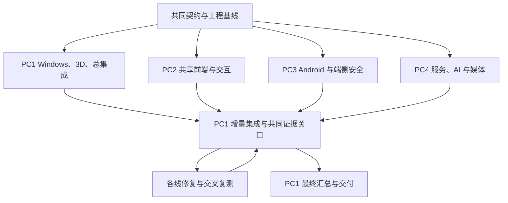

# 「微光指引」AI 公益助手项目实施计划：独立智能桌宠四机并发版

> 文档同步：2026-10-22。产品显示名称为**微光指引**；[当前功能与平台边界](docs/implementation/product-current-state.md)统一说明现行入口、已实现范围和待验证能力。本文已有测试数字与生成日期仍只对应原批次，不因文档更新自动视为重新验收。

## 2026-10-22 名称与实现状态补充

本文现行产品名称为微光指引，保留原需求版本和 CORE-01～12 作为目标基线。独立桌宠各功能应使用独立界面，不重排管理客户端。当前 Windows 默认花环水獭可静态预览，星云实时 3D 需本人启用；连续观察与单帧图像指引是不同流程，单帧需预览和确认发送，用户操作后重新截帧，不自动判定完成。需求中完整的通用软件教学、语音、双端/账号/亲情/同步和生成资产能力并非全部已实现或已验收，逐项以[当前产品状态](docs/implementation/product-current-state.md)和专项证据核对。

本轮仅更新名称及现状说明，不新增系统授权、不执行设备测试、不修改原始验收结论。旧文件名保留用于历史链接；正文引用的旧附件名并不代表它已复制到当前工作区。

| 项目 | 内容 |
| --- | --- |
| 文档版本 | V1.2，独立桌宠核心形态与四机并发执行版 |
| 修订日期 | 形态修订 2026-10-18；名称与现状同步 2026-10-22 |
| 产品依据 | 《暖伴AI公益助手-产品需求文档-独立桌宠版.md》，PRD V1.1 |
| 技术依据 | 《暖伴AI公益助手-技术与实施方案-独立桌宠版.md》，技术方案 V1.1 |
| 原实施基线 | 本次附件《暖伴AI公益助手-项目实施计划(6).md》及本会话已确定的四机并发分工 |
| 本次变更 | 按独立悬浮桌宠重写运行边界/验收，保留四机并发、目录所有权、增量集成与PC1最终汇总 |
| 功能保留 | 原96个工作包编号/名称及桌宠、绘画/生成、3D、输入、教学、对话/笔记、字幕、提醒、账号/同步/亲情等能力保留；活动/验收按本次确认细化 |
| 汇总电脑 | PC1：兼任 Windows/3D 开发与总集成，负责最终集成分支、全项目构建及交付汇总 |
| 时间口径 | 保留原 W1～W24 相对周作为预算参考；同一阶段四机并行、按真实前置和证据关口推进，不因日期到达自动通过 |
| 资源口径 | 四台电脑、四个独立工作目录与 Codex 会话；专业角色由四机承接，不再假定同时有八名人员 |
| 当前事实 | 仓库已有多阶段本地实现和定向验证；本轮只维护文档，真实设备/供应、完整连续教学及正式发布仍须逐项验收 |

**使用方法：** 四台电脑各持有同一份 PRD、技术方案和本计划，从 PC1 发布的同一工程基线开始。先按第 14 章启动，再只执行第 3 章分配给本机的任务；公共文件按第 5 章所有权规则修改；每个可验证增量按第 11 章交接，PC1 最后按第 10 章统一汇总。既有工程必须先检查和复用，不因本计划建议目录而重建项目。

**修订边界：** 保留原96工作包和全部既定模块，本次按用户确认修改其运行要求、相应活动与验收：真实系统级桌宠、本地观察/双唤起、按需云分析、真实软件泛化、本人掌握与确认后复习。四机主责不变，每项一台电脑对交齐负责，跨机子项供给可追踪。新增实证与协作的工作量另估，不冒充原482人日已足额覆盖；旧版表格逐字保留规则由本次明确变更替代。

**解释优先顺序：** PRD 功能和安全边界优先；技术方案的接口及平台边界继续有效；执行归属、文件权限与代码交接以本版为准。原角色 P/D/F/A/W/B/I/Q 表示专业职责，不表示八个并行人员；原周窗、角色人日与候选设备条件均是估算。任何进度调整不能替代真实验收。

## 本次确认的核心形态与统一规则

本版以 2026-10-18 本次对话中用户明确确认的内容为需求依据。微光指引是**悬浮在真实桌面及其他软件上方、理解当前屏幕并指导用户操作的独立智能桌宠**。Android/Windows 宿主承担系统运行、真实捕获与浮层；主界面承担设置、档案、绘画等管理。关闭管理窗口后，只要用户没有退出桌宠、系统条件及授权仍有效，驻留桌宠及本地观察可继续运行。

| 确认编号 | 产品与工程统一要求 |
| --- | --- |
| CORE-01 独立悬浮 | 桌宠、教学标记、语音/字幕和停止入口服务于真实系统桌面及外部软件；管理页面中的模拟手机界面不能作为核心产品或跨应用验收成果 |
| CORE-02 本地观察 | 用户明确开启并获本机系统授权后持续在本地观察；一次教学结束不自动停止用户仍授权的观察会话；退出/撤权/锁屏/进程终止/隐私暂停按清理规则停止，不在重启后自行恢复 |
| CORE-03 按需云分析 | 提问、显著页面变化或步骤核验触发必要画面的本地检测/脱敏与云分析；连续采集不等于连续上云，重复/过期帧不排成长队，原始帧不传云 |
| CORE-04 用户亲手操作 | 从桌面寻找应用、打开应用、导航到功能、点击或输入直至完成，全部由用户执行；光标/桌宠只指示，不自动启动目标第三方应用或注入输入 |
| CORE-05 通用软件理解 | 面向尽可能多的主流软件理解页面结构、控件含义与位置；Top20 是本地加速能力，不是仅允许这20项的产品范围；未预置软件也可在本地判安全后交云AI尝试，实际覆盖按测试公开 |
| CORE-06 双入口核验 | 自动观察到用户操作/页面变化以及用户点击“我点好了”都可触发核验；都须用当前新画面核对结果，不把按钮点击或旧画面直接视为成功 |
| CORE-07 不确定处理 | 支持重新观察、询问用户、展示明确标注不确定性的候选位置，由AI按当前情况选择；候选必须来自当前可定位控件，不能编造坐标，隐私/交易风险不能靠候选提示绕过 |
| CORE-08 隐私与恢复 | 在设备本地识别边界，敏感/未知/检测故障先关出口并停止相应屏幕采集和指引；用户本人明确点击“继续共享”后复核本机授权及新帧安全，满足后恢复；家属/模型/页面变化不能代为恢复 |
| CORE-09 双唤起 | 点击桌宠和语音唤醒均属于正式功能；语音唤醒在麦克风单独授权和系统允许的运行条件下采用本地唤醒检测，未唤醒的常听音频不持续上传云端 |
| CORE-10 完整教学记录 | 每次教学形成一次可追溯笔记，顺利完成、未完成和用户主动结束均记录实际结果；只存安全摘要。“已掌握”由用户本人明确确认，AI/家属/核验成功/练过不能代替确认 |
| CORE-11 复习确认 | AI 建议具体复习日期、时点及时区，用户确认后创建；不能自动替用户安排。原本人手建和获授权家属代建待办能力保留，并标明创建来源 |
| CORE-12 亲情协助 | 从驻留桌宠直接邀请家人；有效关系、当次本人确认与本机权限齐备后共享安全屏幕和语音；仍由用户亲手操作，风险保护对家属与AI出口同样生效 |

**运行边界：** 独立桌宠仍需要可安装的宿主和系统权限。系统不支持的浮层、后台/麦克风或捕获条件必须如实显示，不能以持续观察目标绕过权限。截图/DOM Mock 可用于单元测试、交互夹具与合成风险页，但外部桌面/第三方软件中的真实捕获、浮层、停止及用户操作证据是核心验收必需项。设备与软件的实测覆盖不足不删除产品目标，也不虚构“所有软件均已支持”。

## 目录

1. 项目总体实施概述
2. 项目实施阶段划分
3. 分阶段详细实施计划（完整 96 项任务及主责电脑）
4. 整体项目进度甘特式时间排期
5. 四台电脑分工、目录所有权与负载
6. 项目里程碑计划
7. 项目资源实施保障计划
8. 实施风险预判与进度保障措施
9. 测试实施计划
10. 最终汇总、上线与交付实施计划
11. 四机契约、Git 协作与变更管理
12. 需求追踪、未决事项与能力账本
13. 立项与答辩支撑安排
14. 四机启动提示词、断点续作与计划自检

## 执行摘要

微光指引面向老人、儿童和其他数字弱势群体，交付 Android 与 Windows 双端的多模态提问、桌宠和手绘可动 2D、电脑 3D 导入、一步一核验教学、AI 对话与笔记、字幕、待办复习，以及账号免密/认领、亲情协助、同步、后台通知和 Top 20 流程支撑。功能范围完全沿用三份资料，预留能力不扩为首期已接入能力。

执行分为四条长期开发线：**PC1 做 Windows/3D 与总集成，PC2 做共享前端与交互，PC3 做 Android 与端侧隐私安全，PC4 做后端、AI/语音、生成和协助媒体。** PC1 同时维护公共契约与工程基线；其他电脑向它提交协议变更请求，由其统一落地。四机各有明确目录和任务，不在同一工作目录同时改文件。

依赖顺序保留 A 契约准备 → B 前端与 C 原生/供应验证并行 → D 前端验收 → E 四线真实实现 → F 四线修复与 PC1 汇总。A～D 的 PC4 执行契约、供应沙箱和受控本地验证，不提前建设完整真实业务后端；D 通过后，四机同步进入各自 E 任务。每个增量尽早交 PC1 做构建和兼容检查，最终再统一验收，不等所有人全部做完才首次合并。

原估算 96 项共 482 任务人日保留，四机分配后的估算见第 3.8/5.3 节。四台电脑不等于四倍人力，不能直接将 24 周除以四；W1～W24 继续作参考预算，实际日期由可用人员、设备、供应和已验证吞吐滚动换算。工程性检查可由脚本和交叉复核推进，真实授权、供应凭证、签名和试点不能伪造。

## 1. 项目总体实施概述

### 1.1 建设必要性与实施目标

目标用户可能不会熟练输入、无法理解页面位置、担心误操作，家属与教师也无法持续陪同。仅提供文字答案难以解决“下一步点哪里”。微光指引的建设重点是将解释转为屏幕中的安全操作指引，并让用户亲手完成。桌宠负责亲切入口与陪伴，学习档案负责记忆与复习，亲情协助负责无法确定时的人工兜底。

| 建设目标 | 具体实现结果 | 评价方式与事实边界 |
| --- | --- | --- |
| 降低输入门槛 | 双端多模态输入、可停止状态和替代方式 | AT-01/02；不能以支持输入按钮代替真实理解 |
| 完成手把手教 | 一步一核验、老人光标、儿童指向、失效撤标 | AT-06～09；必须用户自行操作，无代点击 |
| 形成学习闭环 | 自动笔记、掌握来源、复习任务、提醒直达 | AT-13～17/24；练过不等于掌握 |
| 保障亲情兜底 | 当前有效关系、分项授权、当次屏幕与语音协助 | AT-18/19；无接听不能写已解决 |
| 保持隐私与安全 | 本地检测先于传输、风险熔断、停止真实清理 | AT-10～12/22/23；不能保证任意敏感页百分之百识别 |
| 支持持续公益运营 | 本地流程复用、用量统计、维护与成本预算 | AT-20/24及试点报告；效果与成本按真实数据确认 |

### 1.2 范围基线与交付边界

| 类别 | 本计划安排 |
| --- | --- |
| 当前完整基线 | 六大模块；账号免密/人脸验证/代注册/社区认领；基础亲情授权与远程协助；双端同步；后台与通知；Top 20；端云路由；配置、审计、最小化统计 |
| 双端共用 | 独立驻留桌宠、点击/本地语音唤起、本地观察、按需云分析，以及输入/2D/绘画生成/真实跨应用教学/对话/笔记/字幕/复习/账号/亲情；人群模式不绑定设备 |
| 电脑扩展 | 3D 导入；规格按 VRM/FBX/GLB 的版本、骨骼、材质和预算验证，手机回退 2D 不改账号模式 |
| 架构预留 | 星云 SDK、AnySearch、机构服务管理/聚合指标端口；不纳入首期已接入成果 |
| 后续方向 | 完整多老人亲情体系、方言、防诈课堂、可打印步骤卡及完整机构后台 |
| 排除 | iOS、手机 3D、志愿者通道、代点击/代付款/代决策、收费解锁、诱导广告 |

公共运行需求新增 FLOAT-01/OBS-01/WAKE-01；六模块需求编号继续为 IN-01～06、PET-01～04、GUIDE-01～04、SAFE-01、CHAT-01、NOTE-01～02、SUB-01～03、TODO-01～03；支撑编号为 ACC-01～02、HELP-01、SYS-01、FLOW-01。完整映射见第 12 章。

### 1.3 技术与安全实施原则

共享管理界面和宿主驻留核心分别装配，各自通过相同Schema/平台/服务端口工作；Android驻留协调以Kotlin实现同规范/向量，Windows在main/媒体进程，不能依赖管理WebView/renderer。Mock/真实服务集中装配，apiMode 与 platformMode 独立。系统权限只能由原生回调确认。DOM 不承担跨应用绘制，页面 timer 不承担正式通知。A～D 只做契约、Mock、前端和原生验证夹具，不提前建设完整真实业务后端。

所有拟发送画面必须先进入本地检测脱敏，再进入 AI 或亲情媒体出口；未知、失败或无法可靠脱敏就暂停。密码/私人聊天暂停共享与相关画面指导；支付/转账/验证码停止相关教学及绕过路径，按技术方案暂停相关协助媒体并提示电话确认。医疗、用药、投资、理财不作决策；用药仅复述用户或家属设定内容。

停止操作依次关闭发送门、失效代际、取消请求、清待发队列、停相应采集/媒体、清指引与播报、更新状态。撤权、锁屏、终止与重启不得静默恢复。任何候选步骤须绑定当前帧、窗口、显示器与变换；“我点好了”只触发核验。关系、档案授权、当次共享与系统权限分别建模。

### 1.4 实施前提与估算假设

| 编号 | 当前计划假设 | 决策时点与失效影响 |
| --- | --- | --- |
| H01 时间 | 每周 5 个工作日、每天 8 小时；W1 未绑定日历日期；节假日由开工时换算 | W1 确认日历；不可直接以文档日期充当开工日 |
| H02 人员 | 四台电脑承接八类专业职责；四个会话不是八名人员，不以设备数量推定 FTE | 开工检查四机工具链与实际人员容量；按第 5.3 节合并负载重排 |
| H03 估算 | WBS 为自底向上工作量，时间窗含设计/实现/验证准备；不是实测工时 | W2 冻结首版，W9 依据原生证据复估 |
| H04 平台 | 首验 Windows 11 x64；Android 最低版本与厂商范围沿方案候选验证 | W2 确定测试清单，W8 输出可行范围，W20冻结发布范围 |
| H05 供应 | W2 申请、W5 前形成认证/AI/语音/生成验证结论；W10 前生产接入条件齐备 | 晚到直接影响 C12/E01/E08/E09，不假设无限可替换 |
| H06 内容 | W8 前完成 Top 20 清单/应用版本/风险断点评审，E 阶段真实适配 | 清单不齐不得声称 20 项适配完成；影响 E18/E20/E24 |
| H07 试点 | W8 形成合作候选，W17 明确场地/对象/同意与设备，W21 通过准入后开展 | 未签合作就延期试点，不能编造用户反馈 |
| H08 预算 | 尚无金额上限；按用量与角色费率询价、估算和审批 | W2 确定验证预算，W10 前确认接入与试点预算 |
| H09 安全 | 原生门控与受控媒体在 D 前具有可复现可行性证据；发布范围可界定 | 失败是路线阻塞，禁止通过删检测/传原始轨道补进度 |
| H10 数据与授权 | 监护、认领、留存/删除和供应保留条款在真实处理前确认 | 未确认只推进合成演示/独立工作，不开展受阻真实处理 |

### 1.5 四机并发与最终汇总的定义

这里的“并发”指四个独立开发节点按相同契约同时实现不同子系统，不将产品改成四个独立应用，不要求用户运行四台电脑才能使用微光指引。最终交付仍是共享代码、Android 包、Windows 包和统一业务服务。

PC1 的集成职责贯穿全过程：先发基线、接收各线提交、检查协议与构建，最后汇总源码、双端包、服务和证据。PC2/PC3/PC4 在最终阶段继续修复本机模块，不因“交给汇总机”而退出；PC1 负责装配和定位，不独自重写其他三条线。

### 1.6 本次核心形态对执行计划的约束

每个阶段都必须围绕独立桌宠构建：主界面是可关闭的管理窗口，真实桌面/外部软件才是核心指导对象。前期Mock可以替服务、不可以替最终真实屏幕/跨应用浮层证据。Android核心由原生运行服务协调，不挂在WebView；Windows由驻留主进程/媒体进程协调，不挂在management renderer。

四机继续执行：PC1 Windows/3D/公共协议和总集成，PC2共享管理UI/2D/业务规范与向量，PC3 Android原生运行/本地观察/端侧隐私唤醒，PC4后端AI/语音/生成/媒体。所有改动落到原任务子项，不新建互不相干的四套产品。原482人日、24周只保留参考，新增驻留/唤醒/泛化实证与Kotlin对等协调实现须在A/C出口复估。

## 2. 项目实施阶段划分

| 阶段/原参考周窗 | PC1：Windows/总集成 | PC2：共享前端/交互 | PC3：Android/端侧安全 | PC4：后端/AI/媒体 | 共同出口 |
| --- | --- | --- | --- | --- | --- |
| A，W1～2 | 需求索引、契约与版本、仓库/CI、Windows 骨架，协调资源 | tokens、原型、共享 UI 消费端和 Mock 需求 | Android 骨架、测试基线、端侧安全向量 | 供应与媒体规格、认证/服务边界说明 | G0/M02：四机能基于同一基线构建本机最小样例，契约 v0.1 冻结 |
| B/C，W3～8，并行 | Windows 捕获/窗口/多屏/坐标/存储/通知/3D；增量集成 | 六模块及支撑页、画布、Mock、组合根、前端测试 | Android 权限/捕获/浮层/坐标/存储/通知；本地检测模型和 NV 汇总 | 认证/语音/生成沙箱、受控媒体双出口样例、后端交接设计 | G1/M03～M04：UI 可演示，关键原生与供应验证有真实证据或明确阻塞 |
| D，W9 | 冻结契约，收齐 Windows 证据，执行 D07 汇总决策 | 前端候选/重置和无障碍交接 | Android 证据，D01 前端/原生复核 | 媒体/供应结论和后端交接 | G2/M05：D01～D08 条件逐项通过后才进入 E |
| E，W10～17，四线并行 | Windows 生产化、3D/认证/Top20、公共装配集成 | remote 适配、同步/亲情视图、生成/字幕、资源和无障碍 | Android 生产化、Top20/认证/2D、端侧模型固化、安全审计 | 业务单体/任务进程、认证/关系/同步/提醒、AI/ASR/TTS/生成/媒体 | G3/M06：真实模块候选、契约与模块测试齐备；功能缺口继续保留 |
| F，W18～24 | Windows 联调修复、接收四线、构建汇总、最终验收/发布交付 | 前端联调修复、试点候选/反馈、培训和代码交接 | Android 联调修复、性能/隐私/恢复专项、签名包 | 服务/AI/媒体联调修复、恢复/回滚、供应运维交接 | G4/M07 试点准入；G5/M09 发布准入；M10 真实签收 |



图中的四线在每个阶段内按相应职责工作，PC4 的真实业务实现受 D 关口约束。前端交互、原生可行和生产闭环分层验收，任何一层都不能替另一层。可提前准备下阶段测试与设计，不能跳过 FS 前置或将未测项目填为通过。

## 3. 分阶段详细实施计划

### 3.1 WBS、估算与并行规则

以下保留原96工作包编号与名称，各模块功能继续交付；工作活动/验收按本次CORE-01～12细化，原“主责电脑”继续作为跨机调度依据；“原专业角色”仅说明专业类型：P 项目/产品、D 设计、F 前端、A Android、W Windows、B 后端/运维、I AI/媒体、Q 测试/安全。每项原人日与周窗是原预算参考，不代表四机重新排程已通过容量验证。

FS 表示前项完成才开始，SS 表示可与前项开始后并行，FF 表示最终交付必须等待前项完成。跨机任务仍按这些关系推进；开发可使用冻结契约的夹具，真实联调必须等待真实生产者。主责电脑收齐本任务所有子项和证据，不等于独自实现双平台代码。

同一行涉及多个平台时，按第 5 章拆成有归属的子项，例如 C04.android 由 PC3、C04.windows 由 PC1 提供安全源实现，C04.signal/relay 由 PC4 提供；C04 主责 PC4 对完整媒体验证交齐负责。子项不能替代或减少原工作包。证据写 `docs/acceptance/<WBS>/<PC>/`，同一路径仅一台电脑写；主责在 `docs/acceptance/<WBS>/index.md` 汇总。原始凭证和秘密媒体不进入交接。

### 3.2 阶段 A 工作包

| WBS/工作包 | 需求与输入依赖 | 周窗/历时 | 原专业角色/估算人日 | 主责电脑 | 执行活动与输出 | 验收证据 | 风险/接入点 |
| --- | --- | --- | --- | --- | --- | --- | --- |
| A01 范围与假设基线 | 全基线/Q-01～15；前置 无 | W1～1 / 1周 | P / 3 | PC1 | 核对三份资料，列差异与决策时限；交付：范围/假设/决策登记 | 六模块和支撑能力逐项认领 | 未决事项进入关口 |
| A02 架构与服务契约评审 | ACC/HELP/同步；前置 A01：SS | W1～2 / 2周 | B / 4 | PC1 | 冻结领域边界、HTTP/SSE/WS及错误语义；交付：契约评审/ADR；本次落实：冻结独立驻留/管理分离、观察/任务父子代际、本地触发/安全帧及本人确认契约 | 无供应密钥入客户端；契约可校验；FLOAT/OBS/WAKE契约与原六模块可追踪 | 只设计，不建业务后端 |
| A03 Schema、端口与确定性 Mock | IN/CHAT/GUIDE；前置 A02：SS | W1～2 / 2周 | F / 5 | PC1 | 定义DTO/事件、模拟场景和独立模式开关；交付：Schema/Mock/组合根；本次落实：增加observation/runtime/wake/trigger/UIElement/复习建议Schema及双核验/不确定候选夹具 | 输入输出校验；成功失败可重放；原生权限不可Mock；夹具不作为真实跨应用验收 | 真实失败禁回退Mock |
| A04 验收设计与安全素材 | AT-01～30/NV-01～13；前置 A01：SS | W1～2 / 2周 | Q / 5 | PC3 | 设计测试、合成风险页、计数与canary；交付：测试基线/证据模板；本次落实：补AT-25～30及NV-13、真实外部软件来源/管理窗关闭/持续本地观察证据模板 | 每个AT/NV对应任务和证据；新增六项验收与原全部用例有主责/平台 | 无真实秘密测试数据 |
| A05 设计系统与人群交互 | PET/SUB/无障碍；前置 A01：SS | W1～2 / 2周 | D / 4 | PC2 | 输出大字/大按钮/浮层避让及减少动态；交付：tokens/原型/话术；本次落实：设计独立桌宠气泡/原生输入/候选标记/本人继续共享，管理窗口按需打开 | 老人儿童及家属界面均可评审；真实应用目标和停止入口不遮挡 | 不以装饰遮挡停止 |
| A06 Android 工程与端口骨架 | SYS/IN；前置 A02：SS | W1～2 / 2周 | A / 4 | PC3 | 构建宿主和桥接最小样例；交付：可安装测试APK；本次落实：建立Android原生驻留runtime/observation/wake协调骨架，不依赖管理Activity/WebView | 桥来源受控，权限由系统产生；管理窗关闭后原生桌宠可交互；退出执行清理 | 尚不含真实业务 |
| A07 Windows 工程与窗口骨架 | SYS/PET；前置 A02：SS | W1～2 / 2周 | W / 4 | PC1 | 创建主窗/浮层/IPC和捕获实验入口；交付：桌面最小包；本次落实：建立Windows驻留主进程/桌宠独立窗/管理窗分离骨架 | 沙箱/IPC白名单可检查；关闭管理窗不退出桌宠，核心呈现失效可安全停止 | 平台假设待真机确认 |
| A08 安全模型与供应适配设计 | SAFE/PET/CHAT；前置 A02：SS | W1～2 / 2周 | I / 4 | PC4 | 设计本地检测/生成/语音/媒体端口及样本；交付：适配规格/样本清单；本次落实：定义本地唤醒/页面变化触发与通用控件理解端口，原始帧不出端 | 门控位于发送前；供应能力未伪称；常听音频本地；云分析只用必要安全帧 | 真实依赖在C验证 |
| A09 资源与试点申请 | Q-01/02/04/05/15；前置 A01：FS | W2～2 / 1周 | P / 3 | PC1 | 预约设备、供应沙箱、授权与试点窗口；交付：申请表/到位时间 | 关键资源有责任人和截止 | 无凭证不阻断其他工作 |
| A10 工具链与契约发布基线 | 工程/ADR；前置 A02：SS，A03：FF | W2～2 / 1周 | B / 2 | PC1 | 锁版本并验证DTO生成/构建夹具；交付：工具链锁/契约v0.1 | 可复现构建；版本来源可追溯 | 不声称最新政策已复核 |

### 3.3 阶段 B 工作包

| WBS/工作包 | 需求与输入依赖 | 周窗/历时 | 原专业角色/估算人日 | 主责电脑 | 执行活动与输出 | 验收证据 | 风险/接入点 |
| --- | --- | --- | --- | --- | --- | --- | --- |
| B01 UI 路由与应用装配 | 共享管理UI与驻留呈现契约；前置 A03/A05：FS | W3～3 / 1周 | F / 3 | PC2 | 搭页面骨架、账号隔离装配与状态组件；交付：可启动共享UI；本次落实：管理UI装配与独立桌宠呈现契约分离，不将核心做成仿手机页 | 两开关独立，组件不读fixture；UI可Mock演示，原生跨应用证据另验 | 接入点集中组合根 |
| B02 多输入、流式对话与字幕 | IN-01～06/CHAT/SUB；前置 B01：FS | W4～5 / 2周 | F / 5 | PC2 | 完成输入交互、流式中断、静音和重讲；交付：对话/字幕可演示；本次落实：接点击/语音唤起事件与桌宠气泡，语音常听不经云 | 迟到事件不复活；TTS失败可读；双入口/字幕保留；原生唤醒供应在C实测 | 输入捕获由C提供 |
| B03 桌宠、绘画与生成任务交互 | PET-01～04；前置 B01：FS | W4～6 / 3周 | F / 3 | PC2 | 完成草稿、工具、微调、任务状态和确认；交付：桌宠/画布/任务页 | 失败保草稿；静态占位明确 | 真实生成E接入 |
| B04 教学与风险状态界面 | GUIDE/SAFE；前置 B02：FS | W6～7 / 2周 | F / 3 | PC2 | 实现一步指引、核验入口、风险暂停与兜底；交付：教学交互闭环；本次落实：双入口核验、重看/询问/不确定候选、本人恢复按钮 | 点好了只核验；停止始终可达；我点好了只触发新帧核验；候选不冒充确认 | 原生标记由C接入 |
| B05 档案、待办和复习界面 | NOTE/TODO；前置 B02：FS | W6～8 / 3周 | F / 4 | PC2 | 实现筛选/状态来源/时间确认/深链与冲突页；交付：学习闭环UI；本次落实：每次教学笔记、本人掌握、AI建议具体时间确认后排程 | 练过不等于掌握；断链可恢复；同主题各次保留；家属无代改掌握入口 | 同步与调度E接入 |
| B06 账号、家属与协助界面 | ACC/HELP；前置 B03：FS | W7～8 / 2周 | F / 3 | PC2 | 实现登录路径、分scope授权、邀请/断线/结束；交付：亲情交互UI；本次落实：从驻留桌宠发起当次亲情协助 | 不把关系等同本次共享许可；关系/当次同意/系统权限分别确认 | 真实认证与媒体E接入 |
| B07 前端交互整合与修正 | PRD场景A/B/C；前置 B04：FS，B05/B06：FF | W8～8 / 1周 | F / 1.5 | PC2 | 整理三场景和已知限制；交付：演示候选包；本次落实：演示拆分管理交互夹具和真实外部桌宠片段 | 无真实业务后端可启动；内部模拟页面不能作为外部桌宠已实现 | 原生与服务状态分开 |
| B08 适老适幼及绘画资产设计 | PET/SUB/GUIDE；前置 A05：FS | W3～6 / 4周 | D / 6 | PC2 | 交付交互/2D动作样例/字幕布局；交付：设计与可授权素材 | 减少动态、读屏替代与避让可评审 | 资产不冒充AI生成 |
| B09 全页面无障碍复核 | 无障碍/AT-15；前置 B08：FS | W7～8 / 2周 | D / 3 | PC2 | 复核大字号、焦点、文案、纯字幕；交付：问题单与修订 | 关键内容不只靠颜色/声音 | Q独立复测 |
| B10 组件/契约/Mock E2E | AT-01～30前端层；前置 A04：FS，B01～B07：SS/FF | W3～8 / 6周 | Q / 10 | PC2 | 随页面交付增量测试成功与异常场景；交付：前端测试报告；本次落实：补AT-25～30可测交互/契约层和关闭管理窗场景输入 | 场景可重置，未接入明确；前端通过不替NV-13实机 | 只验前端层，不计真实通过 |
| B11 需求澄清与演示评审 | Q-01～15；前置 A09：FS | W3～8 / 6周 | P / 6 | PC1 | 每周评审范围/话术/流程与未决事项；交付：评审/决策记录 | 无新增隐性范围，决策有时限 | 不提前承诺上线 |

### 3.4 阶段 C 工作包

| WBS/工作包 | 需求与输入依赖 | 周窗/历时 | 原专业角色/估算人日 | 主责电脑 | 执行活动与输出 | 验收证据 | 风险/接入点 |
| --- | --- | --- | --- | --- | --- | --- | --- |
| C01 Android 捕获与浮层验证 | NV-01/02/IN/SYS；前置 A06：FS | W3～4 / 2周 | A / 8 | PC3 | 真实授权、跨应用捕获/绘制及触摸验证；交付：最小样例/设备报告；本次落实：手机真实桌面/外部软件捕获/浮层；用户亲手找应用并打开 | 原应用可操作，敏感系统界面不绕过；无第三方自动启动/触摸注入；管理Activity可关闭 | 失败阻断Android教学 |
| C02 桌面窗口/捕获/多屏验证 | NV-03/IN/SYS；前置 A07：FS | W3～4 / 2周 | W / 8 | PC1 | 透明窗/穿透/置顶/捕获与DPI实验；交付：窗口与捕获报告；本次落实：Windows真实桌面/外部窗口捕获和独立桌宠，管理窗关闭 | 混合DPI/负坐标证据完整；捕获源非DOM/仿手机，原软件可正常点击 | 失败触发桌面ADR |
| C03 本地敏感检测与脱敏样例 | NV-06/SAFE；前置 A08：FS | W3～5 / 3周 | I / 9 | PC3 | OCR/规则/模型、未知页和故障注入；交付：本地检测门控样例；本次落实：持续本地观察的安全门/变化事件与按需帧，未知软件名不等于隐私unknown | 未判安全不发；人脸脱敏失败暂停；每拟发帧检测，未知风险不传云，原始帧不留存 | 覆盖不足范围禁共享 |
| C04 受控媒体源与中继样例 | NV-07/HELP；前置 C03：FS，C01/C02：FS | W6～8 / 3周 | I / 9 | PC4 | 安全帧先检测再编码，接本地测试端；交付：双出口/停止竞态报告；本次落实：观察帧按事件用于AI，家属媒体单独用途同安全门 | 原始轨道无直传，结束无新发送；AI与家属双出口；隐私暂停/本人恢复实测 | 仅验证端，不建业务后端 |
| C05 Android 坐标与儿童指向 | NV-08/09/GUIDE；前置 C01：FS | W5～6 / 2周 | A / 5 | PC3 | 处理旋转/裁剪、目标失效、用户核验；交付：原生教学样例；本次落实：真实桌面图标到软件内按钮，自动/手动核验均用新帧 | 旧坐标撤销、无输入注入；当前真实控件/语义和坐标核对，不自动启动应用 | 正式流程后续适配 |
| C06 Windows 坐标与儿童指向 | NV-08/09/GUIDE；前置 C02：FS | W5～6 / 2周 | W / 5 | PC1 | 变换/跨屏/动画终止/目标避让；交付：桌面教学样例；本次落实：真实桌面/第三方窗口当前控件结构与重定位 | 位置与帧/窗口版本一致；无DOM假目标，用户亲手打开/操作 | 不把DOM当跨应用能力 |
| C07 Room、权限与本地提醒 | NV-02/本地数据/TODO；前置 C01：FS | W5～8 / 4周 | A / 5 | PC3 | 本地仓储/账号隔离/迁移/系统调度；交付：真实本地数据与通知 | 拒绝通知可解释，timer不冒充系统调度 | 云同步未接入 |
| C08 SQLite、资源与桌面提醒 | 本地数据/TODO/SYS；前置 C02：FS | W5～8 / 4周 | W / 5 | PC1 | 实现仓储/密钥保护/通知生命周期样例；交付：本地持久化/通知报告 | 退出/睡眠/重启限制如实列明 | 只支持实测矩阵 |
| C09 Android 生命周期清理 | NV-04/05/SAFE；前置 C05：FS，C07：SS | W7～8 / 2周 | A / 4 | PC3 | 锁屏/撤权/进程终止/自身浮层污染实验；交付：清理与捕获报告；本次落实：Android驻留/管理分离、持续观察/本地唤醒、隐私停采集/本人恢复、NV-13 | 关闭出口→失效代际→清队列→停轨；关闭管理窗可用；显式退出/撤权/锁屏停；重启不恢复观察/mic | 重启不恢复采集 |
| C10 Windows 生命周期清理 | NV-04/05/SAFE；前置 C06：FS，C08：SS | W7～8 / 2周 | W / 4 | PC1 | 锁屏/停止/窗口移动/递归捕获实验；交付：清理与捕获报告；本次落实：Windows驻留/管理分离、持续观察/本地唤醒、隐私停采集/本人恢复、NV-13 | 停止后无新出队，失效标记隐藏；独立桌宠源/浮层证据；管理窗关闭不失效；退出停全链路 | 已发帧无法撤回 |
| C11 3D 导入可行性样例 | NV-10/PET-03；前置 C02：FS | W6～8 / 3周 | W / 2 | PC1 | 三格式样本、外链/坏文件/预算验证；交付：支持规格草案 | 按版本材质骨骼验，不只看扩展名 | 正式资源适配留E/F |
| C12 认证/语音/生成供应沙箱验证 | NV-11/12/Q-04/06/15；前置 A08/A09：FS | W3～5 / 3周 | I / 3 | PC4 | 验证可用凭证/质量/取消/活体及替代登录；交付：供应验证与缺口报告；本次落实：验证本地唤醒模型/许可/误唤醒和事件触发AI夹具 | 无凭证标阻塞，不伪称已接入；点击与语音正式双入口均留缺口/实测状态 | 调用夹具非真实业务服务 |
| C13 儿童指向/生成资产质量规则 | NV-09/10/PET；前置 B08：SS，C05/C06：SS | W5～8 / 4周 | D / 3 | PC2 | 定义可动资产和五官/动作/配色验收；交付：资产规范/样本评分表 | 静态晃动不算手绘生成完成 | 供应不合格需重估 |
| C14 后端契约评审与交接准备 | 同步/ACC/HELP；前置 A02：FS，C12：SS | W5～8 / 4周 | B / 4 | PC4 | 审核接口、权限/幂等/媒体租约边界；交付：后端交接草案 | 只形成设计/夹具，不建业务后端 | D后再实现 |
| C15 NV 实测与安全副作用复核 | NV-01～13；前置 A04：FS，C01～C12：SS/FF | W3～8 / 6周 | Q / 14 | PC3 | 测试设计随样例执行，收集计数/抓包证据；交付：逐项NV报告；本次落实：汇总NV-13和AT-25～30原生层，检查未预置外部软件样例 | AI与亲情双出口均验；无设备不判通过；桌宠与捕获真实，管理窗关闭/原始帧零外发 | 关键失败不得过D |
| C16 Top 20 与监护/试点决策 | Q-02/05/10/11/14；前置 A09：FS | W3～8 / 6周 | P / 6 | PC1 | 形成清单/应用版本/风险断点与授权流程；交付：20项范围/试点协议草案；本次落实：Top20作为本地加速清单，另设主流软件泛化覆盖表 | 清单获评审；不宣称已适配20项；未预置软件安全时可AI尝试，不将20项当白名单 | 缺失影响E适配与F试点 |
| C17 共享仓储与桥接装配 | 本地数据/IN/GUIDE；前置 B01：FS，C01/C02：SS | W4～5 / 2周 | F / 2 | PC2 | 接入真实平台端口与账户隔离规则；交付：native模式组合根；本次落实：管理UI桥与原生驻留快照/事件装配分离 | 系统权限不得由Mock伪造；管理UI关闭不持有核心协调；原生账户/权限事实权威 | 与页面服务开关独立 |

### 3.5 阶段 D 工作包

| WBS/工作包 | 需求与输入依赖 | 周窗/历时 | 原专业角色/估算人日 | 主责电脑 | 执行活动与输出 | 验收证据 | 风险/接入点 |
| --- | --- | --- | --- | --- | --- | --- | --- |
| D01 前端与原生验收复核 | 全基线/AT前端层/NV；前置 B07/B10/C15/C16：FS | W9～9 / 1周 | Q / 3 | PC3 | 复核交付、缺口与可复现证据；交付：D交接包/能力账本；本次落实：核对独立桌宠核心实证/关闭管理窗/NV-13 | 无真实业务后端可跑；核心原生有结论；内部模拟手机不能充当核心验收成果 | 未过关不进入E |
| D02 契约冻结与后端交接 | 全基线/AT前端层/NV；前置 B07/B10/C15/C16：FS | W9～9 / 1周 | B / 2 | PC1 | 复核交付、缺口与可复现证据；交付：D交接包/能力账本；本次落实：冻结新增观察/唤醒/触发/控件语义/本人确认契约 | 无真实业务后端可跑；核心原生有结论；跨三层/TS-Kotlin消费者兼容 | 未过关不进入E |
| D03 前端候选包与重置说明 | 全基线/AT前端层/NV；前置 B07/B10/C15/C16：FS | W9～9 / 1周 | F / 1 | PC2 | 复核交付、缺口与可复现证据；交付：D交接包/能力账本 | 无真实业务后端可跑；核心原生有结论 | 未过关不进入E |
| D04 Android证据与限制交接 | 全基线/AT前端层/NV；前置 B07/B10/C15/C16：FS | W9～9 / 1周 | A / 1 | PC3 | 复核交付、缺口与可复现证据；交付：D交接包/能力账本；本次落实：Android驻留原生协调和本地观察实测交接 | 无真实业务后端可跑；核心原生有结论；真实外部软件/点击语音/停止恢复边界有证据 | 未过关不进入E |
| D05 Windows证据与限制交接 | 全基线/AT前端层/NV；前置 B07/B10/C15/C16：FS | W9～9 / 1周 | W / 1 | PC1 | 复核交付、缺口与可复现证据；交付：D交接包/能力账本；本次落实：Windows驻留桌宠/管理窗分离交接 | 无真实业务后端可跑；核心原生有结论；实际桌面/外部软件源和独立运行有证据 | 未过关不进入E |
| D06 媒体/供应能力结论交接 | 全基线/AT前端层/NV；前置 B07/B10/C15/C16：FS | W9～9 / 1周 | I / 1 | PC4 | 复核交付、缺口与可复现证据；交付：D交接包/能力账本 | 无真实业务后端可跑；核心原生有结论 | 未过关不进入E |
| D07 D关口范围与启动决策 | 全基线/AT前端层/NV；前置 B07/B10/C15/C16：FS | W9～9 / 1周 | P / 2 | PC1 | 复核交付、缺口与可复现证据；交付：D交接包/能力账本；本次落实：把CORE-01～12和新增实证加入启动检查 | 无真实业务后端可跑；核心原生有结论；独立桌宠关键NV/原生证据不齐则No-Go，不以仿手机演示过关 | 未过关不进入E |
| D08 体验与无障碍签收 | 全基线/AT前端层/NV；前置 B07/B10/C15/C16：FS | W9～9 / 1周 | D / 1 | PC2 | 复核交付、缺口与可复现证据；交付：D交接包/能力账本 | 无真实业务后端可跑；核心原生有结论 | 未过关不进入E |

### 3.6 阶段 E 工作包

| WBS/工作包 | 需求与输入依赖 | 周窗/历时 | 原专业角色/估算人日 | 主责电脑 | 执行活动与输出 | 验收证据 | 风险/接入点 |
| --- | --- | --- | --- | --- | --- | --- | --- |
| E01 身份、设备与辅助开通 | ACC-01/NV-12；前置 D07：FS | W10～12 / 3周 | B / 9 | PC4 | 实现运营商/人脸适配、挑战、认领与社区批次；交付：真实认证模块 | 服务端验证证明、防重放与撤销 | 凭证/核验方案须到位 |
| E02 关系、同意与协助信令 | ACC-02/HELP；前置 E01：FS | W13～14 / 2周 | B / 5 | PC4 | 分scope授权、监护、邀请/租约/撤权；交付：关系/信令API | 每次查当前关系，过期邀请拒绝 | 媒体出口仍在端侧 |
| E03 笔记、复习与待办服务 | NOTE/TODO；前置 E01：FS | W13～15 / 3周 | B / 5 | PC4 | 持久化、掌握来源、版本/幂等和深链对象权限；交付：学习业务API；本次落实：每次教学笔记按guide_id幂等；仅本人掌握；复习建议经确认建任务 | 任务完成不自动掌握，跨owner拒绝；AI/家属改mastery拒绝，未确认建议无实例 | 与同步共用版本 |
| E04 增量同步与冲突 | AT-21/同步；前置 E03：SS，E01：FS | W15～16 / 2周 | B / 4 | PC4 | mutation/outbox/游标/tombstone与冲突；交付：真实同步API | 重复不多建，删除不复活 | 不能按owner_id直接授权 |
| E05 提醒调度与推送补偿 | TODO-03/SYS；前置 E03：FS，E04：SS | W16～17 / 2周 | B / 4 | PC4 | 实例、投递回执、任务恢复/去重；交付：提醒worker/回执API | submitted与delivered/opened分开 | 厂商可达性F验证 |
| E06 资产任务与签名流程发布 | PET/FLOW；前置 E02/E03：FS | W17～17 / 1周 | B / 2 | PC4 | 实现任务/资源ACL、配置签名/回滚接口；交付：资产/配置API | 坏包不覆盖旧包；取消产物不应用 | 复用E07任务设施 |
| E07 服务骨架、迁移与任务设施 | 后端/运维；前置 D02/D07：FS | W10～11 / 2周 | B / 2 | PC4 | 建模块单体、DB、outbox/任务与环境隔离；交付：独立服务与迁移 | 可启动/回滚夹具，密钥不进仓库 | 同E01按日先骨架后模块 |
| E08 真实多模态、ASR/TTS编排 | IN/CHAT/SUB；前置 D06/D07：FS | W10～12 / 3周 | I / 9 | PC4 | 接供应服务、句段/取消/限流/内容约束；交付：AI/语音适配器；本次落实：提问/变页/核验触发真实多模态控件理解，点击/本地唤醒后本轮语音 | 取消旧流；TTS失败保字幕；非连续云屏幕视频；不上传未唤醒常听音频 | 供应条款/预算先确认 |
| E09 真实手绘与偏好生成 | PET-01/02；前置 E08：FS，C13：FS | W13～15 / 3周 | I / 7.5 | PC4 | 实现可查询/取消任务与可动2D资产验证；交付：真实生成链路 | 样本质量合格，确认前不替旧形象 | 静态占位不能交付 |
| E10 亲情受控媒体生产适配 | HELP/NV-07；前置 E02：FS，E09：SS | W15～17 / 3周 | I / 6 | PC4 | 实现安全源、TURN会话/租约、断线结束；交付：真实媒体适配器 | 交易停相关媒体；撤权不续租 | 验证旧allocation回收 |
| E11 本地检测模型与策略固化 | SAFE/NV-06；前置 C03/D06：FS | W10～12 / 3周 | I / 4 | PC3 | 打包受控模型/规则、监控故障与覆盖；交付：门控规则与模型包；本次落实：固化通用本地页面检测/脱敏及显著变化触发、父子代际 | 未知/超时/坏模型不放行；未知软件可安全分析；本地风险unknown不放行 | 明确支持页面边界 |
| E12 供应配额、成本与故障隔离 | Q-15/成本；前置 E08：FS，E10：SS | W16～17 / 2周 | I / 2 | PC4 | 统计最小用量、设置预算与降级；交付：预算/故障仪表口径 | 不含原文；超额不引入收费解锁 | 异常进入F故障演练 |
| E13 Mock逐项替换与接口装配 | IN/CHAT/NOTE/TODO/ACC；前置 D03/D07：FS | W10～13 / 4周 | F / 10 | PC2 | 逐端口接真实服务，早于API时先跑契约夹具；交付：remote候选客户端；本次落实：管理客户端和宿主驻留的真实适配各自装配，PC3原生Kotlin消费 | 页面不重写；真实失败不回退Mock；关闭管理窗仍由宿主核心发起真实请求 | 仅已通过契约接口启用 |
| E14 真实同步/提醒/亲情视图 | NOTE/TODO/ACC/同步；前置 E13：FS，E02/E03/E04：SS | W14～16 / 3周 | F / 6 | PC2 | 实现冲突确认/撤权/正确深链；交付：跨端学习视图；本次落实：本人掌握确认、完整每次笔记与复习建议确认状态 | 权限/未同步状态诚实可见；家属档案/待办scope不开放mastery；未确认不排程 | 跨端实测在F |
| E15 生成、协助与浮层业务整合 | PET/HELP/GUIDE；前置 E13：FS，E09/E10：SS | W14～17 / 4周 | F / 5 | PC2 | 接任务与媒体事件，协同字幕/风险提示；交付：真实功能候选包；本次落实：桌宠气泡/独立浮层真实服务、双入口核验、候选样式/本人继续共享 | 取消/断线/风险状态无残留；不将服务只接入管理页或模拟手机 | 原生能力由A/W负责 |
| E16 真实接口兼容回归 | 契约/AT前端层；前置 E14：FS，E15：FF | W17～17 / 1周 | F / 2 | PC2 | 跑Schema/事件/异常契约回归；交付：客户端契约报告 | 不符协议拒绝并报错 | E出口必交 |
| E17 Android原生生产化 | IN/GUIDE/SAFE/SYS；前置 D04/D07：FS | W10～17 / 8周 | A / 16 | PC3 | 固化权限/捕获/门控/坐标/通知/安全存储；交付：Android候选包；本次落实：Android原生驻留协调/观察/唤醒/云触发，闭管理窗仍跨应用工作 | 系统状态与停止副作用正确；原生无隐藏WebView核心依赖；退出/隐私/撤权清理 | 不承诺所有厂商保活 |
| E18 Android流程/认证/资产适配 | FLOW/ACC/PET；前置 E17：SS，C16：FS | W12～17 / 6周 | A / 8 | PC3 | 适配Top20、认证桥与2D生成资源；交付：目标应用适配包；本次落实：Top20与未预置主流软件的安全泛化样例 | 每项流程有版本/风险断点；软件结构/控件/真屏和用户亲手打开可验证 | 未适配项留阻塞 |
| E19 Windows原生生产化 | IN/GUIDE/SAFE/SYS；前置 D05/D07：FS | W10～17 / 8周 | W / 16 | PC1 | 固化窗口/捕获/门控/多屏/通知/存储；交付：Windows候选包；本次落实：Windows主进程驻留/独立桌宠/观察/本地唤醒和事件触发 | 停止/穿透/缩放通过支持矩阵；闭管理窗仍真实外部教学，核心状态不在renderer | 未支持系统不默认兼容 |
| E20 Windows流程/3D/认证适配 | FLOW/PET-03/ACC；前置 E19：SS，C11/C16：FS | W12～17 / 6周 | W / 8 | PC1 | 真实流程、模型兼容/限额/回退和认证；交付：桌面适配资源与矩阵；本次落实：Top20与未预置主流软件泛化样例，同时保留3D/认证适配 | 坏模型不破坏现有形象；应用实际结构/语义/坐标与3D支持矩阵独立验 | 实际规格F签收 |
| E21 真实资源与无障碍修订 | PET/SUB/无障碍；前置 D08：FS，E09：SS | W10～17 / 8周 | D / 10 | PC2 | 按真实资源修动作/字号/焦点/微调规则；交付：设计修订/生成评分 | 儿童仍为桌宠指向 | 真实质量证据F评审 |
| E22 后端/契约/模块增量测试 | AT全项准备；前置 D01：FS，E01～E20：SS/FF | W10～17 / 8周 | Q / 24 | PC4 | 越权/任务恢复/取消/状态/迁移等测试；交付：真实模块测试报告；本次落实：补OBS/WAKE/FLOAT、本人掌握鉴权/复习确认/全次笔记模块测试 | 依赖未就绪不填通过；新增AT-25～30及原用例逐层测试 | F前先形成候选版 |
| E23 安全、模型文件与日志审计 | SAFE/AT-10～12/23；前置 E22：SS | W14～17 / 4周 | Q / 4 | PC3 | 复核双出口/恶意资源/日志与崩溃脱敏；交付：安全缺陷清单；本次落实：审常听/原始屏幕零上云、未知隐私/家属恢复/越权mastery | 红线问题不得进发布候选；隐私先关发送停采集，本人恢复前零新采集/发送 | F需再次真实回归 |
| E24 流程内容、试点与培训准备 | FLOW/公益/指标；前置 C16/D07：FS | W10～17 / 8周 | P / 12 | PC1 | 维护20项内容、统计口径和试点预约；交付：流程内容/试点与培训方案；本次落实：主流软件泛化覆盖与真实外部桌宠培训；每次笔记/本人掌握指标 | 每流程维护人/验收人明确；教学完成/本人学会/无提示复现分开统计 | 不宣称试点已开展 |
| E25 供应/授权/发布前提核对 | Q-04/05/10/14/15；前置 E24：SS | W14～17 / 4周 | P / 4 | PC1 | 核对认领、监护、保留期限、供应/分发条件；交付：真实接入准入清单 | 缺项明确阻断F对应能力 | 无自动通过 |
| E26 流程库解释与配置更新 | FLOW；前置 D03：FS，E24：SS | W10～13 / 4周 | F / 4 | PC2 | 接本地流程/签名双槽与停用策略；交付：流程引擎/更新装配；本次落实：流程失配安全时转AI通用结构理解，本地命中不调云 | 命中不调云，失配不猜目标；未预置软件不会只因缺流程被拒绝 | 20项真实适配需A/W与F验证 |

### 3.7 阶段 F 工作包

| WBS/工作包 | 需求与输入依赖 | 周窗/历时 | 原专业角色/估算人日 | 主责电脑 | 执行活动与输出 | 验收证据 | 风险/接入点 |
| --- | --- | --- | --- | --- | --- | --- | --- |
| F01 共享前端真实双端联调 | AT-01～30/三场景；前置 E16/E22/E25：FS | W18～19 / 2周 | F / 4 | PC2 | 按真实账号/供应/设备跑输入→教学→笔记→提醒→协助；交付：联调记录/缺陷；本次落实：真实外部桌宠气泡/笔记/复习全链路，管理窗关闭 | 真实能力逐项替代Mock并核对副作用；本轮源码与双端资源同版，无内部仿手机替代 | 失败不计完成 |
| F02 Android真实双端联调 | AT-01～30/三场景；前置 E16/E22/E25：FS | W18～19 / 2周 | A / 4 | PC3 | 按真实账号/供应/设备跑输入→教学→笔记→提醒→协助；交付：联调记录/缺陷；本次落实：Android闭管理窗仍观察/唤醒/外部教学，未预置软件样例 | 真实能力逐项替代Mock并核对副作用；用户亲手开应用/操作；本地与按需云边界实测 | 失败不计完成 |
| F03 Windows/图形真实双端联调 | AT-01～30/三场景；前置 E16/E22/E25：FS | W18～19 / 2周 | W / 4 | PC1 | 按真实账号/供应/设备跑输入→教学→笔记→提醒→协助；交付：联调记录/缺陷；本次落实：Windows闭管理窗仍观察/唤醒/外部教学，未预置软件样例 | 真实能力逐项替代Mock并核对副作用；实际源窗口/目标/用户操作及3D/多屏分别验 | 失败不计完成 |
| F04 后端/运维真实双端联调 | AT-01～30/三场景；前置 E16/E22/E25：FS | W18～19 / 2周 | B / 4 | PC4 | 按真实账号/供应/设备跑输入→教学→笔记→提醒→协助；交付：联调记录/缺陷；本次落实：每次笔记/仅本人掌握/复习建议确认及驻留网络恢复 | 真实能力逐项替代Mock并核对副作用；家属和AI代改拒绝，建议未确认无实例 | 失败不计完成 |
| F05 AI/媒体真实双端联调 | AT-01～30/三场景；前置 E16/E22/E25：FS | W18～19 / 2周 | I / 4 | PC4 | 按真实账号/供应/设备跑输入→教学→笔记→提醒→协助；交付：联调记录/缺陷；本次落实：触发式必要安全帧真实AI、局部结构/语义、亲情媒体/唤醒音频边界 | 真实能力逐项替代Mock并核对副作用；普通AI分析非持续上行，亲情经当次同意单独用安全源 | 失败不计完成 |
| F06 测试/安全复核真实双端联调 | AT-01～30/三场景；前置 E16/E22/E25：FS | W18～19 / 2周 | Q / 4 | PC3 | 按真实账号/供应/设备跑输入→教学→笔记→提醒→协助；交付：联调记录/缺陷；本次落实：AT-25～30/NV-13独立桌宠版本一致性复核 | 真实能力逐项替代Mock并核对副作用；截图/DOM测试不能代替真实跨应用核心 | 失败不计完成 |
| F07 隐私/性能/长时/恢复测试 | AT-07/10～12/17/21～23；前置 F06：SS，F01～F05：SS | W19～20 / 2周 | Q / 5 | PC3 | 网络整形、停止竞态、越权、负载与恢复演练；交付：专项报告；本次落实：授权持续观察的功耗/内存/事件频率、唤醒误触、隐私停恢复 | 设备/样本/分位数与失败率齐全；同设备基线对照；无触发不连续云传；长时条件如实记录 | 与开发缺陷迭代 |
| F08 缺陷回归与试点候选验收 | AT-01～30；前置 F07：SS | W20～21 / 2周 | Q / 4 | PC2 | 重测已修复缺陷、签收可试点范围；交付：试点候选测试报告；本次落实：新增六项AT和独立驻留真实场景纳入试点准入 | 红线零已知失败、核心链路通过；管理窗关闭与未预置软件核心阻断均不豁免 | 未过不进试点 |
| F09 试点观察与验收复核 | AT-24/无障碍；前置 F08：SS/FF | W21～22 / 2周 | Q / 3 | PC2 | 收集授权体验、提醒与学习结果；交付：试点报告 | 真实反馈可追溯，不虚构公益成效 | W21通过准入后才招募使用 |
| F10 试点培训与反馈闭环 | 公益/亲情/培训；前置 E24：FS，F08：SS | W20～22 / 3周 | P / 8 | PC1 | W20准备；W21后准入培训/试用/回访；交付：签到/同意/反馈/问题单 | 未成年授权有效，支持渠道清楚 | 未签试点可延期，不造样本 |
| F11 发布决策与正式交付 | 全基线；前置 F08/F09/F24：FS或FF | W24～24 / 1周 | P / 2 | PC1 | 复核限制、签署验收与维护责任；交付：交付签收/维护安排 | 资料完整，未完需求不暗中豁免 | 必要时No-Go重排 |
| F12 培训材料与试点体验修订 | 无障碍/交付；前置 E21：FS，F10：SS | W20～22 / 3周 | D / 4 | PC2 | 输出老人/家属指南和可访问材料；交付：培训稿/体验修订；本次落实：材料从驻留桌宠唤起/授权/停止/本人恢复/确认复习讲起 | 步骤简明，权限状态可理解；不把管理页面当真实软件教学主舞台 | 不改安全边界 |
| F13 答辩素材与演示包整理 | 答辩；前置 F12：FS | W24～24 / 1周 | D / 2 | PC2 | 核对演示脚本、真机/录屏与能力标注；交付：答辩资料包；本次落实：演示从真实桌面到第三方软件，关闭管理窗并展示按需云调用证据 | 演示录像不替代真机测试；不能用仿手机按钮点击冒充完整产品 | 无赛事日期不许诺答辩日 |
| F14 共享前端联调/试点缺陷修复 | F01～F09问题单；前置 F01～F06：SS | W20～22 / 3周 | F / 6 | PC2 | 按严重度修复，补对应测试，留试点反馈窗口；交付：修复提交/复测输入 | 问题关联版本，修复不跳安全回归 | 超预算走风险窗口/重基线 |
| F15 Android联调/试点缺陷修复 | F01～F09问题单；前置 F01～F06：SS | W20～22 / 3周 | A / 6 | PC3 | 按严重度修复，补对应测试，留试点反馈窗口；交付：修复提交/复测输入 | 问题关联版本，修复不跳安全回归 | 超预算走风险窗口/重基线 |
| F16 Windows/图形联调/试点缺陷修复 | F01～F09问题单；前置 F01～F06：SS | W20～22 / 3周 | W / 6 | PC1 | 按严重度修复，补对应测试，留试点反馈窗口；交付：修复提交/复测输入 | 问题关联版本，修复不跳安全回归 | 超预算走风险窗口/重基线 |
| F17 后端/运维联调/试点缺陷修复 | F01～F09问题单；前置 F01～F06：SS | W20～22 / 3周 | B / 6 | PC4 | 按严重度修复，补对应测试，留试点反馈窗口；交付：修复提交/复测输入 | 问题关联版本，修复不跳安全回归 | 超预算走风险窗口/重基线 |
| F18 AI/媒体联调/试点缺陷修复 | F01～F09问题单；前置 F01～F06：SS | W20～22 / 3周 | I / 6 | PC4 | 按严重度修复，补对应测试，留试点反馈窗口；交付：修复提交/复测输入 | 问题关联版本，修复不跳安全回归 | 超预算走风险窗口/重基线 |
| F19 部署、备份恢复与发布演练 | 运维/交付；前置 F07：FS，F17：FS | W23～24 / 2周 | B / 4 | PC4 | 验证迁移/备份/恢复/回滚/密钥与监控；交付：运行手册/演练报告 | 恢复后权限与删除不复活 | 没有演练不能正式发布 |
| F20 Android签名/安装/升级交付 | SYS/交付；前置 F15：FS | W23～24 / 2周 | A / 3 | PC3 | 完成签名、升级、回滚兼容与权限说明；交付：Android发布候选包；本次落实：验证Android关闭管理窗/退出桌宠/重启及唤醒权限升级 | 升级不恢复采集，安装与更新可复现；升级/重启不自动恢复观察或麦克风 | 渠道审核时间另核验 |
| F21 Windows签名/安装/升级交付 | SYS/交付；前置 F16：FS | W23～24 / 2周 | W / 3 | PC1 | 打包、签名、更新/回退与用户说明；交付：Windows发布候选包；本次落实：验证Windows独立运行/管理窗关闭/退出/更新 | 支持矩阵安装/卸载/更新通过；核心运行事实与支持矩阵可追踪 | 不默认所有桌面OS支持 |
| F22 代码/契约/客户端交接 | 全客户端；前置 F14：FS | W23～24 / 2周 | F / 3 | PC2 | 整理构建、协议、能力账本与已知限制；交付：开发交接包；本次落实：交接驻留runtime/管理UI边界和新增契约/AT证据 | 独立环境可按文档构建；源码独立可构建，核心不依赖管理页面打开 | 密钥不写文档正文 |
| F23 供应/模型/媒体运维交接 | AI/HELP/SAFE；前置 F18：FS | W24～24 / 1周 | I / 2 | PC4 | 交接配额、模型版本、质量与故障处理；交付：供应运维/资产规范 | 使用量/供应保留条款明确 | 供应秘密单独交接 |
| F24 最终回归与交付证据审查 | AT-01～30/NV账本；前置 F09：FS，F19～F23：SS/FF | W24～24 / 1周 | Q / 3 | PC1 | 重测发布候选/安装/回滚并核对全基线；交付：最终验收报告；本次落实：最终核对CORE-01～12、AT-25～30/NV-13及全部原功能 | 所有真实结果可追踪，安全红线无已知失败；同版真实双端/外部软件/本人恢复/全次笔记/本人掌握/确认复习齐全 | 未通过F11不得发布 |

### 3.8 原工作量参考与四机分配

以下按原任务的主责人日归集，仅用于比较分工。跨机子项和交叉复核的实际投入须记账，不能把主责统计当作精确执行时长。

| 阶段 | 原参考周窗 | 任务数 | 原任务人日 | PC1 | PC2 | PC3 | PC4 |
| --- | --- | --- | --- | --- | --- | --- | --- |
| A | W1～2 | 10 | 38 | 21 | 4 | 9 | 4 |
| B | W3～8 | 11 | 47.5 | 6 | 41.5 | 0 | 0 |
| C | W3～8 | 17 | 96 | 30 | 5 | 45 | 16 |
| D | W9 | 8 | 12 | 5 | 2 | 4 | 1 |
| E | W10～17 | 26 | 188.5 | 40 | 37 | 32 | 79.5 |
| F | W18～24 | 24 | 100 | 26 | 26 | 22 | 26 |
| 合计 | 原参考 24 周 | 96 | 482 | 128 | 115.5 | 112 | 126.5 |

原482人日保留作旧任务参考，不是修订后全部实现已充分估算；新增驻留/原生对等协调/本地唤醒/泛化与新增验收的增量由四机在A/C复估并单列，不能按旧人日承诺完工。旧版按八角色计算的 96 协作人日、19.5 风险人日、888 人日容量与逐周满载结论不再作为四机容量结论。新计划将协调、交接、冲突修复、独立复核和风险余量按实际人员单列，先测两轮交付吞吐再细化日历。不得把机器运行时长直接换算成人日，也不得因四机并发假定整体只要 6 周。

高风险任务仍采用原三点估算作为不确定性参考，不把乐观值视为承诺：

| 任务 | 乐观/最可能/保守人日 | 期望值/本计划取值 | 条件与超出处理 |
| --- | --- | --- | --- |
| C03 本地检测样例 | 6 / 9 / 12 | 9 / 9 | 支持页面可限定；覆盖失控触发路线评审 |
| C04 受控媒体样例 | 6 / 9 / 12 | 9 / 9 | 安全源及编码路径可控；失败不能直传原始轨道 |
| E01 真实认证 | 6 / 9 / 12 | 9 / 9 | 供应授权和认领方案到位；晚到重排 |
| E09 可动桌宠生成 | 4.5 / 7.5 / 10.5 | 7.5 / 7.5 | 供应沙箱质量已通过；未通过重估，不用静态占位交付 |
| E10 媒体生产适配 | 3 / 6 / 9 | 6 / 6 | C04证明可行，信令当前授权可用 |

### 3.9 核心形态增量的跨机落实与关口

| 确认范围 | 原工作包承载 | 主责/协作 | 前置与必需输出 |
| --- | --- | --- | --- |
| FLOAT-01 独立驻留 | A06/A07、C01/C02/C09/C10、D04/D05、E17/E19、F02/F03/F20/F21 | PC3 Android、PC1 Windows；PC2供管理/2D协议 | 管理窗口关闭后真实外部软件仍可桌宠提问/指导/停止，退出则停，AT-25/NV-13 |
| OBS-01 本地持续观察 | A02/A03/A08、C03/C04/C09/C10/C15、E08/E11/E17/E19、F05/F07 | PC3本地策略/Android，PC1Windows，PC4按需云接口 | 观察与教学父子代际、触发/去重/最新帧、隐私停采集/本人恢复，AT-27/30 |
| WAKE-01 双唤起 | A08/B02、C09/C10/C12、E08/E17/E19、F07 | PC3/PC1本地唤醒，PC2气泡，PC4本轮ASR | mic用途独立、未唤醒音频本地、点击/语音均有真证据，AT-26 |
| 通用真实软件理解 | C05/C06/C16、E08/E18/E20/E26、F01～F08 | PC4结构/语义候选，PC1/PC3重定位，PC2步骤/候选协议 | 真实桌面起点、用户开应用/点击、未预置软件泛化、自动/手动核验，AT-06～09/28 |
| 每次笔记/本人掌握/复习确认 | B05/E03/E14/E22、F04/F08/F24 | PC2界面、PC4鉴权/存储/排程、PC1/PC3驻留触发 | guide_id幂等、顺利/中断都记、家属/AI不能改mastery、未确认无实例，AT-14/16/29 |
| 桌宠亲情协助 | B06/C04、E02/E10/E15、F05/F07 | PC2入口，PC4关系/信令/媒体，PC1/PC3安全源 | 从外部软件上的桌宠发起、当次本人确认、安全双出口、无远控，AT-09/19/30 |

以上增量属于原工作包功能落实，不用增加/替换原96编号；实际工时在A/C复估。D关口必须收独立驻留/真实外部捕获与门控可行证据，E/F才能算真实业务闭环；纯前端模拟教学再完整也不能替代。一般管理UI仍可先Mock迭代，绘画/模型/账号等原功能不删。

## 4. 整体项目进度甘特式时间排期

### 4.1 原相对周参考时间轴

W为相对工作周。下表按8周分屏展示同一24周计划，◆表示里程碑，“执行”包含交付/增量验证，“保障”指 W23 缺陷风险复测与发布准备窗口，不预设固定人日容量。没有假定真实开工日期；PC1 在开工时将假期、四机可用时段与实际人员投入换算到日历，变更后同步全部时间表。

**W1～W8**

| 工作包/里程碑 | W1 | W2 | W3 | W4 | W5 | W6 | W7 | W8 |
| --- | --- | --- | --- | --- | --- | --- | --- | --- |
| A01～A10 契约/准备 | 执行 | 执行 | — | — | — | — | — | — |
| B01～B11 前端闭环 | — | — | 执行 | 执行 | 执行 | 执行 | 执行 | 执行 |
| C01/C02 捕获/窗口 | — | — | 执行 | 执行 | — | — | — | — |
| C03/C12 本地检测/供应 | — | — | 执行 | 执行 | 执行 | — | — | — |
| C04 安全媒体源 | — | — | — | — | — | 执行 | 执行 | 执行 |
| C05～C11/C13/C14/C17 坐标/数据等 | — | — | — | 执行 | 执行 | 执行 | 执行 | 执行 |
| C15/C16 验证汇总/流程决策 | — | — | 执行 | 执行 | 执行 | 执行 | 执行 | 执行 |
| 里程碑 | ◆M01 | ◆M02 | — | — | — | — | ◆M03 | ◆M04 |

**W9～W16**

| 工作包/里程碑 | W9 | W10 | W11 | W12 | W13 | W14 | W15 | W16 |
| --- | --- | --- | --- | --- | --- | --- | --- | --- |
| D01～D08 前端验收 | 执行 | — | — | — | — | — | — | — |
| E01～E26 后端/生产化 | — | 执行 | 执行 | 执行 | 执行 | 执行 | 执行 | 执行 |
| 里程碑 | ◆M05 | — | — | — | — | — | — | — |

**W17～W24**

| 工作包/里程碑 | W17 | W18 | W19 | W20 | W21 | W22 | W23 | W24 |
| --- | --- | --- | --- | --- | --- | --- | --- | --- |
| E01～E26 后端/生产化 | 执行 | — | — | — | — | — | — | — |
| F01～F06 真实联调 | — | 执行 | 执行 | — | — | — | — | — |
| F07/F08 专项/回归 | — | — | 执行 | 执行 | 执行 | — | — | — |
| F09/F10/F12 试点/培训 | — | — | — | 执行 | 执行 | 执行 | — | — |
| F14～F18 修复 | — | — | — | 执行 | 执行 | 执行 | — | — |
| F19～F24 发布准备/交付 | — | — | — | — | — | — | 执行 | 执行 |
| W23风险容量（不重复计任务） | — | — | — | — | — | — | 保障 | — |
| 里程碑 | ◆M06 | — | — | — | ◆M07 | ◆M08 | — | ◆M09/M10 |

### 4.2 四条并行泳道与交接节奏

| 开发线 | A | B/C | D | E | F |
| --- | --- | --- | --- | --- | --- |
| PC1 | 发统一基线 | Windows/3D；收公共变更和增量 | 契约冻结与 D07 | Windows 真实适配、持续集成 | 接收全部版本、统一构建、最终汇总 |
| PC2 | 设计/交互 | 共享前端全模块与 Mock | 前端/体验交接 | 真实接口与业务状态装配 | 前端修复、试点反馈、培训交接 |
| PC3 | Android/测试安全基线 | Android 和本地检测；NV 复核 | Android 证据与 D01 | Android 真实适配、检测和审计 | 专项测试、Android 修复和包交付 |
| PC4 | 服务/供应规格 | 供应沙箱、安全媒体样例/契约 | 后端与媒体交接 | 单体服务/AI/生成/媒体/任务 | 后端/媒体修复、部署恢复交接 |

最小交接单位为“一个可构建、可验证且不破坏契约的增量”。每完成一个这样的增量就提交交接；长任务至少每日保存本地检查点，具备传输通道时每日交接一次，PC1 每日至少处理一轮。尚未完成的代码可推送供备份，但不得打 ready 标签或进入稳定集成分支。

PC1 不要求其他三机停工才集成。收包后在独立集成分支合并测试，通过就发布新集成基线；失败隔离该轮，原开发线继续完成不依赖失败部分的任务。每个阶段出口仍需完整合流，不能把单模块合并成功当整阶段通过。

### 4.3 关键依赖与缩短等待

| 依赖链 | 生产方 → 消费方 | 可并行的准备 | 必须等待的真实证据 |
| --- | --- | --- | --- |
| 契约/端口 → UI/宿主/服务 | PC1 → 其他三机 | 各机同步提交契约建议、最小消费样例 | 已发布并可校验的契约版本；不得各自改字段 |
| 本地检测 → 双平台安全源 → 媒体样例 | PC3 → PC1/PC3 → PC4 | 合成接收端、队列/停止测试设计 | 本地安全判定、两个原生出口和 C04 竞态证据 |
| B/C → D → E | 四机 → D01～D08 → 四机 | E 的设计、数据映射和测试准备 | D07 的逐项真实检查；不提前建完整业务后端 |
| E07/E01 → E02/E03 → E04/E05/E06 | PC4 内部串联 | PC2 用同契约夹具接视图，原生各做适配 | 骨架/迁移先就绪，身份和对象鉴权有效，真 API 测试通过 |
| E08 → E09，E02 → E10 | PC4，PC2/PC1/PC3 消费 | 任务状态、预览/取消、宿主安全源 | 真供应质量、当前关系/当次授权与安全媒体 |
| E26/Top20 → 两端逐项适配 | PC2/PC1 → PC1/PC3 | 引擎、格式和合成流程 | 已确认清单/应用版本/风险断点，不能计草案为已适配 |
| 模块 ready → PC1 汇总 → 最终回归 | 四机 → PC1 → 交叉复核 | 各线继续修复本机缺陷 | 同一汇总构建版本的完整 AT/NV/安装/回滚证据 |

不通过删任务压缩排期。可缩短的是接口猜测、重复搭骨架、末尾集中合并和跨机等待；真机、供应、长时测试与有效同意的耗时继续计入。G0、G2、G3 后按实际剩余工作重算关键路径与容量；W23 为风险窗口但不保证足以消化任何延期。

## 5. 四台电脑分工、目录所有权与负载

### 5.1 固定职责与最终责任

| 电脑 | 长期负责模块 | 原专业职责承接 | 不交叉修改的核心代码 | 必须交付 |
| --- | --- | --- | --- | --- |
| PC1，汇总机 | Windows 宿主、3D 导入/多屏/桌面通知；公共契约、构建和总集成；项目范围与 Top20 总索引 | W、P，公共架构/契约与最终质量协调 | desktop、contracts、platform-ports、config、guidance-engine、根工程/CI | Windows 包、公共契约/工程、增量集成基线、最终源码/构建/证据总包 |
| PC2，共享前端机 | 六模块全部共享页面、绘画、2D、字幕、家属视图、复习；用例/状态/remote 客户端、Mock、无障碍与培训 | F、D，前端测试/试点反馈任务 | client-ui、domain、application、api-client、ui、design-tokens、local-data、mocks、pet-engine 的共享 2D 部分 | 可脱离真实后端运行的 UI、完整 Mock 场景、真实适配器、前端/体验测试和用户材料 |
| PC3，Android/安全机 | Android原生驻留协调/观察/唤醒/网络、权限/捕获/浮层/Room/通知/2D；共享隐私策略/向量与本地检测；NV/安全复核 | A，端侧 I 与部分 Q | android、privacy、content/safety、测试合成风险素材 | APK/签名候选、本地检测与测试向量、Android/NV/隐私专项报告 |
| PC4，服务/AI 机 | 免密/人脸/认领、亲情授权、档案待办/同步/提醒、任务与审计；多模态/ASR/TTS/可动2D生成、信令/TURN | B、云端/媒体 I，真实模块测试 | server、infra、供应沙箱夹具和受控接收端 | 服务/worker、迁移、AI/媒体适配、部署/备份恢复/供应运维说明 |

PC1 是唯一最终汇总节点，不替其他电脑包办功能。后端与 AI 放在 PC4 的同一模块化单体代码库，避免两台机器同时修改同一服务骨架和数据库迁移。双端共享管理 UI/2D 组件与规则规范只由 PC2 维护，PC1/PC3 消费构建产物和平台端口；Android驻留核心由PC3原生实现同一协议/向量，桌宠/教学浮层不依赖管理页面存活，不复制第二套管理页面。

### 5.2 文件所有权与公共文件单写者

下面目录沿用技术方案建议；若已有仓库使用不同名称，PC1 先在 `docs/parallel/OWNERS.md` 登记实际路径映射，保持现有架构。新子目录只是隔离写入边界，不代表新增产品模块。

| 目录/文件范围 | 唯一写入方 | 消费/协作规则 |
| --- | --- | --- |
| 根 package.json、pnpm-workspace.yaml、pnpm-lock.yaml、tsconfig 基线、CI、根构建脚本、toolchain.lock.md | PC1 | 各机只改自有包的依赖申请；PC1 统一更新根锁并验证，禁止四机各交一份锁 |
| packages/contracts、packages/platform-ports | PC1 | 其他三机提交 JSON Schema/桥接/错误码变更请求，PC1 统一发布；生成 DTO 不手改 |
| packages/config、packages/guidance-engine、docs/parallel 总索引/集成状态 | PC1 | PC2 业务用例消费，PC3/PC1 平台实现使用同测试向量 |
| apps/desktop 全部，含驻留main/runtime、桌宠/管理独立窗、observation/wake、preload/media/packaging和3D | PC1 | PC4 提供媒体协议/参考代码/测试需求；PC1 落地 Windows 原生安全源，不由 PC4 直接改 desktop |
| apps/client-ui；packages/domain/application/api-client/ui/design-tokens/local-data/mocks | PC2 | native 仓储实现留各宿主；跨端实体/端口变更同时提交给 PC1 契约负责人 |
| packages/pet-engine 共享 2D 解释器、content/pets、content/personas | PC2 | desktop 3D adapter 放 apps/desktop，Android 2D 解释器放 apps/android；资产 manifest 契约归 PC1 |
| apps/android 全部及其 Gradle，含原生runtime/observation/wake、网络/状态协调和overlay | PC3 | PC2 只供 UI 产物；PC4 供认证/媒体端口；PC3 改原生桥实现并提交平台测试 |
| packages/privacy、content/safety、端侧模型清单与共享安全向量 | PC3 | 双宿主各实现本地 detector/runtime 绑定；PC3 的 Kotlin 实现不能代替 PC1 的 Windows 实测 |
| apps/server、数据库迁移、worker、infra | PC4 | 唯一分配迁移序号；各机开发/测试库隔离，只有指定 worker 执行共享联调任务 |
| content/flows/catalog、清单/应用版本/风险断点总表 | PC1 | PC2 实现流程解释器，PC1/PC3 的平台适配与证据分目录；未经验证不进入 verified |
| content/flows/windows、content/flows/android | PC1 / PC3 各自目录 | 使用同 flow_id 与格式，各自登记目标应用版本；总清单由 PC1 汇总 |
| tests/**/pc1、tests/**/pc2、tests/**/pc3、tests/**/pc4 | 对应电脑 | 各机写自测/专项测试；跨机测试入口及共用配置由 PC1 维护，不直接修改同一 spec |
| docs/acceptance/<WBS>/<PC>、docs/parallel/pc<编号> | 对应电脑 | 原任务主责维护该 WBS index.md；PC1 汇总顶层索引，不覆盖别机原始证据 |
| docs/parallel/changes/<发起PC>、docs/parallel/requests/<发起PC> | 发起电脑 | PC1 处理后记录回应与契约版本；请求文件由发起者维护，避免互改同一文件 |

根 `AGENTS.md`、OWNERS 和协议变更仅由 PC1 发布；各机可维护自有目录说明。协议生成物若入库也统一由 PC1 生成并提交；否则由各机构建时从同一 Schema 生成，不提交构建输出。Android assets/ui、desktop renderer 内复制的 UI、dist、node_modules、Gradle 缓存、日志/数据库和秘密文件不通过 Git 交付；相应 UI 资源在构建阶段可复现生成。

### 5.3 负载、跨机子项与任务调度

- **PC1：26 个主责工作包，原估算 128 人日。** 具体以第 3 章每行归属为准。
- **PC2：28 个主责工作包，原估算 115.5 人日。** 具体以第 3 章每行归属为准。
- **PC3：19 个主责工作包，原估算 112 人日。** 具体以第 3 章每行归属为准。
- **PC4：23 个主责工作包，原估算 126.5 人日。** 具体以第 3 章每行归属为准。

这些数字是原角色估算重新归组，未包含其他电脑提供的平台子项，不证明真实负载相等。开工后每机维护 `task_id/子项/前置/剩余估算/可用时段/设备占用/下一交接`，PC1 汇总下一轮关键路径。若同一人操作多台电脑，人工判断、授权、真机操作与复核时间合并计算；让机器无人值守运行构建不增加这人的可用工时。

| 跨机工作包 | 主责对齐 | 分项实现与证据来源 |
| --- | --- | --- |
| A03 Schema/端口/Mock | PC1 | PC1 发布 Schema/端口；PC2 在 mocks 写确定性实现与 UI 消费样例；PC3/PC4 提供原生/服务消费校验 |
| C03/E11 本地检测 | PC3 | PC3 维护模型/策略/测试向量与 Android runtime；PC1 编写 Windows detector/runtime 与停止连接，PC4 不用云检测替端侧 |
| C04/E10 受控媒体 | PC4 | PC4 做接收端/信令/TURN/租约与双出口验证规格；PC1/PC3 各供本平台已脱敏安全源/编码/停止实现与计数 |
| C13/E21 资产/儿童指向 | PC2 | PC2 规定动作/避让/质量规则和共享资源；PC1/PC3 原生实现；PC4 交真实生成资产 |
| C15/D01 NV/前端原生复核 | PC3 | 各机产本领域报告，PC3 逐项复核并列缺口；Windows 需 PC1 实测，认证/语音/媒体需 PC4 真实夹具 |
| E22/E23 模块与安全测试 | PC4 / PC3 | PC4 汇总真实模块测试；PC3 审对象鉴权/媒体出口/日志，PC1 复核 PC3 自身门控实现；实现者自测不能代替交叉复核 |
| E24/E26/Top20 | PC1 / PC2 | PC1 维护清单/风险断点/版本；PC2 流程引擎与配置装配；PC1/PC3 双端逐项适配；PC4 发签名配置 |
| F07/F08/F24 | PC3 / PC2 / PC1 | PC3 汇总专项，PC2 复核候选和缺陷，PC1 对最终同一构建的证据覆盖负责；各线继续定位修复 |

PC1 遇集成负载过高时，先限制每轮合并到少量可验证提交，让各机自测/整理证据后再交接；不把公共文件临时开放给四机抢写。跨机子项必须写入交接清单，主责不能因“别人尚未接好”把本任务提前标 done。

### 5.4 决策和复核责任

PC1 负责执行排期、公共接口兼容和集成决策；PC2 负责体验与共享业务用例；PC3 负责端侧安全规范和 NV 汇总；PC4 负责服务事务、供应和媒体协议。接口改动由 PC1 落地，受影响机先验证消费兼容再推广。任何电脑发现安全红线都可阻断相关合并/发布，PC1 负责安排修复，不能以总集成身份免除检查。

四机没有天然的独立测试团队。采用作者自测 + 非作者电脑复核 + PC1 对最终证据覆盖检查；Android 检测实现由 PC1/PC4 交叉查，Windows 由 PC3 查，服务/AI 由 PC3 查，前端由 PC1/PC3 查。真实监护/授权、试点同意、预算和正式发布责任仍归项目实际有权限的人，不能由虚拟角色冒名签署。

## 6. 项目里程碑计划

| 编号/原参考时点 | 前置与关联WBS | 交付物与可观察验收 | 验收/证据 | 未通过处理 |
| --- | --- | --- | --- | --- |
| M01 范围与假设，W1末 | A01，A02/A04启动 | 六模块/支撑/排除明确，资源假设和未决清单登记 | P批准；范围及决策日志 | A中独立设计继续，争议范围不伪称冻结 |
| M02 契约与工程基线，W2末 | A02～A10 | Schema可校验、Mock样例、平台骨架/原型、工具链和资源申请齐备 | B技术签收、P批准；构建与契约报告 | B/C受影响任务顺延；不能缺契约全量开页面 |
| M03 核心交互样例，W7末 | B02/B03/B04，B10增量结果 | 提问、桌宠/字幕、教学及风险暂停样例可重放；其他页可仍在整合 | F交付、Q复核；演示种子/录制 | 不称前端全部完成，W8继续修复 |
| M04 原生与供应可行结论，W8末 | C01～C17、C15报告 | NV-01～13逐项有证据/结论；核心门控、坐标、受控媒体、清理可行；供应及20项清单明确 | A/W/I签技术结论，Q复核，P作路线决定 | 关键验证失败先ADR/重估，不带无结论进入D |
| M05 前端阶段验收，W9末 | D01～D08，M03/M04 | 无真实业务后端可演示全界面；本地真实与原生证据、契约、缺口和后端交接完整 | P批准；Q测试、B契约、各端证据 | No-Go：E不启动真实业务实现；受影响日期重基线 |
| M06 真实模块候选，W17末 | E01～E26 | 模块/契约/对象权限/迁移/任务恢复通过；真实生成/媒体/认证可供联调；Top20适配包有版本 | B/I/A/W/F交付，Q复核，P出口确认 | 单模块失败继续修，不将Mock列真实，不提前宣称整体通过 |
| M07 受控试点准入，W21第2工作日 | F01～F08、E25，F10准备 | 核心链路与安全专项通过，设备/流程/授权范围冻结；试点材料/支持准备齐 | Q出报告、P批准；隐私/风险/安装/恢复结果 | 拒绝则F09/F10不开展真实试用；继续合成测试和修复 |
| M08 试点反馈与缺陷收敛，W22末 | F09/F10/F12、F14～F18 | 有真实同意/设备/反馈记录和问题结论；核心问题回归，未解决项分类 | P与试点代表验收、Q复核；反馈/缺陷报告 | 必要修复调用W23容量；无试点结果不能虚构成效 |
| M09 发布准入，W24第3工作日 | F19～F24，M08 | 签名/升级、回滚恢复、全AT/NV证据、权限/数据/成本与交付清单齐备 | Q出最终报告，B核运维，P批准 | 红线或关键链路失败No-Go；停止发布并更新计划 |
| M10 发布与交付签收，W24第4～5工作日 | F11/F13，M09 | 受控发布、安装复核、交付清单签收、维护联系人与限制说明生效 | P最终负责，合作方按约定签收；交付记录 | 发布异常执行回滚；验收未签不报整体交付完成 |

阶段出口不得因计划日期到达自动通过。W21前两天完成F08的试点准入检查，之后才使用F09/F10安排真实试用；W24前三天先完成包和证据审查，后两天发布/签收。本章 P/Q/B 等沿用专业职责记号，执行电脑按第 3/5 章；PC1 汇总但不代替真实项目方签收。具体日历与值守班次在开工后冻结。若渠道审核是发布前置而耗时未明，应在W17前评估并调整外部发布日期，不能宣称24周保证过审。

### 6.1 D07 与其他关口的四机执行方式

D07 由 PC1 执行范围与启动条件核对。PC2 提供 B07/B10 和 D03/D08；PC3 提供 C15、Android/D01/D04；PC4 提供供应/受控媒体与 D06；PC1 提供 C16、D02/D05。各机只提交自己产出的事实和证据，PC1 生成 `docs/acceptance/D07/index.md`。

检查按“前置是否交齐、契约是否一致、前端是否无真实业务后端可运行、本地存储与隔离是否真实、核心 NV 是否有可行证据、限制是否可追踪”逐项判定。脚本可自动检查文件/版本/命令结果，交叉复核验证实质内容。工程条件已满足就记录 Go 并继续 E，不把等待一个未设立的人工审批角色当成默认停工步骤；检查失败则写明确 No-Go/blocked 项、责任电脑和复验条件，继续不依赖该失败项的修复/设计，不能伪造通过后启动受阻真实能力。

供应沙箱无凭证、真机缺失或核心媒体/门控不可行必须保留真实阻塞。可以自动生成接入检查脚本、配置模板和待办清单，不能虚构供应账号、监护同意、签名证书或真人试点结果。M07/M09/M10 的真实试用、外部发布和正式签收仍以实际权限与证据为准。

## 7. 项目资源实施保障计划

### 7.1 资源获取与到位安排

数量均为本计划的最低验证配置建议，不是已采购清单；允许设备复用，但同时联调和长时测试需预约时段。设备/账号持有人、访问授权和归还清理须登记。

| 资源 | 最低建议配置/用途 | 需要时点/申请提前量 | 负责人/关联任务 | 替代与缺失影响 | 费用口径 |
| --- | --- | --- | --- | --- | --- |
| 技能与人员 | 第 5 章四机覆盖八类职责；实际人工与原生/媒体/图形技能单列 | W1前确认；缺岗立即升级 | P；全WBS | 同一人多机不增加人工容量；原生/媒体缺口会阻塞 C | 各角色人日×实际费率 |
| Android设备 | 至少3台可轮用：候选低配、主流与较新系统；原生系+至少两家试点厂商；至少1台无SIM | W2到位；A09在W2前预约 | A/Q；C01/C05/C07/C09 | 模拟器可查逻辑，不能替代厂商/电量/通知真机结论 | 采购、租赁或借用成本 |
| Windows设备 | 至少2台Windows 11 x64；含8GB集显基线和混合DPI双屏；相机/麦克风可拔除 | W2到位 | W/Q；C02/C06/C11 | 缺多屏则不能发布该能力结论；第二台用于家属联调 | 设备/显示器/借用 |
| 开发与CI | 源码/文档空间、Node/Gradle工具链、Windows runner、Android构建环境 | W2前最小可构建 | B/F/A/W；A06/A07/A10 | 本地构建可临时代替CI，但可复现与签名隔离仍必须 | 构建时长/runner容量 |
| 测试环境 | 独立合成账号、网络整形、两接收端、帧/队列计数与profiler | W2准备、W3可跑 | Q/A/W/I；A04/C15 | 不可用真实秘密页面代替合成素材 | 测试工具/设备占用 |
| 数据库/资产/备份 | 测试与生产隔离的PostgreSQL、受ACL资产空间、独立加密备份位置 | 测试W10前，生产候选W17前 | B；E07/F19 | 初期受控持久卷可用；不要求提前微服务/复杂集群 | 实例、存储、备份量 |
| AI/ASR/TTS | 沙箱额度、可用区域、取消/流式/数据条款验证；最终供应方待定 | W2申请、W5结论、W10生产接入就绪 | I/P；C12/E08/E12 | 可合成Mock继续UI，不能替真实接入验收 | token、音频时长、字符等实际计费 |
| 手绘生成 | 可生成可动2D所需图层/sprite/动作资源，含内容审核与许可 | W5前质量可行结论；W13前生产条件 | I/D；C12/C13/E09 | 无合格供应则保草稿/旧桌宠并阻塞真实生成交付 | 任务数×实际单价 |
| 运营商/人脸认证 | SDK/服务授权、回调验签、无SIM替代、认领和监护证明流程 | W2申请，W5验证，W10前真实凭证就绪 | P/B/I；C12/E01 | 设备生物认证不是服务端人脸替代；不能自动删人脸需求 | SDK/调用/核验费用 |
| TURN/信令 | 受控媒体测试中继、短期凭证与allocation清理；生产带宽可测 | C04前测试就绪；E10前生产候选 | I/B；C04/E10/F05 | 网络不通先试替代中继；不得直传敏感屏幕解围 | 中继流量/实例/出口 |
| 推送/通知 | 目标厂商通道资质、凭证、回执与本地调度权限 | W10申请、W16前可测试 | B/A/W；E05/F07 | 无通道只能标本地/运行条件，不能宣称全部后台触达 | 通道费/接入工时 |
| Top20/模型/素材 | 20项清单、应用版本、风险断点；合法桌宠/3D样本、字体/音色许可与SBOM | W8范围冻结；W17适配候选 | P/D/A/W/I；C16/E18/E20/E24 | 先用少量合成配置，不能声称20项已适配 | 内容维护/授权/标注 |
| 签名与分发 | Android签名、Windows证书/发布路径、安装更新说明 | W10开始核渠道条件，W17确认；W23签候选 | B/A/W；E25/F20/F21 | 受控测试分发可用于内部验证；正式渠道未定不能假定过审 | 证书/渠道/运维实际询价 |
| 试点与培训 | 建议成人组与儿童组各6人以内起步，获有效同意；家属参与者、场地/设备/支持联系人 | W8意向，W17确认，M07后开展 | P/D/Q；C16/E24/F09/F10/F12 | 样本为可用性探索，不估计总体效果；未落实不造数据 | 场地、交通、材料、支持工时 |

试点人数只是组织预算假设，可随合作条件缩减或分轮，但不能用过小样本宣称普遍适用或统计显著。未成年参与须先确认监护和具体采集范围。资格/资质与分发审核条款在真正申请时核验官方渠道，本计划不宣称已符合某一渠道政策。

### 7.2 四机开发环境与费用口径

四台电脑是开发节点，Android 真机、双屏和低配测试设备仍按上表准备，不因为电脑够四台而减少真机矩阵。PC1 应具备 Windows 构建与桌面测试条件；PC3 具备可用 Android SDK/JDK/Gradle 和真机连接；PC4 具备数据库/任务/TURN 测试条件；PC2 具备共享前端开发环境。具体版本由 A10 锁定，不在本次计划假定软件已安装。

优先使用可访问、可写的共同 Git 远端；没有远端时，使用共享目录/可达传输渠道交接 Git bundle。四机运行在各自本地工作目录，不直接在同一个云同步源码目录并发运行。共享联调的 API 地址、TLS、允许来源和端口由 PC4 公告，PC1 验证；另一台电脑/手机的 localhost 指向它自身，不能统一写成本机回环地址。没有可信局域网通道就用本机隔离环境和离线交接，不裸露数据库或未鉴权服务。

| 成本项 | 核算方式 | 负责人 |
| --- | --- | --- |
| 人工/模型开发用量 | 保留 482 原任务人日参考，另记实际人工、四会话额度、上下文/构建和集成复核成本 | PC1 汇总，四机各记实际 |
| 协作与返工 | 交接、协议变更、冲突、复测、风险余量单列，不沿用旧八席位容量结论 | PC1 |
| 开发/设备 | 现有四机与真机/双屏复用、CI/磁盘/网络/备份的实际费用 | PC1/PC3 |
| 服务/供应 | 服务器/DB/备份、AI token/媒体/ASR/TTS/生成、认证/推送实际用量 | PC4 |
| 媒体 | TURN 流量、运行、监控和测试配额，按实际账单核算 | PC4 |
| 试点/分发/维护 | 有效授权、培训材料、场地支持、签名/渠道和维护投入 | PC1/PC2 |

预算、供应型号和用户规模未给出，不提供虚构金额；公益核心功能免费边界不变。

### 7.3 安全、配置与资源保障

测试/生产账号、数据库、供应凭证、签名密钥及TURN secret隔离；供应key只在服务端，客户端安全存储只持本机必要令牌与密钥。源码和素材记录许可证/来源，生成/导入资产按manifest/hash与预算校验。原始媒体默认短生命周期、不入日志与崩溃附件；数据TTL与删除/备份清除按Q-10决定，技术方案建议值不直接当批准期限。

资源台账记录申请、到位、权限、用途、配额、到期与持有人。关键资源提前一阶段检查，到位失败1个工作日内通知P；备用设备/供应方案只有经过相同授权与测试才能替换。跨团队借用设备须预约，长时测试不能占用唯一演示设备且不留可识别个人信息。

## 8. 实施风险预判与进度保障措施

### 8.1 风险登记表

概率/影响为当前专业判断（高/中/低），不是历史统计。关键风险在C和F每周至少复核一次，出现触发信号立即更新；责任人维护问题、剩余工作、证据与排期影响。

| 风险/概率/影响 | 早期信号与影响任务 | 预防与触发后处理 | 回退/剩余风险 | 主责/关口与缓冲 |
| --- | --- | --- | --- | --- |
| R01跨应用能力；中/高 | 捕获黑屏、浮层隐藏、触摸被拦；C01/C02→D | 最小样例先测、受限页面列支持边界；失败做ADR | 可保留普通问答/安全输入，不算跨应用完成；不能绕系统保护 | A/W，M04；优先早期未指派容量，路线失败重基线 |
| R02敏感识别漏检；中/高 | 未知页被放行、脱敏缺区；C03/E11/F07 | 每拟发帧检测、合成/未知集、模型故障注入；漏检停止该范围共享 | 按通用页面结构/风险检测的实测覆盖声明范围；Top20不作软件白名单，任意页面可靠识别不可保证 | I/Q，M04/M07/M09；安全失败不靠缓冲豁免 |
| R03发送/停止竞态；中/高 | fence后仍新出队、原轨直连；C04/F07 | 单出口、代际、队列与编码入口计数；阻塞线程测试 | 已发帧无法撤回；未发帧必须关门；失败停媒体 | I/A/W，M04/M09；W23须同时留修复与复测容量 |
| R04旧坐标误指；中/高 | 滚动/旋转/跨屏仍沿旧目标；C05/C06 | 绑定帧/窗口/变换，变更立即撤标，显示前重定位 | 无法定位就暂停/求助，不猜 | A/W，M04/F07；延迟威胁M05需重排 |
| R05自绘生成质量；高/高 | 相似性差/缺动作/预算高；C12→E09 | 先样本质量/可动资产规范，再生产适配；取消保草稿 | 静态晃动只能标占位，真实能力仍缺；不悄悄删需求 | I/D，M04/M06；供应更换须重验/复估 |
| R06 3D资源兼容；中/中高 | 骨骼/材质不支持、内存超限/外链；C11/E20 | 支持矩阵、隔离解析、禁脚本/未知外链、资源预算 | 失败保旧形象/2D；只交付实测规格，范围调整需批准 | W，M04/M09；使用W的风险容量 |
| R07免密/认领；高/高 | 供应凭证晚、无SIM/人脸失败无路径；C12/E01 | 一次性挑战、服务端验签与安全替代认领；防重放 | 本机生物认证不替人脸需求；无法认证不开放档案 | B/P，W5与W10；卡E关键分支即重排 |
| R08监护/亲情授权；中/高 | 无有效同意、解绑后可继续看；E02/E25 | 分项scope、当次授权、当前关系与短租约；在线撤权测试 | 离线副本不能保证即时远程擦除；限制缓存/有效期 | P/B/Q，M06/M07；未决不做真实儿童采集 |
| R09后台/提醒限制；高/中高 | 强停/休眠/厂商清理、回执缺失；C07/C08/E05 | 系统真实测试、本地+云补偿、去重与错过列表 | 记录受限，不能承诺永不被杀/准点 | A/W/B，M04/M07；不压安全换保活 |
| R10媒体断线/撤权；中/高 | TURN不可达、旧allocation残留；C04/E10 | 受控源、会话租约/凭证/主动断连、中继回收演练 | 失败结束并提示电话联系；不自动接听 | I/B，M04/M06/F07；替中继后重测 |
| R11同步/提醒重复；中/高 | 两端改时间、重复创建/删除复活；E04/E05 | CAS、幂等、实例ID、tombstone、冲突确认 | 离线多端不能承诺全局严格一次；主设备策略须确认 | B/F，M06/M09；W23修复不能省数据回归 |
| R12流程改版/20项欠缺；高/中高 | 清单不齐、页面特征失配；C16/E18/E20 | 版本匹配、风险断点、更新签名/停用、维护人 | 不强套旧流程；缺项保留未完成，需重排全范围交付 | P/A/W，W8/M06/M09；内容迭代占用E24 |
| R13供应/配额/成本；中/中高 | 超时、限流、条款不符、用量超估；C12/E12 | 有界重试、路由/额度、单次成本与保留条款验证 | 本地可用继续，长尾明确失败；不转付费解锁 | I/P，W5/W10/M06；换供应非零成本 |
| R14资源/人员不足；中/高 | 兼任周超载、关键成员缺岗；全关键链 | W1认领与合并负载、每周查容量、维护交接 | 调整并发/补资源/延长，不加班假设补容量 | P，全里程碑；四机人工容量与技能需实测 |
| R15试点/分发延迟；中/高 | 场地/同意/证书/渠道条件迟到；E25/F10/F20 | 提前申请、明确受控试点和正式渠道区别 | 未落实就推迟，不编试点数据/过审结果 | P/B，W17/M07/M09；外部等待可能超过W23 |
| R16范围失控；中/中高 | 临时加搜索/机构后台/新系统；全阶段 | 变更评审，列当前预留与后续，不暗加任务 | 新增范围单独估算，不挤现有安全/测试 | P/B，周评审；预算/排期随变更重算 |

### 8.2 预警与处置

建议阈值：关键任务预计延迟超过2个工作日、角色下一周容量超过上限、资源在最晚到位前一周仍无确认、某高风险包剩余工作超过基线30%、供应用量达到批准额度80%，进入黄色预警，负责人当天登记，P在下个工作日安排重排/额度决策。超过阶段出口、关键授权无方案、安全红线失败或风险窗口预计超耗进入红色预警，当天升级并阻断受影响准入。这些为管理建议，W1确认后执行。

每日异步更新阻塞/剩余工作，每周滚动细化未来两周；P核对关键路径、角色负载、资源到位和缓冲消耗，Q核对测试与证据债。接口冻结后变更先评兼容/客户端/Mock/数据迁移影响，再排开发；不能把兼容问题留到F统一解决。

发生延期时依序处理：确认真实原因和剩余工作；移动有浮动且同角色可执行的非关键任务；申请具备技能的补位或资源；拆分可独立验证部分；调用批准风险容量并保留回归；仍影响关口则正式调整范围/资源/时间基线。当前既定需求不能默默删除，新增未批准功能可停止。架构失败要重新验证路线，不能假定W23能消化任何返工。

### 8.3 四机并发新增的协作风险

| 风险 | 预防与出现后的动作 | 负责电脑 |
| --- | --- | --- |
| 四机各建一套项目/字段不一致 | PC1 先发基线和冻结契约；旧项目先盘点，不允许直接重建；消费者跑同版契约测试 | PC1，全部消费方 |
| 同改根锁/公共类型导致冲突 | 第 5.2 节单写者；按请求发布公共变更；禁止靠 any、删校验、删测试解决冲突 | PC1 |
| A～D 的 PC4 无任务而空等 | 先供应沙箱、媒体安全源验证、契约/数据库设计和交接；E 实现仍等 D 通过 | PC4 |
| 总集成机成瓶颈 | 每轮小增量、作者先自测、分目录证据；PC1 独立 worktree 集成，其他三机持续修复 | PC1，各模块主责 |
| 共享库/测试 DB 被互相重置 | 每机独立账号/DB/端口/数据命名空间；集成测试用专门环境，不重置别机开发库 | PC4，全部节点 |
| UI 产物/本地秘密混入交接 | 构建产物不入源码；使用可重现构建和白名单交接；环境模板只含变量名 | 提交电脑，PC1 复核 |
| 离线或上下文重连丢进度 | Git 小提交、每机 STATUS/NEXT/HANDOFF、不可变交接 hash，bundle 校验；按第 14 章恢复 | 各机 |
| 只合并不运行/四份测试版本不同 | 记录四条来源 commit，PC1 在同一汇总 SHA 重跑完整构建与必要回归；新合并使受影响旧证据失效 | PC1 |
| 缺凭证/设备被当成全部停工 | 标明精确 blocked 子项，自动继续独立项；核心验收不能由 Mock 冒充，外部条件无法生成就如实保留 | 对应主责机 |

第 8 章原 P/Q 等角色按第 5 章承接；旧版“未指派角色容量”不能直接调用，任何风险工时改用真实四机/人工台账。延期重排不取消原任务和安全复测。

## 9. 测试实施计划

### 9.1 执行安排与缺陷管理

A04在W1～2形成用例、素材与证据模板。B10在W3～8增量组件/契约/Mock E2E；C15同时验证真实原生副作用。D01在W9验收前端层与NV结论。E22/E23在W10～17做真实模块、对象权限、任务/同步恢复与安全测试。F01～F08在W18～21做真实双端联调、专项与回归；M07后F09观察试点；F24在W24复核发布包和全证据。

测试进入条件为依赖版本可构建、Schema/素材可用、环境/权限明确；测试设计可以先行，执行失败或资源未到必须写blocked，不写通过。退出条件为计划用例有结果、严重缺陷收敛、证据索引完整、限制公开。单元聚焦状态机/坐标/门控/时区/冲突规则，组件聚焦输入/字幕/绘画/授权异常；不为简单文案重复写无价值测试。

| 缺陷等级 | 定义/处理建议 | 发布与复测要求 |
| --- | --- | --- |
| S0安全红线 | 秘密外发、越权、代操作、停后继续采集等；立即停受影响功能并通知P/Q/主责 | 绝不带已知失败发布；补根因、双出口和回归证据 |
| S1核心阻断 | 无法完成核心链路、认证/同步致数据错误、无法恢复等；1工作日内给方案与估算 | 试点/发布关口阻断；修复后Q确认 |
| S2主要体验 | 局部交互/可访问性或可恢复失败；2工作日内分派，纳入最近迭代 | 影响目标用户基本使用时升级S1；例外须有替代/责任/期限 |
| S3一般问题 | 不阻断任务的文案/布局；周评审排期 | 可记录受控例外，不把缺陷数少当质量指标 |

响应时间是建议内部目标，不是合同SLA。开发者自测后交Q，Q按受影响AT/NV重测并做相邻链路回归；安全修复须跨角色复核。报告字段为用例/需求/WBS、构建hash、设备/系统/应用/流程/规则/模型版本、网络、素材hash、步骤、预期/实测、计数/日志摘要、缺陷与结果。无需在证据中留真实秘密。

### 9.2 AT-01～AT-30追踪矩阵

缩写：U单元、C组件、K契约、E前端E2E、N原生真机、I后端集成、S安全。AW为Android/Windows支持矩阵。所有行当前为“待执行”，Mock层通过不能填写真实层通过；专业复核职责 Q 由第 3/5 章对应电脑承接，各机供本领域结果、PC1 汇总，平台与业务负责人提供定位/修复，M05收前端证据、M09收最终真实证据。

| 用例/需求 | WBS/周窗与层次 | 设备/素材 | 预期与副作用检查 | 证据/关口 |
| --- | --- | --- | --- | --- |
| AT-01 IN-01～06 | B02/C01/C02/E08/E13/F01～06；W4～5、W18～19；C/K/E/N/I | AW合成文字/音频/图像/摄像/共享 | 上下文及来源正确，状态可停；停后无新采集/发送 | 输入/轨道/帧计数；M05/M09 |
| AT-02 IN-02/03/05 | C09/C10/F07；W7～8、W19～20；N/S | AW拒绝/撤回mic/camera | 实际停采集，替代输入可用 | 系统权限/设备占用计数；M04/M09 |
| AT-03 PET-01/02 | B03/C13/E09/F05/F08；W4～8、W13～15、W18～21；C/K/N/I | 双端多种手绘及生成失败 | 真实可动资产可微调确认；失败保草稿/原配置 | 任务/manifest/质量评审；M05模拟，M09真实 |
| AT-04 PET-03 | C11/E20/F03/F07；W6～8、W12～20；N/S | Windows合法/损坏/恶意三格式，Android | 支持规格可预览，外链不下载；Android无3D入口 | 格式/网络/内存报告；M04/M09 |
| AT-05 PET-04 | B03/E15/E18/E20/F01～03；W4～19；U/N/I | 两模式/两账号/桌面3D | 模式不绑定设备，切号无串资源，手机2D回退不改mode | 仓储/资产/同步证据；M05/M09 |
| AT-06 GUIDE-01/02 | B04/C05/C06/E17/E19/F01～03；W5～19；U/E/N | 安全合成设置流程及已适配应用 | 每步等用户操作再新帧核验，无输入注入 | 状态/系统调用/核验轨迹；M04/M09 |
| AT-07 GUIDE-01 | C05/C06/F07；W5～6、W19～20；U/N | 旋转/滚动/移动/混合DPI | 旧标记隐藏，frame/window/transform失配不绘制 | 坐标误差与代际轨迹；M04/M09 |
| AT-08 GUIDE-03 | C05/C06/C13/F02/F03；W5～8、W18～19；U/C/N | 图标密集、窄屏、大字幕 | 可达/避让指向，不可达有替代位置；失效止动画 | 路径与目标证据；M04/M09 |
| AT-09 GUIDE-04/HELP | B04/B06/C04/E02/E10/F01～06；W6～19；K/E/N/I | 低置信/失败/无绑定/拒绝/超时 | 不猜步骤；关系、当次同意、系统授权齐备才接通 | 邀请/信令/媒体记录；M05/M09 |
| AT-10 SAFE-01 | C03/C04/E11/E23/F07；W3～8、W14～20；S/N | 合成密码/聊天/未知页和检测故障 | 检测前零外发，敏感/未知不发AI或家属、不入笔记日志 | 双出口canary/缓存扫描；M04/M09强制 |
| AT-11 SAFE-01 | C04/E10/E23/F07；W6～20；S/K/N/I | 合成支付/转账/验证码 | 停共享与交易教学，文字/字幕/亲情媒体无绕过 | 播报/队列/接收端计数；M04/M09强制 |
| AT-12 SAFE-01 | C09/C10/E17/E19/F07；W7～20；U/N/I | 离开风险但未确认/旧事件 | 保持暂停，不自动恢复；本机确认与授权有效才继续 | consent/generation/gate轨迹；M04/M09 |
| AT-13 CHAT-01 | B02/E08/E13/F01/F08；W4～21；U/K/E/I | 同题、重讲、打断、乱序/迟到流 | 历史授权、简化重讲；旧播报/字幕不复活 | request/segment及事件回放；M05/M09 |
| AT-14 NOTE-01/02 | B05/E03/E14/F01/F04/F08；W6～21；U/C/I | 摘要失败/主题重复/掌握确认 | 字段、筛选、来源正确，保存失败不报成功 | 仓储/版本/掌握记录；M05/M09 |
| AT-15 SUB-01～03 | B09/C09/C10/E21/F07；W7～20；C/N | 最大评审字号、读屏、静音、TTS故障 | 完整可读，不挡停止与目标；纯字幕不依赖TTS | 布局/读屏/播放证据；M05/M09 |
| AT-16 TODO-01～03 | B05/E03/E05/E14/F01～04；W6～19；U/E/N/I | 自建/代建/笔记、含糊时间/时区/删笔记 | 精确时间确认；权限/直达正确；断链解释 | instance/deep link/ACL；M05/M09 |
| AT-17 TODO-03/SYS | C07/C08/E05/F07；W5～20；N/I | 关窗/离线/禁通知/强停/休眠 | 能力状态真实，发出不等于看到，错过可达 | 调度/OS回执/后台报告；M04/M09 |
| AT-18 ACC-01/02 | C12/E01/E02/E04/F04/F07；W3～20；K/I/S/N | 双端、认领/绑定/解绑/旧token | 本人数据同步，授权投影有效，撤权无新增访问 | 越权/重放/撤权/接收计数；M09 |
| AT-19 HELP-01 | B06/C04/E02/E10/F05/F07；W6～20；K/N/I | 未接/拒绝/到期/掉线/结束/旧offer | 状态明确，旧信令失效、结束后无新媒体 | 信令/编码/发送/接收记录；M05/M09 |
| AT-20 FLOW-01 | C16/E18/E20/E24/E26/F01～03；W3～19；U/K/N/I | 命中/改版/坏签名/下载中断 | 命中无云调用，失配停，坏包不覆盖旧包 | 请求计数/版本/回滚；M05/M09 |
| AT-21 同步 | C07/C08/E04/E14/F04/F07；W5～20；U/K/I | 双端改/重复/断网/删改冲突 | 不重复不串号，冲突可解释，删除不复活 | outbox/版本/冲突/约束；M05模拟、M09真实 |
| AT-22 SYS/隐私 | C09/C10/E17/E19/F07/F20/F21；W7～24；N/S | 重启/恢复服务/升级 | 只恢复配置/提醒，不自动开启任何采集/协助 | 设备占用/轨道计数；M04/M09 |
| AT-23 安全/统计 | A04/E23/F07/F19/F24；W1～24；S/I | 合成秘密canary，请求/日志/崩溃/缓存 | 无秘密落盘/埋点，扫描器先证明能检出注入样本 | 扫描/人工审查/备份策略；M09 |
| AT-24 成功指标 | E24/F09/F10/F24；W10～24；U/I | 首次/重复/协助/练习/掌握事件集 | 规范化操作去重、协助排除、每次教学笔记、掌握仅本人确认、复习建议确认后排程 | 聚合口径/事件/试点记录；M09 |
| AT-25 独立驻留 | A06/A07/C09/C10/D04/D05/E17/E19/F02/F03/F24；N/I | AW管理窗口关闭、真实桌面和外部软件 | 桌宠仍可提问/教学/停止，源非内部模拟界面，退出才停止 | 进程/窗口/捕获源/设备记录；M04/M05/M09 |
| AT-26 双唤起 | B02/C12/E08/E17/E19/F07；U/N/S | AW点击/语音/拒绝撤回mic/误唤醒 | 两种真实可用、常听音频零上传，权限拒绝仍可点击文字 | 本地检测/网络计数/系统权限；M04/M09 |
| AT-27 本地观察按需云 | C03/C09/C10/E08/E11/E17/E19/F07；U/N/I/S | AW无事件/提问/页面变化/核验、乱序/重复 | 连续本地观察与触发上行分开，安全最新帧有界，任务完回观察、退出停 | 触发/帧/代际/调用计数；M04/M09 |
| AT-28 通用软件教学 | C05/C06/C16/E08/E18/E20/E26/F01～F08；N/I | 每平台未预置主流软件，真实桌面起点/相似遮挡控件 | AI识别结构/语义/坐标，用户亲手打开/操作，不确定提示不冒充确认，Top20不作白名单 | 软件版本/控件/源窗口/操作与覆盖矩阵；M06/M09 |
| AT-29 笔记与确认 | B05/E03/E14/E22/F04/F08/F24；K/I/N | 完成/中断/失败、AI/家属改mastery、未确认时间 | 各次笔记幂等且保留，mastery仅本人，无确认无提醒实例，家属原待办仍可用 | 笔记/ACL/proposal/实例断言；M06/M09 |
| AT-30 隐私暂停恢复 | C03/C09/C10/E11/E17/E19/E23/F07/F24；U/N/I/S | 隐私页、离开/未确认、家属/模型/旧事件恢复 | 立即停出口/相应采集，不在暂停中偷看；本人继续共享后复权/新帧安全再开 | capture/send/fence/本人动作/权限轨迹；M04/M09 |

### 9.3 NV-01～NV-13技术验证安排

| 验证编号/范围 | 负责人/WBS/时间 | 验证证据与准入 | 失败处置 |
| --- | --- | --- | --- |
| NV-01 Android跨应用捕获/浮层 | A，C01；W3～4，E17/F02复验 | 系统授权、底层可点、捕获来源与限制 | 阻断对应Android教学，评审路线 |
| NV-02服务/通知/自启动 | A/W，C01/C07/C08；W3～8 | 权限拒绝/强停/后台/重启的真实状态 | 不能保证保活；支持矩阵收紧并记录缺口 |
| NV-03桌面窗口/多屏 | W，C02；W3～4，C06复验 | 穿透、置顶、混合DPI与负坐标 | 触发宿主/原生辅助模块ADR |
| NV-04采集生命周期 | A/W，C09/C10；W7～8 | stop/revoke/lock/kill/reboot后计数 | 门控/清理失败不得过M04 |
| NV-05自身浮层污染 | A/W，C09/C10；W7～8 | 对比浮层开关，排除/隐藏/屏蔽结果 | 受影响模式停用，不能假设全系统排除 |
| NV-06本地检测脱敏 | I，C03；W3～5，E11/F07复验 | 风险/未知/超时/坏模型/第三方人脸测试 | 保守停；覆盖范围不明不发媒体 |
| NV-07安全媒体出口 | I，C04；W6～8，E10/F07复验 | 编码入口无raw轨道，AI/家属双出口与竞态 | 不得直接addTrack原始屏幕 |
| NV-08用户自行操作/核验 | A/W，C05/C06；W5～6 | 无输入注入；页面不变不推进 | 阻断教学完成判定 |
| NV-09儿童指向 | A/W/D，C05/C06/C13；W5～8 | 路径可达、遮挡、过期终止与替代停靠 | 重做交互，不改回儿童光标掩盖 |
| NV-10 2D/画布/3D规格 | W/D，C11/C13；W5～8，E20复验 | 三格式样本/外链/骨骼/材质/资源预算 | 格式失败保旧形象并记录待支持规格 |
| NV-11语音/多模态/生成 | I，C12；W3～5，E08/E09复验 | 真凭证夹具、流式取消、质量/成本/条款 | 缺凭证写blocked；Mock不算通过 |
| NV-12免密/人脸/无SIM | B/I，C12/C14；W3～8，E01复验 | 服务端证明、防重放、失败替代与认领 | 本机解锁不作服务端人脸证明，阻断真实认证交付 |
| NV-13独立驻留/持续本地观察/双唤起 | PC1 Windows、PC3 Android，C09/C10/C12/C15，E17/E19/F07复验 | 管理窗关闭、真实外部软件、点击/本地唤醒、触发安全帧/去重、隐私停采集/本人恢复和退出计数 | 核心独立运行不通过不得以模拟手机演示通过D/发布 |

### 9.4 三条端到端链路与指标冻结

场景A：管理窗口关闭，老人从真实桌面点击/语音唤起桌宠，明确开启本地观察，从找到并亲手打开应用到外部软件内操作；自动/手动新帧核验，每次教学笔记、本人掌握，AI建议具体复习时间经确认后通知直达。含未预置主流软件安全泛化；原视频通话流程保留，家属按权限查看。遇私人聊天/密码页必须暂停；视频通话流程不享豁免，无法安全连续教学应说明断点，不制造一次性跑通。

场景B：儿童从独立桌宠按需打开画稿面板，真实生成可动2D/微调确认后回桌宠拍题分步讲解；每次教学成笔记，本人掌握，次日复习时间先建议再确认；电脑3D另测，不作为该链路前置。前端阶段只跑模拟生成，真实生成在E/F验。

场景C：先以合成支付/验证码页验证停止共享与相关指导、电话确认提示、离开后明确恢复；另以未预置软件的安全页验证重看/询问/候选及失败后当次亲情协助、拒绝/无人接听/断线与结束。不能把后一条协助用来绕过前一条风险暂停。

性能在C测本地、F测真实：按技术方案候选设备与网络条件记录冷启、语音反馈、AI首片段、屏幕到指引、坐标误差、门控耗时、字幕差、帧率、内存/CPU/GPU、电量、提醒和同步。每类交互候选100样本、冷启30次、8小时混合运行与24小时后台观察，按实际设备/自动化条件安排；样本不足如实标注。用p50/p95/最大值与失败率报告，不把方案候选预算直接写成已达标。

M04形成设备候选门槛，M07冻结试点范围与体验阈值，M09复测最终范围；改阈值须说明影响，不能调整硬性安全行为。没有授权不采集、敏感/未知不发、停止后无新入发送队列、旧坐标不显示、不代操作、无越权、重启不恢复采集始终是硬约束。

### 9.5 四机交叉测试与最终版本一致性

| 实现电脑/范围 | 作者自测 | 非作者复核 | PC1 集成时必须再验 |
| --- | --- | --- | --- |
| PC1 Windows/3D/公共工程 | 原生窗口/多屏/导入/通知/停止及根构建 | PC3 审停止/门控/旧坐标，PC2 查 UI 装配 | Windows 实机安装与 UI 资源版本；AT-04/07/22 |
| PC2 前端/共享规则 | Mock 全场景、流中断/画布/笔记/时间/授权 UI | PC1 宿主装配，PC3 Android/无障碍与账号隔离 | mock/remote 两开关、真实失败无 Mock 回退、两端资源匹配 |
| PC3 Android/端侧检测 | 原生/权限/本地数据/每拟发帧检测/生命周期 | PC1 审共享安全规则/模型向量，PC4 查 AI/家属出口拒绝语义 | Android 实机与双出口停止计数；AT-10～12/22/23 |
| PC4 后端/AI/媒体 | 契约/鉴权/迁移/任务/同步/供应/媒体端到端 | PC3 查越权/日志/撤权，PC2 查消费契约 | 双端真实账号/生成/流式/提醒/协助，恢复和回滚 |

测试按实现层和平台逐条记录 passed/failed/blocked/not_run，不把跳过写成 passed。最终报告引用 PC1 汇总的源代码 commit、双端包 hash、服务镜像/模型/流程/规则版本与设备条件；仅在来源、配置和依赖完全匹配时复用已留存报告，否则重测受影响项。安全/授权/媒体/同步修改必须补相邻链路复测；不要求每次文案改动重跑全部长时测试。

## 10. 最终汇总、上线与交付实施计划

### 10.1 演示、试点与正式交付的区别

| 层级 | 准入和能力范围 | 用户/设备与数据 | 完成判断 |
| --- | --- | --- | --- |
| 开发演示，M05 | 前端闭环+原生证据；AI/账号/云同步可明确模拟 | 开发设备、合成账号/媒体；不对外承诺生产服务 | 可重置可复现，不算整体上线 |
| 受控试点，M07～M08 | 真实身份/AI/媒体/同步、已验证设备/流程、安全无已知失败 | 建议最多12名首轮对象，实际合作与同意决定；最小真实数据 | 有授权/支持/反馈/缺陷与效果口径，不推断广泛成效 |
| 发布交付，M09～M10 | 交付基线逐项验收、签名/安装/恢复回滚、监控/维护可执行 | 公开支持矩阵/权限/流程限制，按批准渠道发布 | 文档、包、服务、证据、责任与签收齐全 |

技术方案与本计划未确定应用市场/官网/机构受控分发的最终方式。W17前核验官方分发与签名条件，若审批等待超窗口，应把对外发布日期单独管理并重排；安装包可交付不等于应用市场已经上架。

### 10.2 上线操作与回滚顺序

| 步骤/时间 | 执行/复核 | 前置、操作与验证点 | 失败停止条件/回退 |
| --- | --- | --- | --- |
| REL-01，W17前 | P/B/Q | 确认发布范围、授权/供应条款、数据期限、渠道与预算；固定验收口径 | 必要决定缺失不进入受影响真实处理/发布 |
| REL-02，W23～W24第1日 | B，Q复核 | 备份DB/资产/配置，校验可读性与恢复点，冻结版本hash | 备份或恢复演练失败停止迁移 |
| REL-03，同上 | B，F/A/W复核 | 兼容迁移采用扩展/回填/延后删字段；检查旧客户端与tombstone | 破坏兼容则暂停；先回应用/功能开关，不能盲目回滚数据库 |
| REL-04，W23～W24第2日 | B/I，Q复核 | 配置密钥、供应额度、TURN/推送/告警、资产ACL与签名流程包；禁Mock生产装配 | 错环境、泄密、缺权限即停；撤凭证/恢复已验配置 |
| REL-05，同上 | A/W/F，Q复核 | 签名/包hash、安装/升级/卸载、权限与后台指南、采集不自动恢复 | 包或升级异常停止分发，回兼容旧包；不得强制恢复旧采集会话 |
| REL-06，W24第1～3日 | Q及各端，P关口 | 发布候选上完成AT/NV回归、实际供应/断线/撤权/深链、备份恢复与回滚验证 | 红线/核心失败No-Go，先修复再重新M09 |
| REL-07，M09通过后 | P批准，B/A/W执行 | 按确认渠道小范围发布，校验安装与关键任务、流量/成本/错误监测 | 出现秘密外发/越权/崩溃阻断立即停受影响功能/分发并启动事件处置 |
| REL-08，W24第4～5日 | P/B/I/Q与试点代表 | 复核实际运行、交付清单、维护联系人、账号权限和限制并签收 | 无签收或运行异常不报告整体完成；记录回退与复验计划 |

回滚先关受影响外发/协助功能并停止相关媒体，再判断回滚应用、配置/流程包或供应适配。流程包只能回到兼容且未被安全撤销的版本；不能恢复有漏洞的安全规则。数据库避免破坏性反向迁移，必要恢复在隔离环境验证，再重放删除/撤权清单并确认资产引用；防止恢复后已删数据或旧权限复活。客户端回退必须保持数据迁移兼容，安装/更新不恢复旧采集授权。回滚后重验对应AT、权限/数据一致性与完整链路，由P批准重新开放。

### 10.3 交付清单与签收责任

| 交付类别 | 内容/关联任务 | 交付与复核角色 |
| --- | --- | --- |
| 源码/构建 | 单仓库、依赖锁、工具链、CI、构建与重置说明；F22/A10 | F/B/A/W交付，Q复核可复现 |
| 双端包 | Android/Windows签名包、hash、版本/支持矩阵、升级/回退说明；F20/F21 | A/W交付，Q安装验收 |
| 服务部署 | 模块化后端、任务进程、环境模板、健康检查、迁移与回滚；F19 | B交付，I/Q交叉复核 |
| 数据与同步 | 服务端/本地迁移、版本/幂等/冲突/tombstone说明、备份恢复/删除重放 | B/F/A/W交付，Q验恢复 |
| 契约/配置/流程 | OpenAPI/Schema/事件/桥接、Mock夹具、签名/回滚、Top20清单与逐项适配证据 | F/B/P/A/W交付，Q查覆盖 |
| 桌宠/媒体/AI | 2D/3D规格、生成资产与许可、模型版本/支持边界、语音/媒体/成本和故障处理；F23 | I/W/D交付，Q核验限制 |
| 质量与账本 | AT/NV结果、缺陷/例外、性能/无障碍/安全报告、能力账本、已知限制；F24 | Q汇总，各端签证据真实性 |
| 用户与培训 | 老人/儿童/家属指南、共享停止/权限/后台/提醒受限说明、培训与答辩素材 | P/D/F交付，试点代表确认易懂 |
| 运维与授权 | 故障/告警/密钥轮换/供应配额/备份恢复/回滚、账号权限移交记录 | B/I交付，P复核；秘密通过受控通道交接 |
| 验收与维护 | 范围/版本/证据/遗留/联系人、服务期及响应约定、签收文件 | P最终负责，合作方按实际约定签署 |

维护建议为交付后首2周安排加强观察，P收反馈、Q分级、对应端修复、B/I看成本与服务；具体投入/响应/维护周期需在M09前与接收方确认，尚未形成合同SLA。新增系统、应用改版、供应调整、模型/流程更新按版本和测试管理，不因进入维护期降低安全要求。

### 10.4 由 PC1 执行的最终汇总步骤

1. **收齐交接。** PC1 收本机 Windows 交接、PC2 UI/规则、PC3 Android/隐私、PC4 服务/AI/媒体交接。每份含任务列表、base/source SHA、契约版本、路径、命令结果、依赖和真实限制；缺项退回相应电脑补交，不能只接收压缩包里的 dist。
2. **固定待汇总版本。** 从最近通过的 integration 基线建候选分支；先公共契约/工具链，再共享包/UI、隐私模型/策略、服务、双宿主适配。具体顺序按依赖拓扑，遇安全源依赖先合所需模块；不按“PC 编号顺序”盲合。PC1 自己的开发分支也走同样检查。
3. **解决冲突并构建。** 文本冲突定位到所有权方；语义冲突回生产者修，记录修复 SHA。四机继续可复现修复，PC1 不用整目录覆盖其他机代码。干净检出统一依赖，从源码生成 UI/DTO，再构建服务、Windows 和 Android。
4. **核对全范围。** PC1 以第 3 章 96 个任务、第 12 章需求表、AT-01～30、NV-01～13 和 Top20 逐条核对。任务 done、代码 merged、真机 verified 分开；缺少任何必需功能或核心实证不能报整体完成。
5. **生成发布候选并复测。** PC1 生成总版本/来源清单；PC3 在 Android 实机安装复测，PC1 跑 Windows，PC4 跑服务/任务/媒体/恢复，PC2 跑共享交互/无障碍/端到端消费。全部报告绑定此候选；再次修改后更新候选和受影响报告。
6. **汇总交付目录。** PC1 按下表整理源码引用/基线、双端包、部署/恢复、契约/流程/资源和证据。签名有合法证书才标 signed，debug/unsigned 包如实标注。最终代码和资料齐备后，才按 M09/M10 执行真实发布与签收。

| 最终交付逻辑位置 | 来源 | 核对内容 |
| --- | --- | --- |
| release/<version>/manifest.json | PC1 汇总四机 | 集成 SHA、各线源 SHA、契约/工具链、包/镜像/资源 hash、支持矩阵、限制 |
| release/<version>/source-reference.md | 全部源码 | 仓库/tag/commit 或 Git bundle；不带 node_modules、缓存、凭证和个人本地库 |
| release/<version>/android | PC3、PC1 统一版本校验 | 安装/升级包、签名状态、hash、设备/权限/后台指南 |
| release/<version>/windows | PC1 | 安装/升级包、签名状态、3D/多屏支持规格与回退说明 |
| release/<version>/server | PC4 | API/worker/部署配置模板、迁移、备份恢复与回滚、TURN/推送/模型运行说明 |
| release/<version>/contracts-content | PC1/PC2/PC3/PC4 | Schema/事件/桥、Top20/版本/风险断点、资产/模型/许可和配置更新 |
| release/<version>/evidence | 四机，PC1 总索引 | 全96 WBS/AT-01～30/NV-01～13、真实/Mock/blocked层次与CORE确认覆盖、缺陷、性能/隐私/安装/回滚结果 |
| release/<version>/guides | PC2/PC1/PC4 | 老人/儿童/家属使用、培训/答辩、运行维护、交付签收与联系人 |

这些路径是拟定交付结构，开发落地后创建；本次没有生成应用安装包或执行测试。最终汇总由一台电脑组织完成，不要求其他三台同时成为生产运行节点。

## 11. 四机契约、Git 协作与变更管理

### 11.1 开工时必须统一的基线

PC1 先盘点现有代码、未提交改动、已完成证据和三文档差异；现有成果能复用就保留，不将“计划待执行”机械覆盖真实已完成状态。无代码才建技术方案建议的单仓库。四机采用相同仓库历史、精确工具链、Schema 和目录映射，禁止各自让 Codex 重新生成一整套产品后再拼接。

| 基线文件/内容 | 写入者 | 完成标准 |
| --- | --- | --- |
| 根 AGENTS.md、docs/parallel/OWNERS.md | PC1 | 明确本机身份、目录单写者、原 96 任务归属、交接及不能删改功能规则 |
| docs/parallel/CONTRACT-BASELINE.md | PC1 | contract/bridge/asset/flow 版本、源码 SHA、生成方法和兼容规则 |
| docs/parallel/ENV-MATRIX.md | PC1 汇总各机环境 | OS/SDK/精确版本、依赖与端口、API 可达地址、账号/DB 命名空间；无 secret |
| docs/parallel/INTEGRATION.md | PC1 | 最近通过集成 SHA、本轮来源 SHA、测试结果、待合变更与下一步 |
| docs/parallel/pc1～pc4 的 STATUS.md、NEXT.md、HANDOFF.md | 对应电脑 | 单机状态/续作/交接，所有权不交叉 |
| docs/parallel/changes/pc<编号>/CR-<编号>.md | 发起电脑 | 接口变更、依赖/迁移/兼容影响与消费方；PC1 在总索引记录处理结果 |

根脚本名由 A10 真正实现并登记；不得仅在 README 写一个命令就称可运行。下文示例分支/tag 是约定，工程不存在时先创建，已有命名时由 PC1 给出等价映射。

本次 G0 契约还包含runtime/management分离、观察/任务/回答父子代际、本地唤醒/触发原因、UIElement/候选呈现、本人掌握和复习proposal确认。PC1统一定义Schema，PC3落实Android原生协调/网络消费；PC2不能通过管理页面常驻JS代替核心，PC4不能把云端持续视频当默认观察实现。四机分别补相同向量/状态测试。

### 11.2 公共契约冻结与变更

冻结范围至少覆盖：User/Note/Todo/Review/Pet/Asset/Assist/Consent/Relation/Sync 等 DTO、FrameContext/StepCandidate、安全句柄语义、HTTP/SSE/WS/桥接、错误/取消代际、资产 manifest、流程 Schema、权限和账号隔离。公共契约定义归 PC1，业务用例归 PC2，平台实现归 PC1/PC3，服务实现归 PC4。

消费者需要新字段/事件时，发起 CR 并附最小失败示例、需求编号、生产方/消费方和兼容方案；PC1 先改 Schema、fixture/生成器和契约测试，再发布新契约，受影响电脑合入后实现。兼容新增优先，破坏性变更需版本过渡/迁移/重测；不靠字段重命名后临时猜测、any、吞错或放宽安全检查解决。

原 FS 依赖不因冻结契约而消失。消费方可用确定性夹具推进 UI 和测试，但真实能力以真实生产者验收。公共包行为变化由其所有者提交，涉及传输/桥协议时仍需 PC1 契约变更，不能只改 TypeScript 类型。

### 11.3 推荐 Git 分支与独立工作目录

| 分支/标记 | 写入者 | 用途 |
| --- | --- | --- |
| main | PC1 | 已验稳定基线，进入条件与保护规则由 A10 落地 |
| integration/main | PC1 | 最新通过集成构建的开发基线 |
| work/pc1-windows | PC1 | Windows/3D/公共工程开发，与集成目录分离 |
| work/pc2-ui | PC2 | 前端/共享业务/交互 |
| work/pc3-android | PC3 | Android/端侧隐私和专项 |
| work/pc4-server | PC4 | 后端/供应/媒体与任务 |
| baseline/parallel-v1 | PC1 创建一次的 tag | 四机开工的同一已提交源码基线 |
| handoff/pc<编号>/R<轮次> | 各机创建的不可变 tag | 指向该机通过本轮自测的确切提交；不得复用覆盖 |

每台电脑独立 clone 或使用独立工作目录；PC1 的总集成用另一 worktree，不在正在跑开发工具的目录切分支。四机不共享 node_modules、构建缓存、本地数据库和环境秘密。工作分支开始前都从 PC1 指定的同一 baseline 建立，不从各自新建的空仓库开始。已交接提交不 force push，不改写历史；采用合并更新基线，下一轮包含可追溯来源。

典型日常顺序：先读本机状态和集成公告 → 确认工作区干净/保存已有工作 → fetch 最新通过基线 → 在本机分支 merge 对应集成 SHA → 实现少量本机任务 → 自测 → 提交并更新交接 → 创建不可变 handoff tag。不要每轮重新从旧 baseline 开发。PC1 未处理完本轮时，下一轮依赖仍写最近已知集成 SHA，不假定尚未合并代码已经可用。

### 11.4 每轮交接的最小内容

| 字段 | 必填内容 |
| --- | --- |
| 身份与版本 | 电脑编号、轮次、分支/tag、base_commit、source_commit、contract_version、工具链版本 |
| 工作范围 | WBS/需求编号、本轮完成的子项与修改路径；未完成部分单列 |
| 接入 | 公开导出/端口、消费方法、配置变量名、依赖变更；无秘密值 |
| 验证 | 执行命令、退出码、设备/模型/流程版本、证据路径；未运行说明真实原因 |
| 状态 | done/ready_to_merge/merged/verified 分开；Mock/local/backend/device 层次分开 |
| 风险与下一步 | blocked 子项、所需条件、消费方、兼容/迁移风险、可继续的独立任务 |
| 工件 | 代码可用的远端引用或 bundle 文件及 SHA256；包/资产 hash；大文件按受控资源通道传 |

交接清单随源码提交，引用 source_commit 用于识别代码提交；包含交接清单的 handoff tag 可指向随后产生的元数据提交，须明确两者关系，不能填写包含自身文件 hash 的循环引用。PC1 以不可变 tag 实际解析的 commit 为合并依据，并核对清单里的代码 SHA 是其可达祖先。

### 11.5 PC1 增量集成、冲突与回退

1. PC1 校验交接引用可取、Git 历史同源、基线/契约一致、修改路径符合 OWNERS，并确认作者自测结果。越界修改退回所有者处理；有意公共变更需附 CR。
2. 从最近通过的 integration/main 建临时 `integration/R<轮次>`；依赖公共变更的提交先合公共变更，再合消费提交。按固定 SHA/不可变 tag 合并，不拉取一个移动分支后就假定它仍是报告中的版本。
3. 每次合并跑受影响契约、构建和关键测试；全部到位再跑双端/服务整体验证。文本合并成功只表示 Git 接受，不代表功能集成成功。
4. 冲突按目录所有者解决；跨模块语义问题记录发起/被依赖电脑、最小复现和下一轮修复。不能整目录覆盖、直接丢弃一方提交、统一禁用失败测试或改契约绕过错误。
5. 本轮通过才推进 integration/main 并发 `integration-ready` 记录；失败保留最近通过 SHA，隔离临时分支用于复现，通知对应机修复。已共享错误提交通过后续修复/revert 处理，不强推重写公共历史。
6. 各机下一轮合入最新通过基线；PC1 更新 96 项状态和能力账本。已合并但依赖未通的能力仍写 merged/blocked，不能直接标整体完成。

### 11.6 没有 Git 远端时的离线交接

PC1 先生成含完整起点历史的基线 Git bundle，通过现有共享目录/受控传输交给其他三机；其他机从同一 bundle clone，确认 baseline tag 的 SHA 相同。每机将通过自测的分支和不可变 handoff tag 打包为 bundle，附交接清单和独立 SHA256。只拷贝整个工作目录容易带进缓存/秘密，也无法可靠追踪删除，不作为默认汇总方式。

以下是未来执行示例，先替换轮次并确保所列分支/tag 已存在；本次未执行这些 Git 操作：

```bash
# PC2 在干净且已提交的本机仓库生成本轮交接；不向公开仓库上传秘密。
git bundle create PC2-R01.bundle work/pc2-ui refs/tags/handoff/pc2/R01
git bundle verify PC2-R01.bundle

# PC1 将文件放到本机 incoming 后，先校验随附 SHA256 和共同基线。
git bundle verify incoming/PC2-R01.bundle
git fetch incoming/PC2-R01.bundle refs/tags/handoff/pc2/R01
# FETCH_HEAD 是此次精确 tag；核对其提交和清单，再在临时集成分支合并。
git merge --no-ff FETCH_HEAD
```

bundle 默认包含引用所需完整历史，初期文件可能较大；需要增量 bundle 时必须注明 prerequisite 并验证接收端具有它，不能丢基线历史。PC1 对通过的集成分支同样导出带新集成 tag 的 bundle 返给各机；各机先 fetch/验证再 merge，不能通过覆盖本地目录更新。自动导出/导入脚本由 A10/F22 落地；若各机之间没有任何可达传输通道，无法凭文档自动同步，保留本机提交并登记传输阻塞。

### 11.7 变更、沟通与真实性

沿用原 CR 原则：保留既定需求，新增范围另评估；范围/日期/费用由实际项目负责人决定，技术兼容由 PC1 组织相关机确认，安全底线不可豁免。每机用各自状态文件异步更新，PC1 维护总集成索引，避免四机一起覆盖一个 PROGRESS.md。只在需要真实外部授权/资源或原需求有实质冲突时集中列出阻塞；常规目录、工程和代码选择由负责电脑在既有范围内推进。

## 12. 需求追踪、未决事项与能力账本

### 12.1 全基线需求追踪

本章原角色记号只表示专业职责；任务主责电脑以第 3 章为准，平台/服务贡献以第 5.3 节为准。需求/AT/NV原编号保留，补充独立运行项并按本次本人掌握、复习确认和通用真实软件要求更新。

接口/平台端口的具体Schema沿技术方案第7章在A冻结；下表作为需求到实施索引。当前所有项均为“设计/计划，待执行”。每项最终证据写入第3章统一目录，并由Q在AT报告引用到具体构建版本。

| 需求 | WBS/交付物与端口依赖 | AT/NV | 里程碑/主责 |
| --- | --- | --- | --- |
| IN-01文字 | B02/E08/E13/F01；ConversationService/responses | AT-01/13；NV-11 | M05/M06/M09；F/I |
| FLOAT-01独立悬浮 | A06/A07/C01/C02/C09/C10/E17/E19/F02/F03/F24；驻留runtime/独立浮层/管理生命周期 | AT-25；NV-13 | M04/M05/M09；PC1/PC3 |
| OBS-01本地持续观察 | A02/A03/C03/C09/C10/E08/E11/E17/E19/F07；观察/任务代际和触发 | AT-27/30；NV-13 | M04/M09；PC1/PC3/PC4 |
| WAKE-01点击/语音 | B02/C12/E08/E17/E19/F07；本地wake/本轮ASR/桌宠气泡 | AT-26；NV-13 | M04/M09；PC1/PC3/PC4/PC2 |
| IN-02语音 | B02/C12/E08/E17/E19；AudioPort/ASR | AT-01/02/13；NV-04/11 | M04/M09；I/A/W |
| IN-03拍照/选图 | B02/C01/C02/E08/E13；Camera/File/MediaPort | AT-01/02/23；NV-06/11 | M04/M09；F/A/W/I |
| IN-04截屏 | C01/C02/C03/E13；CapturePort/脱敏上传 | AT-01/10；NV-01/03/06 | M04/M09；A/W/I |
| IN-05实时摄像 | C03/C09/C10/E08/E17/E19；Camera/安全源 | AT-01/02/22；NV-04/06/11 | M04/M09；A/W/I |
| IN-06共享 | C01～C04/E10/E17/E19；Capture/Gate | AT-01/10～12/22；NV-01/03/07 | M04/M09；A/W/I |
| PET-01选一选 | B03/C12/E09/E15；PetGenerationService | AT-03/05；NV-11 | M05模拟/M09真实；I/F/D |
| PET-02画一画 | B03/C13/E09/E21；草稿/异步生成/微调 | AT-03；NV-10/11 | M04/M09；I/F/D |
| PET-03电脑3D | C11/E20/F03；AssetPort/Three.js适配 | AT-04/05；NV-10 | M04/M09；W |
| PET-04互动 | B03/E15/E18/E20/E21；pet-engine/状态与2D回退 | AT-05/15/16；NV-09/10 | M05/M09；F/D/A/W |
| GUIDE-01一步核验 | B04/C05/C06/E17/E19/E26；GuidanceService/FrameContext | AT-06/07；NV-08 | M04/M09；F/A/W |
| GUIDE-02老人光标 | C05/C06/E17/E19；原生OverlayPort | AT-06/07；NV-01/03/08 | M04/M09；A/W |
| GUIDE-03儿童指向 | C05/C06/C13/E21；路径/避让/动画终止 | AT-08；NV-09 | M04/M09；A/W/D |
| GUIDE-04失败兜底 | B04/B06/E10/E15；低置信/NeedHelp/邀请 | AT-09；NV-07/11 | M05/M09；F/I |
| SAFE-01 | A04/C03/C04/C09/C10/E11/E23/F07；本地Gate/停止与输出策略 | AT-10～12/22/23；NV-04～07 | M04/M07/M09强制；I/A/W/Q |
| CHAT-01 | B02/E08/E13；responses/SSE/句段与取消 | AT-13；NV-11 | M05/M09；F/I |
| NOTE-01 | B05/E03/E14；NotesRepository/掌握变更 | AT-14/24 | M05/M09；F/B |
| NOTE-02 | B05/E02/E03/E14；档案授权投影/复习历史 | AT-13/14/18 | M05/M09；F/B |
| SUB-01同步字幕 | B02/E08/E15；CaptionSegment/TTS时钟 | AT-15；NV-11 | M05/M09；F/I |
| SUB-02纯字幕 | B02/E08/E15；silent_mode/保留文本 | AT-15 | M05/M09；F/I |
| SUB-03双端浮层 | B09/C09/C10/E17/E19/E21；原生字幕/避让 | AT-15；NV-01/03 | M04/M09；A/W/D |
| TODO-01 | B05/E02/E03/E14；TodoRepository/时间确认/家属scope | AT-16 | M05/M09；F/B |
| TODO-02 | B05/E03/E14；note_id/review/deep link | AT-16/24 | M05/M09；F/B |
| TODO-03 | C07/C08/E05/E17/E19；系统调度/instance/delivery | AT-16/17；NV-02 | M04/M09；A/W/B |
| ACC-01 | C12/C14/E01/E17/E19/E25；运营商/人脸/设备挑战/辅助及批量认领 | AT-18+专项；NV-12 | M04/M06/M09；B/P/I |
| ACC-02 | B06/E02/E14/E25；relation/scope/consent/当前revision | AT-18/19 | M05/M09；B/P/F |
| HELP-01 | B06/C04/E02/E10/E15；当次授权/信令/WebRTC/TURN | AT-09/19；NV-07 | M04/M09；I/B/F |
| SYS-01 | C01/C07～C10/E17/E19/F20/F21；后台/权限/通知/打包 | AT-17/22；NV-02/04 | M04/M09；A/W |
| FLOW-01 | C16/E06/E18/E20/E24/E26；20项/本地匹配/签名更新 | AT-20；NV-08 | M04清单/M09逐项；P/A/W/F/B |
| 双端数据一致性 | C07/C08/E04/E14/F04；outbox/CAS/冲突/tombstone | AT-18/21 | M05模拟/M09真实；B/F/A/W |
| 公益/统计/成本 | E12/E24/F09/F10/F24；最小化事件与真实用量 | AT-23/24 | M08/M09；P/I/B/Q |
| 星云/AnySearch/机构预留 | A02/A08/D02；仅适配端口与职责边界 | 不算首期真实接入 | M02/M05；B/I |

### 12.2 Q-01～Q-15决策台账

下面“最晚时间”是计划依赖期限，逾期必须触发影响评估，不是默认批准。原始问题以PRD为准。

| 问题 | 当前假设与需决定内容 | 负责人/最晚关口 | 未确认时可推进/阻塞与逾期动作 |
| --- | --- | --- | --- |
| Q-01平台矩阵 | Windows11首验；Android候选版本/厂商不作全部支持 | P/A/W/Q；W2清单、W8可行范围、M07冻结 | 可搭骨架；缺设备无法过真实对应NV，重排/缩支持范围需批准 |
| Q-02 Top20 | 字体/通话/挂号/Wi-Fi等只作示例，清单/版本/风险断点待定 | P；W8，C16 | 可做Schema与合成例；清单迟到影响E18/E20/E24，不能报20项完成 |
| Q-03阈值 | 低置信/失败/超时、性能按样本校准 | I/Q/P；W8候选、M07冻结 | 状态机与参数可先做；无标注/实测不能判实际达标 |
| Q-04免密替代 | 无SIM/电脑/人脸失败使用经验证安全认领/设备绑定路径；人脸独立需求保留 | B/P/I；W5方案结论、W10真实接入 | Mock/协议可做；真实账号阻塞，申请供应或重排E01 |
| Q-05监护/授权 | 关系/档案/当次/系统授权分开，核验与同意人待确认 | P/B；W5初步、真实采集前最终，M07复核 | 合成演示可做；儿童真实采集/档案分享阻塞，不以家属账号替代 |
| Q-06生成 | 异步可动2D资产，不扩为手绘转3D | I/D/P；W5可行、M06真实质量 | 画布/任务UI可做；无可动资产不能交付PET-02，换供应需复估 |
| Q-07 3D规格 | 三格式目标版本/骨骼材质/预算须实测 | W/D/Q；W8草案、M07冻结 | 支持矩阵/导入样例可做；坏/不支持保原配置，不泛称兼容 |
| Q-08儿童应用内指向 | 真实桌面和应用内均用桌宠指向，路径/遮挡参数待实测 | D/A/W/P；W6规则、W8验证 | 原型/路径可做；不自动改回儿童光标，问题影响C13/E21 |
| Q-09跨端配置/3D同步 | 账号2D基线、设备位置覆盖；3D默认本机、手机2D回退为建议 | P/B/F；W8，E实现前冻结 | 端口可做；资产同步范围不清不得误上传/修改模式 |
| Q-10期限/删除 | 原始实时媒体不持久化；其余TTL/备份清除以技术建议为候选 | P/B/Q；W10前，早期真实素材前先明确用途期限 | 可做清理机制/合成数据；真实存储/供应条款不明阻塞对应接入 |
| Q-11掌握/北极星 | 已确认仅本人可改掌握；AI只建议、家属不代改；无AI复现另记 | P/Q；W8口径、M07复核 | 模型和记录先做；无口径不发布转化结论 |
| Q-12涉钱人工接管 | 展示遭遇/熔断/电话入口使用等分母，下降不削保护 | P/Q；W8口径、E24落地 | 可做最小事件；不以降低转接作压缩安全目标 |
| Q-13提醒/冲突 | 稳定实例、分时区、主设备建议；离线全局恰好一次不保证 | B/F/A/W/P；W8规则、E05前确认 | 用例/模拟可做；冲突先显式处理，不静默覆盖或多端轰炸 |
| Q-14亲情范围 | 当前保留绑定/档案/代设待办/当次屏幕语音，复杂家庭后续 | P/B；W2基线、W8授权细则 | UI/契约可做；不能只档案查看却报完整闭环 |
| Q-15供应/预算 | 型号/区域/条款/额度待选，星云/搜索仅预留 | P/I/B；W5沙箱结论、W10生产条件 | Mock/适配口可做；真实供应未就绪阻E01/E08/E09/E10，重估关键链 |

### 12.3 能力账本与真实状态

初始能力账本所有需求为`design/planned`，当前无真实结果。每条记录需求、WBS、端/设备、实现级别（design/ui/mock/local_real/backend_real/device_verified）、版本、证据路径、限制、依赖、负责人、下次验证点和最近验证时间。一个能力可拥有多层证据，不能用单个done布尔值替代。

| 能力组 | M05应达到 | M09必须达到 | 不得混淆 |
| --- | --- | --- | --- |
| 输入/对话/字幕 | 全交互Mock+真实本地输入/原生样例，语音供应夹具有结论 | 双端真实理解/播报/取消/字幕及异常验收 | 输入按钮存在不等于真实理解 |
| 桌宠/画稿/3D | 画布/预览本地真实，生成状态模拟，3D规格样例 | 真实可动2D生成、微调和电脑支持规格 | 原画晃动不算AI生成；格式扩展名不算兼容 |
| 教学/隐私/媒体 | 原生标记/核验/检测/安全源与停止可行证据 | 真AI与亲情两个出口、授权/风险/停止/过期目标全通过 | 浏览器箭头不算跨应用；加密不替检测 |
| 笔记/待办/同步 | 本地真实仓储与提醒样例；云/冲突可模拟 | 真鉴权/双端同步/通知深链/任务恢复 | 本地已保存≠已同步；已发≠已看到 |
| 身份/亲情 | 登录/认领界面模拟，认证供应验证有结论 | 免密/人脸/替代/代注册/社区认领与授权/撤权真实 | 本机解锁≠服务端人脸；关系≠永久共享 |
| 流程/统计/运营 | 清单和格式/更新样例、口径冻结 | 20项逐适配、更新回退、真实用量/事件及试点结果 | 按AI教完成≠无AI复现；练过≠掌握 |
| 预留能力 | 接口边界 | 继续仅预留 | 不把星云/AnySearch/完整机构后台列已接入 |

### 12.4 四机状态字段与范围完整性

每条 WBS/能力增加 `owner_pc`、`contributor_pcs`、`base_commit`、`source_commit`、`integrated_commit`、`contract_version`、`implementation_level`、`test_status`、`evidence_paths`、`blocked_by`、`next_action`。状态至少区分 planned/in_progress/ready_to_merge/merged/verified/blocked；实现等级仍沿用 design/ui/mock/local_real/backend_real/device_verified。进度清单没有证据时不可批量把 planned 改为 done。

PC1 最终核对 A/B/C/D/E/F 阶段的任务数量分别为 10/11/17/8/26/24，合计 96，编号连续且各有唯一主责；功能基线、AT-01～30、NV-01～13、Q-01～15、Top20 和预留边界全部可追踪。电脑之间拆子项不减少原任务数，不用“本机负责部分完成”代替全项目完成。

## 13. 立项与答辩支撑安排

### 13.1 可提炼的一页立项摘要

| 要点 | 答辩使用内容 |
| --- | --- |
| 建设目标 | 让数字弱势用户看懂下一步、亲手完成并持续复习，家属在授权下兜底 |
| 创新点 | 跨应用一步一核验的光标/桌宠教学，与自动笔记—复习提醒—亲情协助联动 |
| 范围 | Android+电脑，双端2D/手绘生成，电脑3D，六模块及账号/同步/后台/流程支撑 |
| 路线 | 共享UI+原生宿主+模块化单体，端侧检测/流程优先，云兜底；前端先行 |
| 周期/人员 | 四台电脑并发、PC1 总集成；96项原任务482人日保留，原24周为参考，实际人工/协作/风险容量滚动复估 |
| 关口 | W2契约、W8原生结论、W9前端验收、W17真实候选、W21试点准入、W24发布交付 |
| 资源 | 真机与双屏、供应认证/AI/语音/生成、受控媒体中继、Top20、有效同意和试点合作 |
| 成本 | 按角色费率、基础设施、用量与试点实际报价核算；无已批准金额，不面向服务对象收费解锁 |
| 风险/证据 | 门控/停止/坐标、生成、认证、媒体与后台是核心风险，以NV/AT/实测/账本回答可行性 |
| 成效边界 | 暂无真实增长/准确率/公益成效数据；试点后按独立完成、掌握来源、提醒与成本口径报告 |

### 13.2 演示组织与失败预案

答辩日期未提供，不绑定赛事日历。基于M05可做一场“前端/原生可行性演示”，基于M10可做“真实交付演示”；前者不能替完整基线。F13负责最终资料，但P/D/F/Q可按实际答辩时点从已有版本提取，不新增未批准产品功能。

演示前5个工作日冻结演示版本与脚本，前3日按目标电脑/手机全流程排练，前1日检查权限、网络、供应额度、数据重置、字幕与录屏备份。这些是相对准备节点；若与关键开发冲突，按四机/实际人工台账重新分配可用容量，不挤安全回归。

| 演示环节 | 主讲/操作 | 内容与状态标注 | 失败预案 |
| --- | --- | --- | --- |
| 价值与范围 | P | 说明用户困难、教学闭环和当前能力等级 | 使用已核对的静态摘要，不能编真实案例 |
| 老人教学与复习 | F操作、A/W支持 | 安全设置/通话入口，一步核验、笔记、提醒深链；M05明确服务模拟 | 切已验证安全流程或已标录屏；不通过关闭熔断跑通 |
| 儿童画稿/生成 | D/I | 草稿、任务、真实资产与微调；生成耗时用已完成任务但注明非现场 | 展示已验产物与失败状态；静态占位标Mock，不冒充生成 |
| 风险/亲情 | Q/I/B | 合成支付熔断、停止计数；另在安全页做协助邀请/结束 | 无网展示已脱敏合成录制；不现场危险交易 |
| 可行性与交付 | P/B/Q | WBS/甘特、NV/AT、账本、成本与未决项 | 以实际证据索引回答，不把计划当已完成 |

### 13.3 常见质询与回答依据

| 质询 | 回答要点与证据路径 |
| --- | --- |
| 为什么先前端？ | 先用契约/Mock验证弱势用户交互，同时做原生高风险样例；D后再建真实后端，减少页面与服务耦合返工。依据A～D交接与M05，而非声称已省多少成本。 |
| 跨应用如何可行？ | 由Android/Windows宿主实现真实授权/捕获/浮层/坐标；NV-01/03/08和AT-06/07有设备证据才确认，不用网页内箭头替代。 |
| 敏感帧如何保护？ | 本地检测/脱敏先于编码发送，未知与失败暂停，AI/家属共安全出口，stop fence/代际清理；查看NV-06/07与AT-10～12/23。仍需公开覆盖与残余误判风险。 |
| 为什么不是普通桌宠或聊天？ | 核心交付是用户自行操作与新状态核验，连接困难点、复习和亲情兜底；AT-06/14/16/24检验，而非只看角色动画。 |
| 免费服务如何持续？ | 本地Top20命中减少云调用，按实际供应/中继用量和资金渠道预算；E12/E24有口径，不报虚构单价和盈亏。 |
| 手绘生成是否真实？ | 真实产出可动2D资产/动作manifest并经用户确认，E09及AT-03提供证据；未接入只报告模拟，不把CSS晃动称生成。 |
| 系统限制或AI失败怎么办？ | 支持矩阵、权限/后台状态、低置信暂停与亲情/电话入口、受控回退；AT-09/17/19/22，不承诺永不被杀或完全准确。 |
| 如何证明学会？ | 教学完成/待办完成/掌握确认分开，状态来源可追溯；无AI复现另计。AT-24和Q-11口径，不用回答生成代替学习结果。 |

本章主讲/操作仍使用专业角色简称，由第 5 章对应电脑准备资料，实际答辩由真实项目成员完成。并发开发的答辩证据可展示四条来源提交、公共契约、集成 SHA 和同版测试报告；不将“开了四个会话”当作交付成效。

## 14. 四机启动提示词、断点续作与计划自检

### 14.1 首轮开工顺序

1. 四机各放本次同一套三份资料，确定 PC1～PC4 身份；若有代码，先由 PC1 盘点当前状态和已完成证据。不要四机同时从零生成整仓库。
2. PC1 执行 A01/A02/A03/A07/A09/A10 的相应准备，建立最小工程、OWNERS、公共契约和工具链；PC2 并行做 A05，PC3 做 A04/A06，PC4 做 A08/供应与服务设计，并将 A03 所需 Mock 由 PC2 提供。各自的正式任务细节以第 3 章为准。
3. PC1 提交第一版可复现基线，发 `baseline/parallel-v1` 与精确 SHA；其他三机从该基线建立本机分支，验证自身构建和契约消费，反馈问题由所有者修。
4. G0 通过后，PC2 跑 B，PC1/PC3/PC4 按 C 的前置同时推进；PC1 每轮收增量。各机不等对方全部完成才交第一份可测模块。
5. D01～D08 收齐并过 D07 后，四机各进 E；仍有外部阻塞的子项明确记账，不把整个仓库当无事可做。
6. F 阶段各机持续修复本机模块，由 PC1 完成最后汇总、版本一致性检查、构建/验收与交付材料。

下面每个提示词单独发给对应电脑上的 Codex，并同时提供三份文档和相同源码基线。提示词是执行入口，不能替代第 3 章完整功能清单和验收要求。

### 14.2 PC1 启动提示词：Windows、3D 与最终汇总

```text
你是微光指引项目 PC1，承担 Windows/3D、公共工程/契约和最终总集成。
先阅读本次 PRD、技术方案和《四机并发版实施计划》，盘点现有仓库和证据，
保留已有实现，不重建、不删除原 96 工作包或改变功能验收。

先执行第 3 章所有主责 PC1 的当前可执行任务；公共接口/目录按第 5 章单写者规则。
若其他机尚无基线，先发布最小单仓库、精确工具链、Schema/端口/错误/事件与 Mock 契约，
建立 AGENTS.md、OWNERS、ENV-MATRIX、集成记录和本机状态文件，标定共同 baseline SHA。
PC2实现按需管理UI/2D/规则规范/Mock，PC3实现Android驻留协调/持续本地观察/唤醒/检测，PC4实现服务/按需AI/供应/媒体；
不要代它们重写整套模块。你负责 Windows 捕获/多屏/浮层/存储/通知/3D、
Windows本地detector/本地语音唤醒/事件触发安全帧与受控媒体源，以及生命周期/打包。关闭管理窗后桌宠仍能从真实桌面指导外部软件，所有目标应用启动和点击都由用户执行。

日常开发与总集成使用两个独立工作目录/分支。按第 11 章接收不可变 handoff，
核对基线/协议/所有权，逐增量在临时分支合并、构建、测试，通过再推集成基线。
按依赖拓扑合并，文本无冲突不代表功能通过；本人代码也走同样检查。
D07 逐项检查证据，工程条件齐备就记录 Go 并继续，不虚构人工审批；
关键验证失败写明 No-Go 和修复机，不绕过安全或将 Mock 填成真实。

最终收齐四机源码引用/双端包/服务/资源/证据，由你统一版本、构建与总验收，
检查 96 WBS、全部 AT/NV、Top20、签名/恢复/回滚和限制，再生成交付目录。
每轮先落代码和小提交，再更新 docs/parallel/pc1 的 STATUS/NEXT/HANDOFF。
回复只列本轮完成/验证/阻塞/下一步，详细进度写文件。当前请求未授权时不外部发布。
```

### 14.3 PC2 启动提示词：共享前端与完整交互

```text
你是微光指引项目 PC2，只负责共享前端、共享业务用例/规则、2D、设计和前端测试/材料。
阅读同版三文档和四机实施计划，从 PC1 指定的共同 baseline/最新通过集成 SHA 开始，
使用 work/pc2-ui；先检查现有实现，不重新创建独立项目。

按第 3 章主责 PC2 的任务执行，覆盖原六模块及账号/亲情/同步/通知状态等全部支撑页面：
输入/流式对话/字幕、桌宠偏好/画布/真实生成任务预览微调、逐步教学/风险状态、
笔记/掌握来源/复习/时间确认、家属权限/协助，以及无障碍、2D 引擎、流程解释与装配。
A03的Mock与消费样例按PC1 Schema实现；新增观察/唤醒/候选/笔记确认向量由你供给，但Android驻留核心由PC3原生执行，不能要求管理WebView常开。

只修改第 5.2 节 PC2 目录，不改 desktop/android/server/根锁/公共契约；
需要新端口/字段/依赖就向 PC1 提 CR，按同版夹具继续独立任务。
apiMode 与 platformMode 分开，权限只能来自原生，真实失败不回退 Mock，
DOM 不能冒充跨应用指引，静态晃动不能冒充 AI 可动资产生成。

执行本机高价值自测和交叉复核；每个可运行增量提交 handoff 给 PC1，
标清消费接口、命令/退出码、证据、原生/服务待接点和真实限制。
D 后逐项切 remote，在两个宿主验证；F 阶段继续修复本机问题和交付培训/开发材料。
每轮更新 docs/parallel/pc2 的 STATUS/NEXT/HANDOFF，保存小提交，简短回复。
```

### 14.4 PC3 启动提示词：Android 与端侧隐私检测

```text
你是微光指引项目 PC3，负责 Android 宿主、端侧安全模型/策略和指定测试复核任务。
先阅读同版三文档和四机实施计划，盘点现有实现，从 PC1 指定共同基线建立
work/pc3-android。按第 3 章主责 PC3 的任务和第 5 章目录所有权执行。

覆盖 Android 真实权限/MediaProjection/相机/音频/原生浮层/坐标/儿童指向、
Room/账号隔离/迁移/通知/后台/生命周期、认证桥/2D 资产/Top20/打包。
维护packages/privacy、模型清单/安全策略/共享测试向量，落地Android detector、本地wake和原生RuntimeCoordinator/HTTP-SSE-WS消费；管理Activity/WebView关闭不影响正常桌宠核心。
PC1 编写 Windows runtime，你要提供跨平台规范/测试集，不能用 Android 成果代替 Windows 实测。
配合 PC4 媒体协议，在 Android 上实现经本地检测脱敏才可编码发送的安全源。

本机授权后持续观察，提问/页面变化/核验只发必要安全帧；每拟发帧本地检测。隐私/未知/故障先关门并停相应采集，暂停中不继续偷看；本人点击继续共享并复核本机授权/新帧安全才恢复。停止先关闭发送门，
递增代际、取消/清队列、停采集/媒体、撤标和播报，重启不恢复采集。
支付/验证码同时停止相关教学和协助音视频，不通过文字/语音绕行；无代点击。

维护 A04/C15/D01/E23/F06/F07 等指定工作包的证据汇总，
收齐 PC1 Windows 与 PC4 供应/媒体报告，准确标 passed/failed/blocked。
不改 UI/服务/公共契约/根锁；变更向 PC1 提 CR。无真机如实记阻塞，继续可跑代码和测试。
每个可验证增量交 PC1；F 阶段继续 Android 修复、交叉测试和签名/安装说明。
更新 docs/parallel/pc3 的 STATUS/NEXT/HANDOFF 并保存小提交，简短回复。
```

### 14.5 PC4 启动提示词：后端、AI/语音、生成与媒体

```text
你是微光指引项目 PC4，负责模块化单体服务/worker、供应适配和受控媒体协议。
阅读同版三文档和四机实施计划，复用当前工程，从 PC1 指定共同基线建立
work/pc4-server，按第 3 章主责 PC4 任务及前置推进。

A～D 只做契约/边界设计、供应认证/ASR/TTS/生成沙箱、受控本地接收端与媒体验证，
不要空等前端，也不提前建设完整真实业务后端。D07 条件通过后开始 E 实现。
按原依赖先骨架/迁移，再身份/设备/人脸/认领/社区开通；AI只接本地提问/变页/核验触发的必要安全帧，不持续收屏；提供真实结构/控件语义候选、每次教学笔记/本人mastery鉴权/复习建议确认事务；继续
再关系/同意/档案/待办/同步/提醒/任务/资产/流程签名/审计，
以及多模态、语音、可动2D生成、信令/TURN/配额与故障隔离。

所有对象和续租查当前授权，凭证不进客户端/日志；幂等/CAS/tombstone/任务租约可恢复。
PC1/PC3 提供 Windows/Android 安全源，你定义协议/参考夹具和双出口验证，
不直接改它们宿主目录；禁止将原始屏幕轨道接入 PeerConnection 绕过门控。
生成产物是真实可动2D/manifest，取消后旧结果不复活；不能用静态占位通过验收。

唯一修改 server/infra/本机测试与交接目录，不改公共契约/根锁/其他宿主；
协议/依赖改动向 PC1 提 CR。缺供应凭证就记精确阻塞并完成适配器/测试/文档，
不虚构真实登录、模型回复或试点。维护 E22 模块报告，接受 PC3 对安全的交叉复核。
每个可运行增量交 PC1；F 阶段负责本机联调修复、恢复/回滚和供应运维交接。
更新 docs/parallel/pc4 的 STATUS/NEXT/HANDOFF，保存小提交，简短回复。
```

### 14.6 四机提示词共同追加的核心完成条件

```text
以 CORE-01～12 为本次需求依据：微光指引是在真实桌面和其他软件上方的独立桌宠。
管理窗口按需打开，关闭后核心仍可运行；Android核心在原生驻留服务，Windows在main/受控媒体进程。
点击与本地语音唤醒均须交付。用户明确开启并授权后本地持续观察，
提问/显著页面变化/核验才把必要脱敏帧送云AI；原始帧/未唤醒常听音频不上传。
用户从桌面找应用、自己打开和点击，AI理解真实控件结构/含义/位置；Top20不是软件白名单。
自动/我点好了均用新帧核验；重看/询问/不确定候选可组合，候选不冒充确认。
隐私边界在本地先关出口停相应采集，暂停不偷看；本人继续共享并复权/新帧安全才恢复。
每次教学都有笔记，只有本人可改掌握；AI建议具体复习时间，本人确认才创建提醒。
家属当次屏幕/语音协助和原全部桌宠/绘画/2D/3D/账号/同步/字幕功能保留。
全项目验收覆盖原96 WBS、AT-01～30/NV-01～13，真实外部软件实证不能被仿手机页面代替。
```

### 14.7 四机通用续作规则与防长输出

每次会话先读本机 STATUS/NEXT、OWNERS、最新集成公告与相关 WBS，不反复全文读完三份资料再从头开发。文档更新或接口变更时只读受影响部分；保留需求/验收索引，不能为节省上下文忽略原任务。

一次推进一个或少量相互依赖的可验证子项。先检查现状和未提交改动，保存检查点后再操作；实现、必要验证、小提交、状态更新依次完成。长构建可以后台运行并记录运行状态，不能因为还在跑就写 passed。不要把整份代码/日志/计划反复输出到聊天；回复控制为“完成、验证、阻塞、下一步”四项，错误保留关键行和日志路径。

重连/新会话时恢复提示词如下，PC 编号替换为本机：

```text
继续微光指引 PC<编号> 的开发。先读取 docs/parallel/pc<编号>/STATUS.md、NEXT.md、
本机 Git 分支/未提交改动、OWNERS 和 PC1 最新通过集成记录。
核对源码基线、契约版本、已交接 tag、已合入 SHA 和真实测试层次。
保护已有工作，从最近检查点继续本机当前可执行任务，不重建整仓库，
不重新生成已完成模块，不越界改其他机文件，不把计划/Mock/未运行记为已验证。
完成一个可验证增量就保存提交、更新状态并交接 PC1；输出简短进度。
```

一项缺外部条件时，记录准确条件/责任机/下一验证点，继续其他无依赖工作；不反复生成相同待办文件或无限重试供应请求。没有任何可执行独立任务才报告实际阻塞，不能自动编造凭证、设备、同意、签名或试点。普通技术/目录选择在既有授权内自行落实，不设置多余的人工确认轮次。

### 14.8 修订自检与执行声明

| 自检项 | 本版安排 |
| --- | --- |
| 功能任务完整 | A/B/C/D/E/F 阶段任务数为10/11/17/8/26/24，合计96；原任务编号/名称与模块能力保留，按CORE-01～12细化活动/验收 |
| 四机唯一归属 | 每项主责仅 PC1/PC2/PC3/PC4 之一，跨机子项列生产方，主责对收齐负责 |
| 并发有依据 | 共同基线、接口冻结、目录单写者、独立分支/目录、隔离测试环境，B/C 与 E/F 的四线并行 |
| 总集成具体 | PC1 持续接收增量，最终统一 SHA/包/服务/证据；其他三机持续修复各自模块 |
| 可直接启动 | 四份专用提示词、首轮步骤、handoff/变更/离线交接和重连续作规则齐备 |
| 原开发顺序保留 | A 契约、B/C 并行、D 实证关口、E 才真实业务实现，F 真实双端/试点/发布验证 |
| 计划与容量诚实 | 482 原任务人日保留，24 周为原参考；不沿用八席位容量，不声称四机等于四倍效率 |
| 安全/外部依赖 | 原检测/停止/授权/风险边界和 AT/NV 保留；缺资源精确标阻塞，不伪造通过 |
| 原资料不改写 | 三份文档同步更新独立桌宠定位、运行边界、交互/数据/任务与验收，保留原模块能力 |
| 本次成果范围 | 本次交付修改后的 Markdown 实施计划，没有宣称已开发、集成、测试或上线 |

本计划可直接作为四台电脑的共同执行基线。所有功能仍以原 PRD/技术方案和第 3 章原工作包验收；四机开发成果最终由 PC1 汇总，以同一集成版本的真实证据判定交付。
